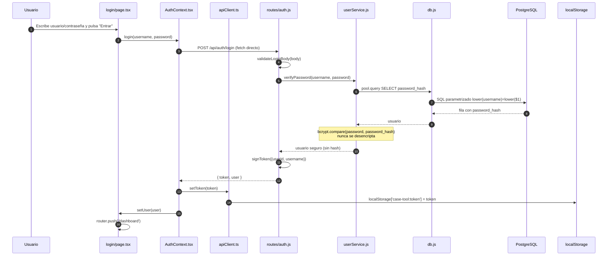
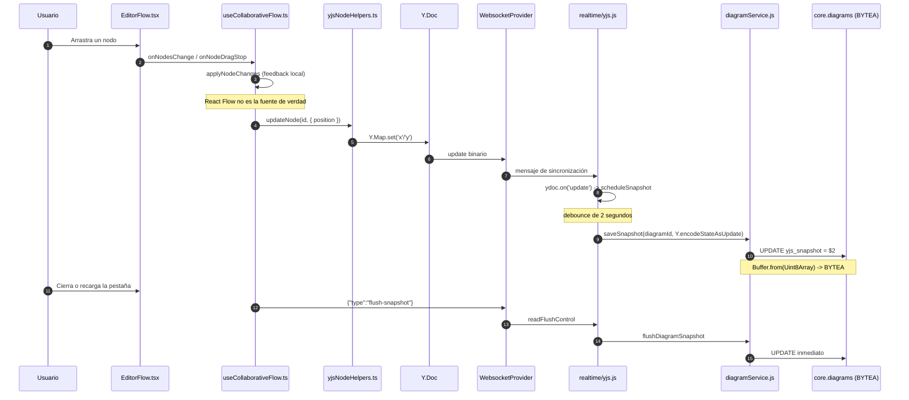
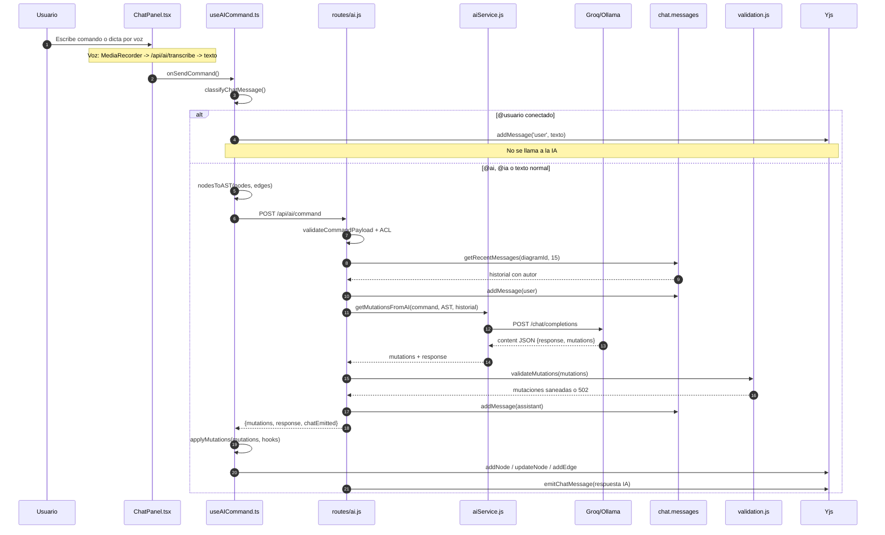
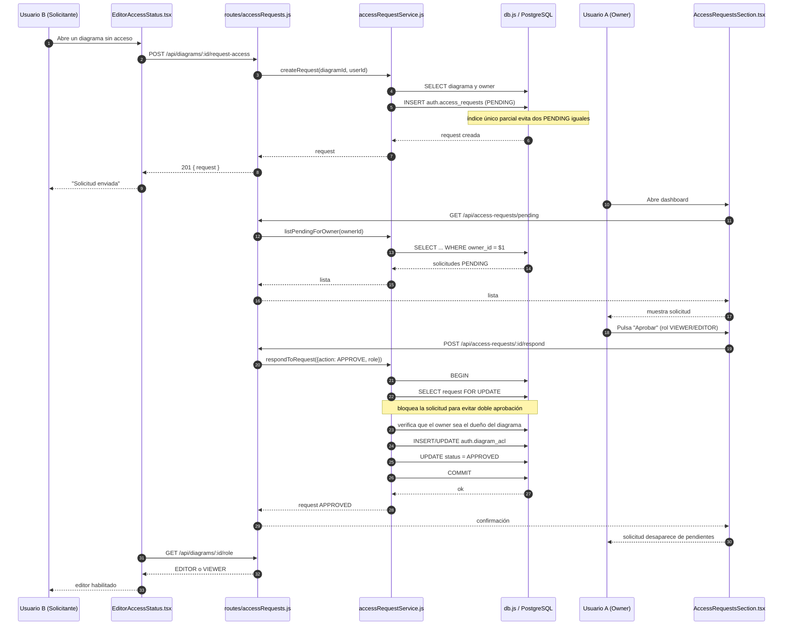
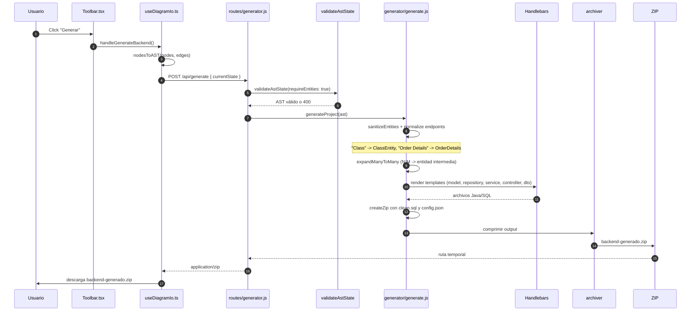
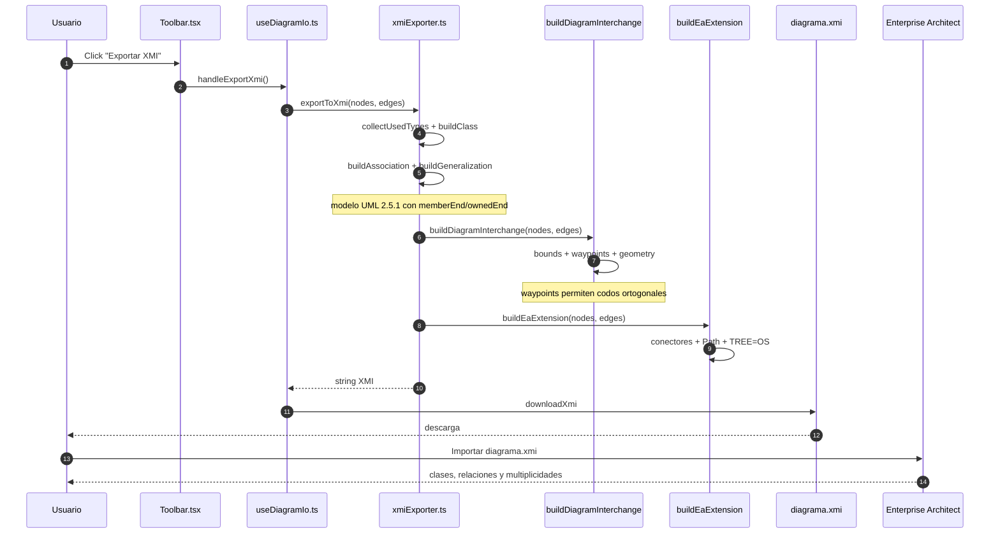
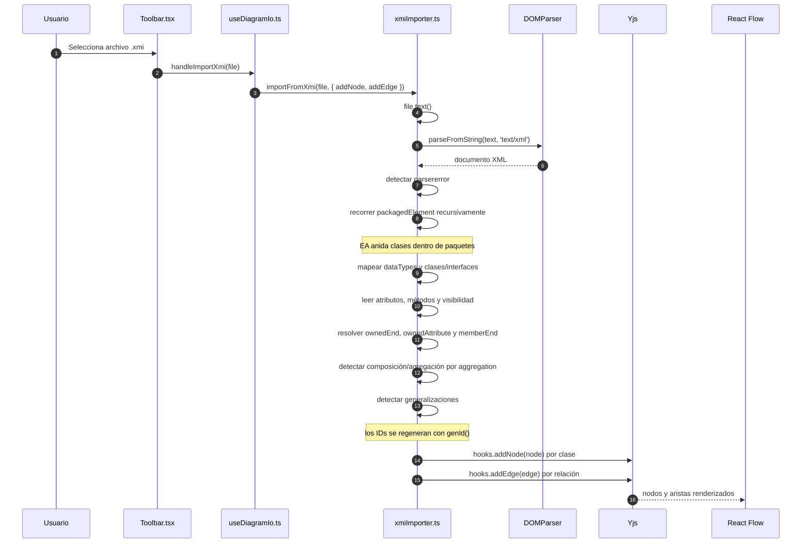

# ATLAS DE DIAGRAMAS DE SECUENCIA

**Proyecto:** Herramienta CASE Colaborativa con IA  
**Objetivo:** explicar, paso a paso, cómo viaja una acción del usuario por el frontend, el backend, Yjs, PostgreSQL y los servicios externos.  
**Regla:** todos los participantes existen en el código actual. Los nombres de archivo y método son reales.

> Cada diagrama usa `autonumber` para que puedas decir “en el paso 4 pasa esto”.  
> Los `Note over` marcan decisiones técnicas importantes.

---

## Índice

1. [Autenticación (Login)](#1-flujo-de-autenticación-login)
2. [Colaboración al mover un nodo](#2-colaboración-en-tiempo-real-mover-un-nodo)
3. [Asistente IA de texto/voz](#3-interacción-con-el-asistente-ia-textovoz)
4. [Solicitud y aprobación de acceso](#4-gestión-de-accesos-fase-3)
5. [Generación de backend Spring Boot](#5-generación-de-backend-spring-boot)
6. [Exportación a XMI](#6-exportación-a-xmi)
7. [Importación desde XMI](#7-importación-desde-xmi)

---

## 1. Flujo de Autenticación (Login)

**Qué explica:** cómo el formulario de login se convierte en un JWT y por qué no hace falta guardar sesiones en PostgreSQL.

**Idea simple:** el usuario entrega credenciales; el backend busca el hash, compara con bcrypt y devuelve un pase VIP firmado. El pase se guarda en `localStorage` y viaja en cada request.

### Pasos clave

- **Paso 1–2:** `login/page.tsx` captura el formulario y llama `AuthContext.login`.
- **Paso 3–4:** `AuthContext` hace `fetch` directo a `/api/auth/login`; `routes/auth.js` valida el body.
- **Paso 5–8:** `userService.verifyPassword` busca el usuario y `bcrypt.compare` compara el intento contra `password_hash`.
- **Paso 9–10:** `signToken` firma un JWT con `userId`, `username` y expiración.
- **Paso 11–14:** `AuthContext` guarda el token en `localStorage` y actualiza el usuario; la página navega al dashboard.

### El “por qué”

- **Stateless:** no hay tabla de sesiones. El backend verifica firma y expiración en cada request.
- **Flutter / móvil:** un cliente móvil puede consumir la misma API y guardar el JWT; no necesita compartir cookies ni sesiones de navegador.
- **bcrypt:** aunque se filtre la base, no se obtienen contraseñas en claro.
- **SQL parametrizado:** evita inyección; `lower(...)` unifica mayúsculas y minúsculas.
- **Tradeoff:** no hay revocación inmediata; se compensa con expiración y rotación de `JWT_SECRET`.

**Archivos clave:** `frontend/src/app/login/page.tsx`; `frontend/src/contexts/AuthContext.tsx`; `frontend/src/lib/apiClient.ts`; `backend/routes/auth.js`; `backend/services/userService.js`; `backend/middleware/auth.js`; `backend/db.js`.

---

## 2. Colaboración en Tiempo Real (Mover un Nodo)

**Qué explica:** cómo un movimiento visual se convierte en un update binario de Yjs y luego en un snapshot `BYTEA` en PostgreSQL.

**Idea simple:** React Flow mueve el nodo para que se sienta fluido; al soltar, Yjs recibe la posición final. El servidor mantiene el documento vivo y guarda una foto cada 2 segundos. Si cierras la pestaña, se fuerza una última foto.

### Pasos clave

- **Paso 1–2:** React Flow avisa `onNodesChange` y `onNodeDragStop`; la UI se actualiza localmente.
- **Paso 3–4:** al soltar, `yjsNodeHelpers.updateNode` escribe `x`/`y` en el `Y.Map`.
- **Paso 5–7:** Yjs emite un update binario; `WebsocketProvider` lo envía.
- **Paso 8–9:** `backend/realtime/yjs.js` aplica el update y reinicia el debounce.
- **Paso 10–11:** a los 2 s, `saveSnapshot` hace `UPDATE` con `BYTEA`.
- **Paso 12–16:** al cerrar/recargar, `requestFlush` pide un guardado inmediato.

### El “por qué”

- **React Flow no es dueño de la verdad:** si tuviera su propio `useNodesState`, competiría con los updates remotos y se perderían cambios.
- **Yjs:** es un CRDT; si dos mueven el mismo nodo, las escrituras convergen sin bloquear el canvas.
- **Debounce:** evita miles de `UPDATE` por segundo; agrupa una ráfaga en una sola escritura.
- **Snapshot binario:** el grafo no se normaliza en filas de clases/relaciones porque Yjs necesita conservar relojes, IDs internos y tombstones.
- **Flush al cerrar:** cierra la ventana de pérdida de los últimos 2 s.
- **`writeState` de y-websocket:** cuando se va el último cliente, hace un guardado final y destruye el documento para liberar memoria.

**Archivos clave:** `frontend/src/components/diagram/EditorFlow.tsx`; `frontend/src/hooks/useCollaborativeFlow.ts`; `frontend/src/utils/yjsNodeHelpers.ts`; `backend/realtime/yjs.js`; `backend/services/diagramService.js`.

---

## 3. Interacción con el Asistente IA (Texto/Voz)

**Qué explica:** cómo un comando se convierte en un AST, viaja a Groq/Ollama, vuelve como JSON validado y termina aplicado en Yjs.

**Idea simple:** el chat captura el texto o la voz; el frontend manda el AST; la IA responde con una receta JSON; el backend revisa que la receta sea segura; el frontend la cocina en el canvas.

### Pasos clave

- **Paso 1–2:** `ChatPanel` captura Enter o transcripción; el texto llega a `useAICommand`.
- **Paso 3–4:** `classifyChatMessage` decide si es humano (`@usuario`) o IA (`@ai`/texto normal).
- **Paso 5–7:** `nodesToAST` convierte el canvas en AST; el backend valida, revisa ACL y recupera 15 mensajes.
- **Paso 8–11:** `aiService` arma el prompt, llama Groq/Ollama y obtiene JSON.
- **Paso 12–13:** `validateMutations` aplica la allowlist; si falla, 502 sin cambios.
- **Paso 14–17:** el frontend aplica mutaciones en Yjs y el backend emite la respuesta al chat compartido.

### El “por qué”

- **JSON estructurado:** el código necesita saber exactamente qué entidad, atributo o relación crear; texto libre no es ejecutable.
- **Validación:** el LLM es probabilístico; `validateMutations` es determinista y solo permite cinco acciones.
- **Historial:** los últimos 15 mensajes permiten resolver “eso”, “esa clase” o “bórralo”, y el autor distingue a Carlos de Andrés.
- **Menciones:** `@usuario` conectado va solo a Yjs; evita gastar tokens y responder conversaciones humanas.
- **Voz:** Whisper transcribe y el texto sigue el mismo flujo; no hay una segunda lógica de IA.
- **Tradeoff:** `applyMutations` no es una transacción atómica; si una mutación falla, las anteriores ya se aplicaron.

**Archivos clave:** `frontend/src/components/ChatPanel.tsx`; `frontend/src/hooks/useAICommand.ts`; `frontend/src/utils/chatMentions.ts`; `frontend/src/utils/ast.ts`; `backend/routes/ai.js`; `backend/services/aiService.js`; `backend/validation.js`; `backend/services/chatService.js`.

---

## 4. Gestión de Accesos (Fase 3: Solicitud y Aprobación)

**Qué explica:** cómo un usuario sin permiso pide acceso y cómo el owner lo aprueba sin dejar la ACL a medias.

**Idea simple:** B toca “solicitar acceso”; se crea una fila `PENDING`. A ve la campana, aprueba y, en una sola transacción, se crea la ACL y se marca `APPROVED`.

### Pasos clave

- **Paso 1–6:** B solicita acceso; se inserta `auth.access_requests` con estado `PENDING`.
- **Paso 7–13:** A carga pendientes; el backend filtra por `owner_id`.
- **Paso 14–24:** al aprobar, la transacción bloquea la solicitud con `FOR UPDATE`, valida owner, crea/actualiza la ACL y marca `APPROVED`.
- **Paso 25–28:** B consulta su rol y el editor se habilita.

### El “por qué”

- **Transacción:** si se aprueba, la ACL debe existir inmediatamente; si falla, `ROLLBACK` y no queda una solicitud aprobada sin permiso.
- **`FOR UPDATE`:** evita que dos pestañas del owner aprueben la misma solicitud dos veces.
- **Índice único parcial:** impide dos solicitudes `PENDING` del mismo usuario al mismo diagrama.
- **Estados:** `PENDING`, `APPROVED`, `REJECTED`; el historial no se borra.
- **Tradeoff:** `diagram_acl.diagram_id` no tiene FK física; la integridad se mantiene en servicio.

**Archivos clave:** `frontend/src/components/diagram/EditorAccessStatus.tsx`; `frontend/src/components/dashboard/AccessRequestsSection.tsx`; `backend/routes/accessRequests.js`; `backend/services/accessRequestService.js`; `backend/services/aclService.js`; `backend/scripts/access_requests.sql`.

---

## 5. Generación de Backend Spring Boot

**Qué explica:** cómo el AST del diagrama se convierte en un proyecto Java compilable y se descarga como ZIP.

**Idea simple:** el usuario pulsa “Generar”; el servidor recibe el AST, valida que no esté vacío, sanitiza nombres, expande N:M, renderiza plantillas y empaqueta todo.

### Pasos clave

- **Paso 1–3:** `Toolbar` llama `useDiagramIo`; se genera el AST.
- **Paso 4–5:** `routes/generator.js` valida que exista al menos una entidad.
- **Paso 6–8:** `generate.js` sanitiza nombres y expande relaciones N:M.
- **Paso 9–11:** Handlebars renderiza plantillas; se agrega `clean.sql` y `config.json`.
- **Paso 12–16:** `archiver` crea el ZIP y se descarga.

### El “por qué”

- **Sanitización / Fuzz Testing:** `Class` es keyword Java; se convierte en `ClassEntity`. `1Order` en `V1Order`. Sin esto, el código no compila.
- **N:M a entidad intermedia:** `@ManyToMany` no permite columnas extra (fecha, rol); la entidad intermedia sí.
- **ZIP en el servidor:** el cliente no tiene Java/Maven; el servidor ya tiene el pipeline y las plantillas.
- **Handlebars:** separa estructura y datos; la plantilla no decide JPA.
- **Tradeoff:** el ZIP no incluye lógica de negocio específica; es un backend CRUD base.

**Archivos clave:** `frontend/src/hooks/useDiagramIo.ts`; `frontend/src/components/Toolbar.tsx`; `backend/routes/generator.js`; `backend/validation.js`; `backend/generator/generate.js`; `backend/generator/naming.js`; `backend/generator/expander.js`; `backend/generator/templateEngine.js`; `backend/generator/packager.js`.

---

## 6. Exportación a XMI (Interoperabilidad)

**Qué explica:** cómo el canvas se convierte en un archivo que Enterprise Architect puede abrir con clases, relaciones y geometría.

**Idea simple:** el modelo UML dice “qué es”; UMLDI dice “dónde dibujarlo”; la extensión EA dice “cómo dibujar la línea”.

### Pasos clave

- **Paso 1–3:** `Toolbar` llama `useDiagramIo`; `exportToXmi` recorre nodos/aristas.
- **Paso 4–6:** se genera el modelo UML 2.5.1 con asociaciones, multiplicidades y herencia.
- **Paso 7–9:** `buildDiagramInterchange` agrega posiciones y `waypoints`.
- **Paso 10–12:** `buildEaExtension` agrega conectores, `Path` y `TREE=OS`.
- **Paso 13–16:** se descarga el `.xmi` y EA lo importa.

### El “por qué”

- **Waypoints:** EA necesita puntos intermedios para dibujar líneas ortogonales; sin ellos, las relaciones quedan diagonales o fuera del nodo.
- **Doble sección:** UMLDI es el estándar; la extensión EA es lo que EA realmente usa para reconstruir conectores.
- **`TREE=OS`:** indica estilo ortogonal.
- **`xmi:version` en `Documentation`:** EA ignora su extensión si la versión está en la raíz.
- **Tradeoff:** el vínculo de clase asociativa no se exporta; está documentado como limitación.

**Archivos clave:** `frontend/src/components/Toolbar.tsx`; `frontend/src/hooks/useDiagramIo.ts`; `frontend/src/utils/xmiExporter.ts`; `AUDIT_XMI.md`.

---

## 7. Importación desde XMI

**Qué explica:** cómo un archivo hecho en Enterprise Architect se reconstruye como nodos y aristas en el editor web.

**Idea simple:** la herramienta lee el XML, busca clases, atributos, asociaciones y generalizaciones, genera IDs nuevos y los inserta en Yjs.

### Pasos clave

- **Paso 1–4:** `Toolbar` abre el file picker; `useDiagramIo` llama `importFromXmi`.
- **Paso 5–7:** `file.text()` y `DOMParser` convierten el archivo en XML; se detecta error de parseo.
- **Paso 8–11:** se recorren `packagedElement`; se leen clases, interfaces, atributos y métodos.
- **Paso 12–15:** se resuelven asociaciones con `ownedEnd`, `ownedAttribute` y `memberEnd`; se detectan composición/agregación y generalizaciones.
- **Paso 16–18:** se regeneran IDs y se insertan nodos/aristas en Yjs.

### El “por qué”

- **Interoperabilidad:** permite traer diagramas hechos en Architect a la herramienta web.
- **IDs regenerados:** evita colisiones con nodos ya existentes en el canvas.
- **Parser tolerante:** si un tipo es desconocido, cae a `String`/`ASSOCIATION` para no romper la importación.
- **Soporte EA:** EA guarda extremos de asociación en `ownedEnd` y también en `ownedAttribute`; el importador revisa ambos.
- **Tradeoff:** la geometría original no se conserva; se reubica en una cuadrícula.

**Archivos clave:** `frontend/src/components/Toolbar.tsx`; `frontend/src/hooks/useDiagramIo.ts`; `frontend/src/utils/xmiImporter.ts`; `frontend/src/utils/xmiParserUtils.ts`; `frontend/src/utils/yjsNodeHelpers.ts`; `frontend/src/utils/yjsEdgeHelpers.ts`.

---

## Cómo usar este atlas en la defensa

- Si te preguntan **“¿cómo viaja un clic?”**, abre el diagrama 2.
- Si preguntan **“¿cómo se guarda sin botón?”**, muestra el final del diagrama 2: `flush-snapshot`.
- Si preguntan **“¿cómo evitas que la IA rompa el diagrama?”**, abre el diagrama 3 y señala `validateMutations`.
- Si preguntan **“¿cómo se comparte un diagrama?”**, abre el diagrama 4 y señala la transacción + ACL.
- Si preguntan **“¿cómo se genera el backend?”**, abre el diagrama 5.
- Si preguntan **“¿cómo se integra con EA?”**, abre los diagramas 6 y 7.

**Frase final:** “Cada flujo tiene un dueño claro: Yjs para colaborar, PostgreSQL para lo durable, validación para la IA y Handlebars para el código.”
