# Requisitos y Proceso

## 1. Enfoque metodológico: PUDS

El proyecto se desarrolló aplicando el **Proceso Unificado de Desarrollo de Software (PUDS/RUP)**, organizado en cuatro fases secuenciales con iteraciones cortas y controladas por riesgos. Cada fase produjo artefactos verificables y cada iteración cerró con criterios de aceptación trazables al código y a la base de datos.

### 1.1 Fases del PUDS

| Fase | Hito PUDS | Objetivo | Artefactos producidos | Criterio de salida |
|---|---|---|---|---|
| Inicio | LCO (Lifecycle Objectives) | Definir alcance, actores, casos de uso y valor | Visión, actores, CU-01 a CU-08, requisitos | Alcance y casos de uso aprobados |
| Elaboración | LAM (Lifecycle Architecture) | Estabilizar arquitectura y mitigar riesgos | Clean Architecture (capas), BCE, diseño de datos, prototipo | Arquitectura validada y riesgos críticos identificados |
| Construcción | IOC (Initial Operational Capability) | Implementar incrementos y verificar | Backend, frontend, IA, PostgreSQL, pruebas | Build, typecheck y pruebas de integración aprobadas |
| Transición | PRM (Product Release Milestone) | Validar con usuarios, desplegar y documentar | V&V, Vercel, Railway, Neon, bóveda Obsidian | Producto operable y documentación trazable |

**Lectura de hitos:** LCO fijó el alcance y los casos de uso; LAM estabilizó la **Clean Architecture y la separación de capas** (`routes/` → `middleware/` → `services/` → `db.js`), el modelo BCE y el esquema PostgreSQL; IOC consolidó la capacidad operativa inicial con build y pruebas; PRM cerró la validación, el despliegue y la documentación de liberación.

### 1.2 Flujos de trabajo PUDS

| Flujo de trabajo | Actividad principal | Evidencia |
|---|---|---|
| Requisitos | Captura, actores, casos de uso y reglas | `01_Requisitos_y_Proceso`, CU-01 a CU-08 |
| Análisis | Modelo conceptual y BCE | `02_Analisis`, `ChatPanel`, `useAICommand`, `chat.messages` |
| Diseño | Clean Architecture (capas), clases, datos y secuencias | `03_Diseno_Arquitectura`, `04_Diseno_UML`, Mermaid UML |
| Implementación | Código por capas, hooks, validación y errores | `05_Implementacion_y_Pruebas`, `backend/`, `frontend/` |
| Prueba | Integración, regresión, build, typecheck y V&V | `05_Implementacion_y_Pruebas`, suite 23/23 y chat 32/32 |

### 1.3 Principios de trabajo

1. **Arquitectura primero:** las decisiones de colaboración, persistencia y seguridad condicionan el resto del sistema.
2. **Trazabilidad:** cada caso de uso se relaciona con componentes, endpoints y tablas.
3. **Verificación temprana:** las pruebas de integración se ejecutan contra PostgreSQL, no solo con mocks.
4. **Compatibilidad:** se conservaron contratos y tipos de aristas para no romper diagramas existentes.
5. **Seguridad por defecto:** el WebSocket niega el acceso si falta token o rol.
6. **Documentación verificable:** las afirmaciones se contrastan con el esquema y el código.

## 2. Alcance del Segundo Parcial

El Segundo Parcial se concentra en dos capacidades:

1. **Asistente IA colaborativo con identidad y memoria contextual.**
2. **Persistencia sectorizada en PostgreSQL/Neon.**

Además, se consolidan la autenticación, las ACL, el dashboard, la edición colaborativa y la generación de backend.

## 2.1. Captura de Requisitos

La captura se realizó con entrevistas, observación del flujo de modelado y análisis de los incidentes detectados durante las pruebas colaborativas. Los actores se consolidaron en tres roles de negocio; los roles técnicos `OWNER`, `EDITOR` y `VIEWER` son especializaciones de autorización, no actores UML independientes.

| Actor | Tipo | Descripción | Casos de uso |
|---|---|---|---|
| Visitante | Primario | Persona no autenticada que accede al sistema para registrarse o iniciar sesión | CU-01 |
| Ingeniero de Software | Primario | Usuario autenticado que crea, edita, comparte, asiste con IA y genera backends | CU-02 a CU-08 |
| Colaborador | Primario | Miembro invitado con permisos de edición o solo lectura sobre un diagrama | CU-03, CU-05, CU-06 |
| Asistente IA | Secundario | Servicio que clasifica intención, responde y propone mutaciones | CU-06 |
| Groq | Externo | Proveedor de modelos de texto, voz y visión | CU-06 |
| PostgreSQL/Neon | Externo | Persistencia de usuarios, ACL, snapshots y chat | CU-01 a CU-07 |
| Sistema de archivos | Externo | ZIP temporal del backend generado | CU-07 |

**CU-06 — Interactuar con Agente IA.** El Ingeniero de Software o el Colaborador envía un mensaje en el chat del diagrama. El sistema recupera la identidad del JWT, valida la membresía, carga los últimos 15 mensajes, clasifica la intención y responde. Si la intención es una consulta teórica, devuelve una explicación sin mutaciones; si es una acción, devuelve mutaciones JSON validadas y las publica en el chat Yjs.

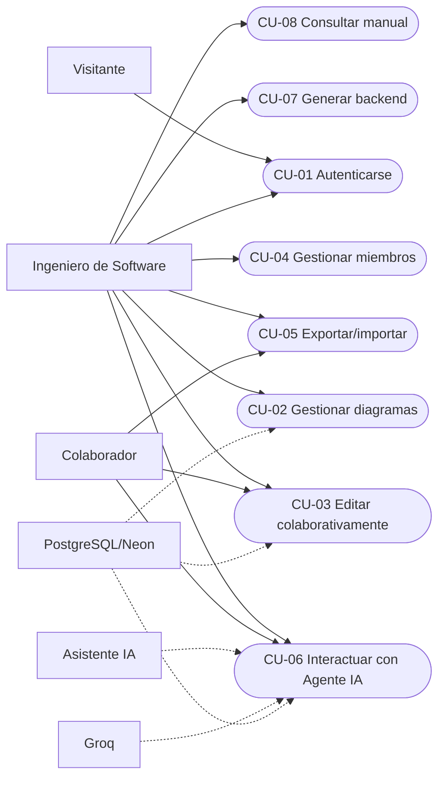

**Reglas de captura relevantes para CU-06:**

- La identidad del usuario proviene del JWT y nunca del cuerpo de la petición.
- Una consulta teórica no produce mutaciones.
- Una acción ambigua debe pedir aclaración.
- Las mutaciones se validan antes de aplicarse.
- El historial es contexto, no una lista de órdenes pendientes.
- La respuesta se publica en el chat colaborativo de la sala.

### 2.1.1. Requisitos funcionales

| Código | Requisito | Caso de uso |
|---|---|---|
| RF-01 | Registro con username, email y contraseña | CU-01 |
| RF-02 | Inicio y cierre de sesión con JWT | CU-01 |
| RF-03 | Listado de diagramas propios y compartidos | CU-02 |
| RF-04 | Creación, renombrado y eliminación de diagramas | CU-02 |
| RF-05 | Edición colaborativa de nodos y aristas | CU-03 |
| RF-06 | Presencia y soft-lock visual | CU-03 |
| RF-07 | Gestión de miembros y roles | CU-04 |
| RF-08 | Exportación e importación JSON/XMI | CU-05 |
| RF-09 | Comandos IA por texto | CU-06 |
| RF-10 | Comandos IA por voz | CU-06 |
| RF-11 | Generación desde imagen | CU-06 |
| RF-12 | Identidad del usuario en la respuesta IA | CU-06 |
| RF-13 | Memoria contextual del chat | CU-06 |
| RF-14 | Emisión de la respuesta IA en el chat colaborativo | CU-06 |
| RF-15 | Generación de backend Spring Boot + PostgreSQL | CU-07 |
| RF-16 | Manual de usuario embebido | CU-08 |

### 2.1.2. Requisitos no funcionales

| Código | Requisito | Criterio |
|---|---|---|
| RNF-01 | Colaboración en tiempo real | Los cambios se propagan por WebSocket sin recarga |
| RNF-02 | Durabilidad | El snapshot y el chat sobreviven al cierre del navegador |
| RNF-03 | Seguridad | Contraseñas con bcrypt; JWT firmado; ACL por diagrama |
| RNF-04 | Rendimiento | Historial de IA limitado a 15 mensajes; pool de 10 conexiones |
| RNF-05 | Mantenibilidad | Separación en capas y servicios con responsabilidad única |
| RNF-06 | Portabilidad | Frontend y backend desplegables por separado |
| RNF-07 | Usabilidad | Dashboard, toolbar, chat, ayuda y atajos |
| RNF-08 | Compatibilidad | Diagramas antiguos y tipos de arista persistidos siguen funcionando |
| RNF-09 | Recuperación | Errores de IA no deben mutar el diagrama de forma parcial |
| RNF-10 | Privacidad | El historial se consulta por diagrama y no se comparte entre salas |

### 2.1.3. Casos de uso

#### 2.1.3.1. Inventario

| ID | Caso de uso | Actor principal | Prioridad | Resultado |
|---|---|---|---|---|
| CU-01 | Autenticarse en el sistema | Visitante | Alta | Sesión JWT activa |
| CU-02 | Gestionar diagramas | Ingeniero de Software | Alta | Diagrama creado, listado, renombrado o eliminado |
| CU-03 | Editar diagrama colaborativamente | Ingeniero de Software / Colaborador | Alta | Grafo Yjs actualizado y sincronizado |
| CU-04 | Gestionar miembros y permisos | Ingeniero de Software (`OWNER`) | Alta | ACL actualizada |
| CU-05 | Exportar e importar diagramas | Ingeniero de Software / Colaborador | Media | Archivo JSON o XMI intercambiado |
| CU-06 | Interactuar con Agente IA | Ingeniero de Software / Colaborador | Alta | Respuesta contextual y mutaciones aplicadas |
| CU-07 | Generar backend Spring Boot | Ingeniero de Software | Media | ZIP con proyecto ejecutable |
| CU-08 | Consultar manual de usuario | Ingeniero de Software | Baja | Ayuda contextual visible |

#### 2.1.3.2. Especificación formal de casos de uso

Las especificaciones siguen el formato de Jacobson: identificador, nombre, actores, precondición, postcondición, flujo principal y flujos alternativos. Los flujos alternativos conservan la numeración del paso que interrumpen.

| Código | Nombre | Actores | Precondición | Postcondición | Flujo principal | Flujos alternativos |
|---|---|---|---|---|---|---|
| CU-01 | Autenticarse en el sistema | Visitante; AuthService; PostgreSQL | Backend disponible; `AUTH_ENABLED=true` para el flujo completo | Sesión JWT activa o error informado | 1. Abrir `/login` o `/register`. 2. Ingresar credenciales. 3. Enviar `POST /api/auth/login` o `/register`. 4. Validar entrada. 5. Comparar/generar bcrypt. 6. Firmar JWT. 7. Guardar token. 8. Redirigir al dashboard. | 4a. Datos inválidos: `400`. 5a. Credenciales incorrectas: `401`. 6a. Usuario/email duplicado: `400`. 7a. Backend caído: no se crea sesión; se informa error. |
| CU-02 | Gestionar diagramas | Ingeniero de Software; DiagramService; PostgreSQL | Sesión JWT válida | Diagrama creado, listado, renombrado o eliminado con ACL consistente | 1. Abrir dashboard. 2. `GET /api/diagrams`. 3. Mostrar `owned/shared`. 4. Crear con `POST /api/diagrams`. 5. Insertar diagrama + ACL `OWNER` en una transacción. 6. Abrir editor. 7. Renombrar o eliminar según rol. | 5a. Falla la transacción: `ROLLBACK`. 7a. `VIEWER` intenta borrar: `403`. 7b. Diagrama inexistente: `404`. 7c. Borrado: ACL + diagrama en transacción. |
| CU-03 | Editar diagrama colaborativamente | Ingeniero de Software; Colaborador; Yjs | Membresía en el diagrama; fila en `core.diagrams` | Grafo Yjs actualizado, sincronizado y snapshot programado | 1. Abrir `/diagram/:id`. 2. Cargar metadatos y chat. 3. Conectar WebSocket. 4. Pausar socket, validar JWT/ACL y esperar snapshot. 5. Ejecutar `setupWSConnection`. 6. Editar nodo/arista. 7. Yjs propaga el update. 8. Persistir snapshot con debounce. | 3a. Token inválido: `4401`. 3b. Sin rol: `4403`. 3c. Diagrama inexistente: `4404`. 4a. Snapshot corrupto: `1011`. 6a. `VIEWER`: UI de solo lectura. 7a. Corte de red: reconexión y re-sync. |
| CU-04 | Gestionar miembros y permisos | Ingeniero de Software (`OWNER`); Usuario invitado; ACLService | El actor es `OWNER` del diagrama | ACL actualizada con un rol válido o error | 1. Abrir `MembersPanel`. 2. Buscar username. 3. Seleccionar `EDITOR` o `VIEWER`. 4. `POST /api/diagrams/:id/members`. 5. Validar UUID y rol. 6. Upsert en `auth.diagram_acl`. 7. Recargar miembros. | 2a. Usuario inexistente: `404`. 3a. Rol inválido: `400`. 5a. Owner intenta agregarse: `400`. 6a. Owner intenta autoeliminarse: `400`. 6b. Miembro se elimina a sí mismo: permitido. |
| CU-05 | Exportar e importar diagramas | Ingeniero de Software; Colaborador; Exportadores | Acceso al diagrama; archivo válido para importar | Archivo descargado o grafo Yjs repoblado | 1. Elegir JSON o XMI. 2. Serializar nodos/aristas. 3. Descargar archivo. 4. Para importar, seleccionar archivo. 5. Validar estructura. 6. Repoblar Yjs en una transacción. | 5a. JSON/XMI inválido: no se modifica el grafo y se informa. 6a. `VIEWER`: puede exportar, no importar. 6b. Error de lectura: se conserva el estado anterior. |
| CU-06 | Interactuar con Agente IA | Ingeniero de Software; Colaborador; Asistente IA; Groq | Sesión JWT válida; membresía en el diagrama | Mensaje persistido; respuesta emitida; mutaciones aplicadas o ninguna | 1. Escribir comando. 2. Convertir canvas a AST. 3. `POST /api/ai/command` con JWT. 4. Validar entrada y ACL. 5. Leer últimos 15 mensajes. 6. Persistir mensaje del usuario. 7. Groq clasifica y responde. 8. Validar mutaciones. 9. Persistir respuesta. 10. Emitir por Yjs. 11. Aplicar mutaciones. | 4a. Sin acceso: `403`; diagrama inexistente: `404`. 7a. Consulta teórica: `mutations=[]`. 7b. Ambigüedad: pide aclaración. 7c. JSON inválido: `502`. 7d. Timeout: `504`. 8a. Acción no permitida: no se aplica. |
| CU-07 | Generar backend Spring Boot | Ingeniero de Software; Generador; Handlebars | Sesión JWT; AST con al menos una entidad | ZIP descargado; temporales eliminados | 1. Pulsar Generar. 2. `nodesToAST`. 3. `POST /api/generate`. 4. Validar AST. 5. Sanitizar nombres. 6. Expandir relaciones N:M. 7. Renderizar Handlebars. 8. Empaquetar ZIP. 9. Descargar y limpiar. | 4a. Sin entidades: `400`. 5a. Nombres reservados: se sanean. 8a. Error de generación: `500` y limpieza. 9a. Peticiones concurrentes: directorios temporales aislados. |
| CU-08 | Consultar manual de usuario | Ingeniero de Software; HelpModal | Aplicación cargada | Manual visible y navegable | 1. Pulsar Ayuda o `F1`. 2. Abrir `HelpModal`. 3. Navegar secciones o buscar. 4. Leer contenido de `data/manual.ts`. | 2a. `Escape` o clic fuera: cierra. 3a. Sin resultados: estado vacío. 4a. El manual no documenta funciones inexistentes. |

#### 2.1.3.3. Diagrama general de casos de uso

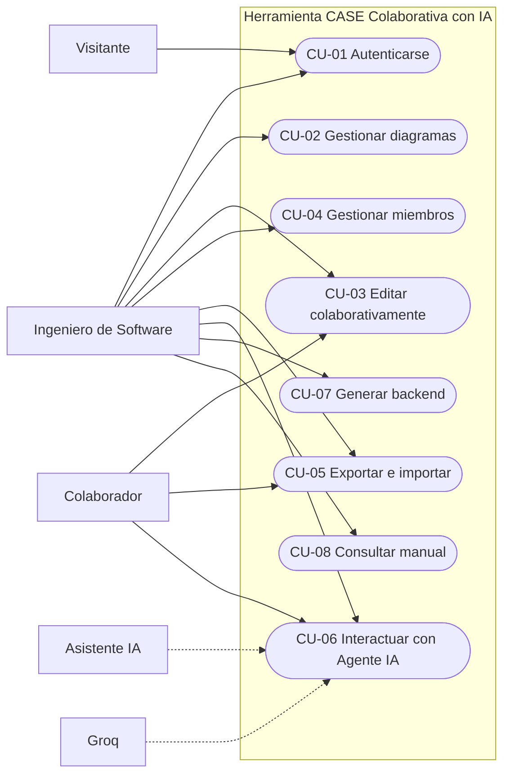

La IA y Groq son actores secundarios: participan en CU-06, pero no inician el caso de uso. El Ingeniero de Software inicia la interacción y el backend coordina a los participantes externos.

**Relaciones `<<include>>` y `<<extend>>`.** Las operaciones que requieren sesión incluyen autenticación; la gestión de miembros extiende la gestión de diagramas y la generación de backend incluye la gestión previa del diagrama.

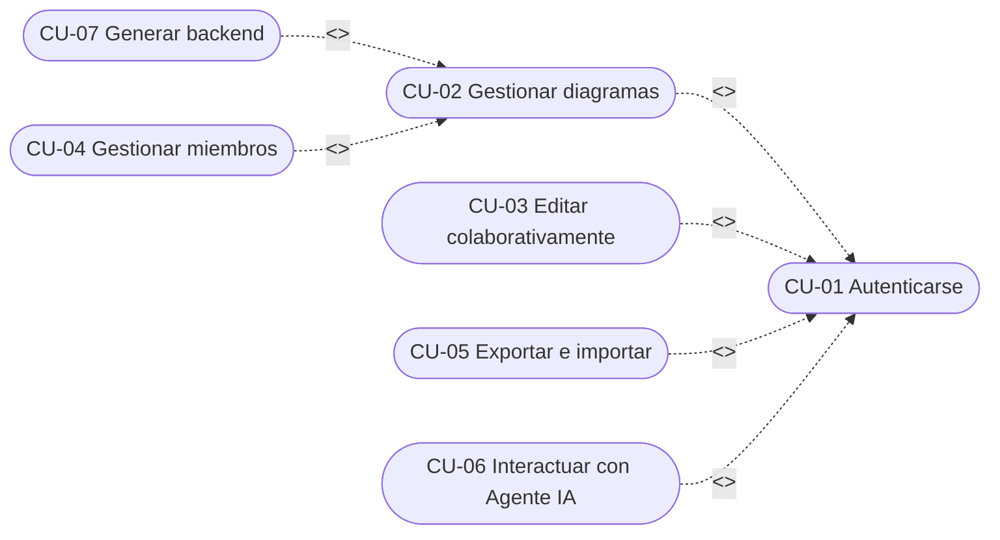

`CU-01` es el punto común de autorización. `CU-04` extiende `CU-02` porque agrega la administración de miembros sobre un diagrama existente, y `CU-07` incluye `CU-02` porque necesita un diagrama válido como entrada.

#### 2.1.3.4. CU-01 Autenticarse en el sistema

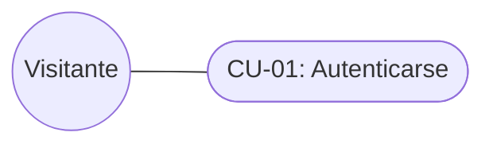

**Objetivo:** establecer una identidad verificable para acceder a diagramas y a la IA.

**Precondiciones:** el backend está disponible y `AUTH_ENABLED=true` para el flujo completo.

**Flujo principal:**

1. El visitante abre `/register` o `/login`.
2. Ingresa username, email y contraseña, o username y contraseña.
3. El frontend llama a `POST /api/auth/register` o `POST /api/auth/login`.
4. El backend valida los datos.
5. bcrypt compara o genera el hash.
6. El backend firma un JWT con `userId` y `username`.
7. El frontend guarda el token en `localStorage`.
8. El usuario es redirigido al dashboard.

**Alternativas:**

- Credenciales inválidas: `401`.
- Username o email duplicado: `400`.
- Contraseña corta: `400`.
- Backend caído: el frontend mantiene el modo abierto si la configuración lo permite.

**Postcondiciones:** existe una sesión con token válido o se informa el error.

#### 2.1.3.5. CU-02 Gestionar diagramas

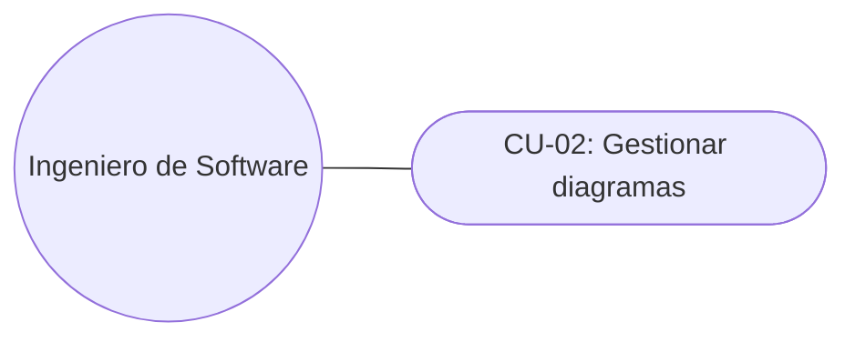

**Objetivo:** administrar el ciclo de vida de los diagramas desde el dashboard.

**Flujo principal:**

1. El usuario autenticado abre `/dashboard`.
2. El frontend solicita `GET /api/diagrams`.
3. El backend devuelve `{ owned, shared }`.
4. El usuario crea un diagrama con `POST /api/diagrams`.
5. El backend crea la fila en `core.diagrams` y la ACL `OWNER`.
6. El usuario abre el editor, renombra o elimina según su rol.
7. El borrado elimina primero la ACL y luego el diagrama en una transacción.

**Reglas:**

- Solo el `OWNER` puede eliminar.
- El nombre no puede quedar vacío.
- Un diagrama compartido muestra su propietario.
- Los diagramas legacy sin ACL no se listan hasta ser migrados.

#### 2.1.3.6. CU-03 Editar diagrama colaborativamente

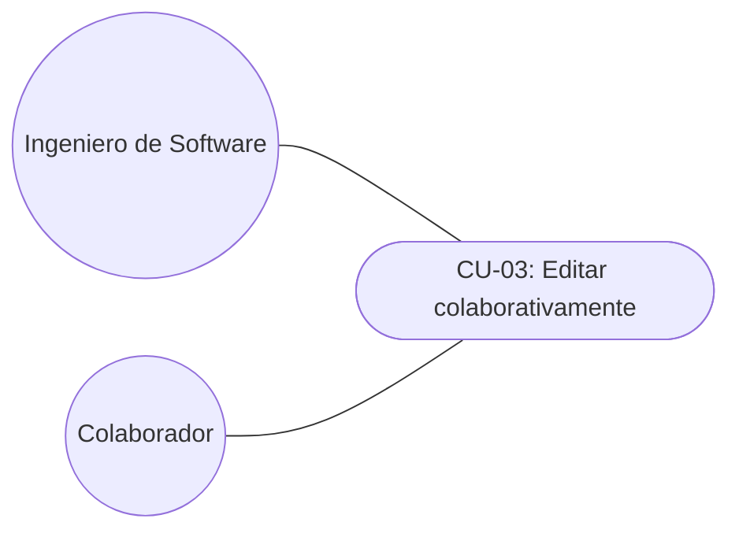

**Objetivo:** modificar el modelo UML y ver los cambios de otros participantes.

**Flujo principal:**

1. El usuario abre `/diagram/<id>`.
2. El frontend carga el snapshot desde `GET /api/diagrams/:id`.
3. El snapshot se aplica a Yjs.
4. El usuario agrega una entidad, un atributo o una relación.
5. La acción escribe en el `Y.Map` correspondiente.
6. Yjs envía el update por WebSocket.
7. Los demás clientes reciben el update y actualizan React Flow.
8. Al seleccionar un nodo, se publica el soft-lock en `awareness`.

**Reglas:**

- El estado canónico es Yjs.
- Las aristas usan doble tipado: `edge.type` para render y `data.type` para semántica.
- Un `VIEWER` no debe arrastrar, conectar ni editar.
- El soft-lock expira a los 30 segundos.

#### 2.1.3.7. CU-04 Gestionar miembros y permisos

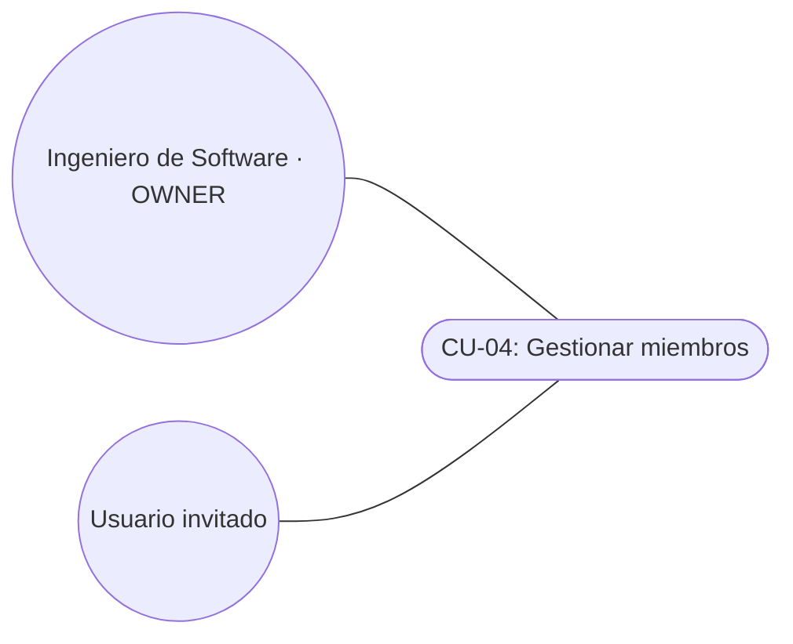

**Objetivo:** compartir un diagrama con otros usuarios y asignar roles.

**Flujo principal:**

1. El `OWNER` abre `MembersPanel`.
2. Busca un usuario por username.
3. Selecciona `EDITOR` o `VIEWER`.
4. El frontend llama a `POST /api/diagrams/:id/members`.
5. El backend valida el rol y actualiza `auth.diagram_acl`.
6. El miembro puede abrir el diagrama según su rol.

**Reglas:**

- El `OWNER` no puede eliminarse a sí mismo.
- Un usuario solo puede tener un rol por diagrama.
- La clave única `(diagram_id, user_id)` evita duplicados.
- La actualización de rol se implementa como upsert.

#### 2.1.3.8. CU-05 Exportar e importar diagramas

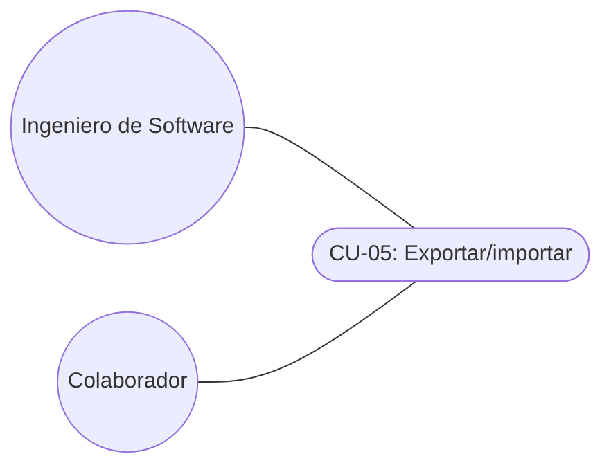

**Objetivo:** respaldar o intercambiar el modelo.

**Flujo principal:**

1. El usuario elige JSON o XMI.
2. El frontend serializa nodos, aristas y metadatos.
3. Se descarga un archivo.
4. Para importar, el usuario selecciona un archivo válido.
5. El frontend valida y carga los datos en una transacción Yjs.

**Reglas:**

- JSON conserva la información completa del editor.
- XMI prioriza interoperabilidad con Enterprise Architect.
- El vínculo de clase asociativa no se preserva en XMI; es una limitación documentada.

#### 2.1.3.9. CU-06 Interactuar con Agente IA

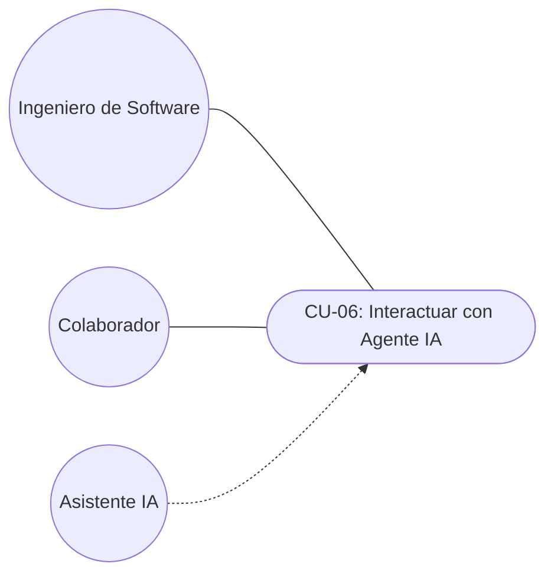

Este caso de uso se desarrolla en detalle en la sección 2.1.5.

#### 2.1.3.10. CU-07 Generar backend Spring Boot

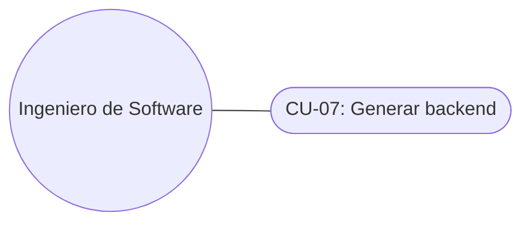

**Objetivo:** obtener un proyecto backend a partir del modelo UML.

**Flujo principal:**

1. El usuario pulsa **Generar**.
2. El frontend convierte el canvas en AST.
3. Envía `POST /api/generate` con el estado actual.
4. El backend valida que existan entidades.
5. El generador normaliza nombres y expande relaciones `* a *`.
6. Handlebars renderiza entidades, repositorios, servicios, controladores, DTO, migraciones y seguridad.
7. Archiver crea un ZIP.
8. El navegador descarga `backend-generado.zip`.
9. El archivo temporal se elimina.

**Reglas:**

- Las relaciones muchos-a-muchos se convierten en entidad intermedia explícita.
- La herencia JPA usa `JOINED` solo en la raíz.
- Los nombres de tabla se sanean para evitar palabras reservadas.
- Si no hay entidades, se devuelve `400`.

#### 2.1.3.11. CU-08 Consultar manual de usuario

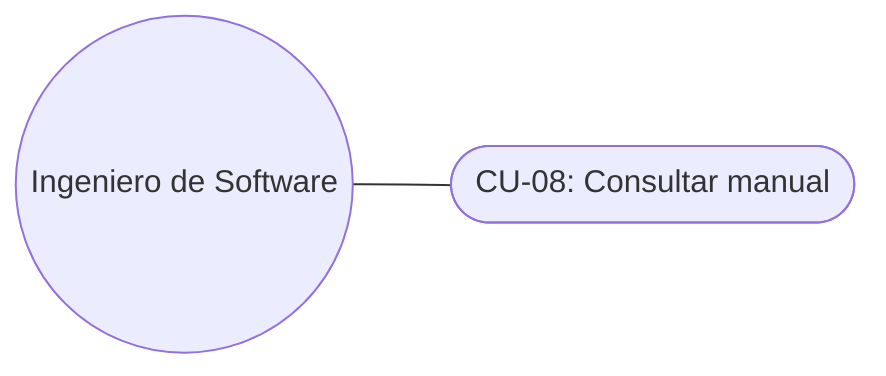

**Objetivo:** resolver dudas sin abandonar la aplicación.

**Flujo principal:**

1. El usuario pulsa **Ayuda** o presiona `F1`.
2. Se abre `HelpModal`.
3. El usuario navega por las secciones o busca texto.
4. El contenido se renderiza desde `data/manual.ts`.

**Reglas:**

- El manual no debe documentar funciones inexistentes.
- `Escape` o clic fuera cierran el modal.

### 2.1.4. Priorización

| Prioridad | Casos de uso | Justificación |
|---|---|---|
| Must | CU-01, CU-02, CU-03, CU-04, CU-06 | Núcleo del parcial y de la operación segura |
| Should | CU-05, CU-07 | Valor diferencial y generación de artefactos |
| Could | CU-08 | Mejora la adopción, no bloquea el flujo |
| Won't (esta entrega) | Invitaciones, PlantUML/SQL, app móvil | Fuera del alcance acordado |

### 2.1.5. CU-06 Interactuar con Agente IA en detalle

#### 2.1.5.1. Ficha

| Campo | Valor |
|---|---|
| Identificador | CU-06 |
| Nombre | Interactuar con Agente IA |
| Actor principal | Ingeniero de Software o Colaborador autenticado |
| Actores secundarios | Asistente IA, Groq, PostgreSQL, Yjs |
| Prioridad | Alta |
| Canal | Texto, voz o imagen |
| Precondición | Sesión JWT activa y membresía en el diagrama |
| Precondición | Sesión válida y diagrama accesible |
| Postcondición | Respuesta persistida y, si corresponde, mutaciones aplicadas |

#### 2.1.5.2. Objetivo

Permitir que el usuario construya o consulte el modelo en lenguaje natural, con una respuesta personalizada, consciente del estado del diagrama y del historial reciente, visible para todos los colaboradores.

#### 2.1.5.3. Disparador

El usuario escribe un comando, dicta una instrucción o adjunta una imagen y confirma el envío.

#### 2.1.5.4. Flujo principal

| Paso | Actor / componente | Acción |
|---|---|---|
| 1 | Usuario | Abre el chat del diagrama |
| 2 | Frontend | Recupera el `diagramId` y el estado actual de Yjs |
| 3 | Usuario | Escribe o dicta un comando |
| 4 | `ChatPanel` → `useAICommand` | Agrega el mensaje del usuario al chat Yjs |
| 5 | `nodesToAST` | Convierte nodos y aristas en un AST |
| 6 | `apiFetch` | Envía `POST /api/ai/command` con JWT, comando, AST y `diagramId` |
| 7 | `requireAuth` | Verifica el JWT y obtiene `userId` y `username` |
| 8 | `chatService` | Recupera los últimos 15 mensajes del diagrama |
| 9 | `chatService` | Persiste el mensaje del usuario con rol `user` |
| 10 | Backend | Construye el prompt con identidad, estado e historial |
| 11 | Groq | Devuelve `response` y `mutations` |
| 12 | Backend | Valida y normaliza la respuesta |
| 13 | `chatService` | Persiste la respuesta con autor `IA` y rol `assistant` |
| 14 | Backend | Emite la respuesta al chat Yjs de la sala |
| 15 | Frontend | Aplica las mutaciones en orden |
| 16 | Yjs / React Flow | Propaga y renderiza el nuevo estado |

#### 2.1.5.5. Flujo alternativo: consulta teórica

1. El usuario pregunta por un concepto, por ejemplo: “¿qué es una clase abstracta?”.
2. El modelo clasifica la intención como consulta pedagógica.
3. Devuelve una explicación y `mutations: []`.
4. El diagrama no cambia.
5. La respuesta se persiste y se emite en el chat.

#### 2.1.5.6. Flujo alternativo: comando ambiguo

1. El modelo no puede determinar si el usuario quiere teoría o acción.
2. Devuelve una solicitud de aclaración.
3. `mutations` queda vacío.
4. No se modifica el diagrama.

#### 2.1.5.7. Flujo alternativo: error de IA o de red

1. Groq no responde o devuelve un formato inválido.
2. El backend intenta recuperar mutaciones del texto.
3. Si no es posible, responde con error.
4. El frontend informa el problema en el chat.
5. No se aplican mutaciones parciales no verificadas.

#### 2.1.5.8. Reglas de negocio

| Regla | Descripción |
|---|---|
| RN-06.1 | La identidad se obtiene exclusivamente del JWT |
| RN-06.2 | El cliente no puede enviar el nombre del usuario en el cuerpo |
| RN-06.3 | El historial autoritativo se lee de `chat.messages` |
| RN-06.4 | Se usan como máximo 15 mensajes recientes |
| RN-06.5 | El mensaje del usuario se persiste antes de llamar a Groq |
| RN-06.6 | La respuesta del asistente se persiste con rol `assistant` |
| RN-06.7 | Las mutaciones se aplican en orden: entidad, atributo, relación, eliminación |
| RN-06.8 | Una consulta teórica nunca produce mutaciones |
| RN-06.9 | La respuesta se emite al chat Yjs para todos los colaboradores |
| RN-06.10 | El frontend evita duplicar la respuesta si `chatEmitted` es verdadero |
| RN-06.11 | Sin JWT válido, la IA responde `401` |
| RN-06.12 | El historial se consulta por `diagram_id`, sin mezclar salas |

#### 2.1.5.9. Datos de entrada y salida

**Entrada:**

```json
{
  "command": "Crea la entidad Pedido con id y total",
  "currentState": {
    "entities": [],
    "relationships": []
  },
  "diagramId": "diagram-123"
}
```

**Salida:**

```json
{
  "mutations": [
    {
      "action": "addEntity",
      "entityName": "Pedido",
      "attributes": [
        {
          "name": "id",
          "type": "UUID",
          "isPk": true,
          "nullable": false,
          "unique": true
        }
      ]
    }
  ],
  "response": "Ana, agregué la entidad Pedido con su identificador.",
  "username": "Ana",
  "chatEmitted": true
}
```

#### 2.1.5.10. Criterios de aceptación

1. La respuesta usa el username del JWT.
2. El historial enviado a Groq proviene de PostgreSQL.
3. El mensaje del usuario queda registrado.
4. La respuesta de la IA queda registrada.
5. Todos los colaboradores ven la respuesta en el chat.
6. Las entidades se crean antes que las relaciones.
7. Una consulta teórica no modifica el diagrama.
8. Un token inválido no puede invocar la IA.
9. Un error de Groq no deja mutaciones a medias.
10. El frontend no duplica la respuesta emitida por el backend.

#### 2.1.5.11. Trazabilidad

| Elemento | Implementación |
|---|---|
| Interfaz de chat | `frontend/src/components/ChatPanel.tsx` |
| Control de envío | `frontend/src/hooks/useAICommand.ts` |
| Conversión a AST | `frontend/src/utils/ast.ts` |
| Endpoint | `backend/routes/ai.js`, `POST /api/ai/command` |
| Identidad | `backend/middleware/auth.js`, `req.user` |
| Historial | `backend/services/chatService.js` |
| Persistencia | `chat.messages` |
| Emisión colaborativa | `emitChatMessage` en `realtime/yjs.js` |
| Modelo externo | Groq `openai/gpt-oss-20b` |
| Tabla de chat | `chat.messages` |

### 2.1.6. Pruebas de Aceptación de Usuario (UAT)

Las UAT validan el valor entregado al usuario final, no solo la implementación técnica. Cada prueba se ejecuta sobre el flujo completo: frontend, rutas, middleware, servicio y persistencia.

| ID | Escenario de aceptación | Precondición | Resultado esperado | Evidencia |
|---|---|---|---|---|
| UAT-01 | Registro e inicio de sesión | Usuario sin sesión | Token JWT válido y redirección al dashboard | Login/registro manual PASS |
| UAT-02 | Ciclo de vida de un diagrama | Usuario autenticado | Crear, renombrar y eliminar con ACL consistente | Dashboard + PostgreSQL PASS |
| UAT-03 | Edición colaborativa | Dos usuarios con acceso | Cambios Yjs sincronizados sin recargar | Prueba A/B PASS |
| UAT-04 | Solicitud y aprobación de acceso | Usuario sin ACL y OWNER | Solicitud PENDING, aprobación y rol efectivo | Fase 3 PASS |
| UAT-05 | Comando IA contextual | Diagrama con chat e historial | Respuesta dirigida al usuario, mutaciones validadas y chat compartido | Regresión IA 32/32 PASS |
| UAT-06 | Generación de backend | Diagrama con entidades | ZIP descargable con proyecto Spring Boot compilable | `mvn clean package` PASS |

**Criterio de aceptación global:** ninguna UAT se considera cerrada si deja datos huérfanos, rompe la ACL, duplica mensajes de IA o impide la compilación del backend generado.

## 2.2. Análisis (Iteraciones PUDS)

El análisis del módulo de IA se realizó en cuatro iteraciones breves, cada una con un riesgo dominante, un artefacto de análisis y un criterio de aceptación. La secuencia sigue las fases de PUDS: **Inicio, Elaboración, Construcción y Transición**.

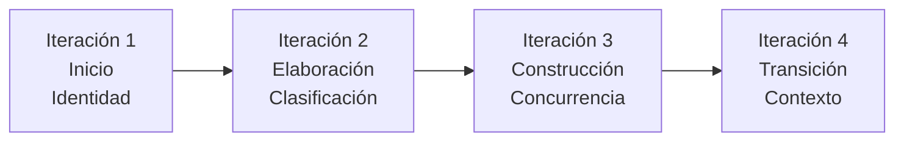

## 2.3. Diseño (Iteraciones PUDS)

### 2.3.1. Iteración 1 — Inicio: identidad del usuario

**Riesgo:** el modelo podía responder de forma genérica y el cliente podía enviar un `username` arbitrario, permitiendo suplantación.

**Análisis:** la identidad es un atributo de seguridad, no un dato del comando. Debe obtenerse del token verificado y propagarse al prompt y a la respuesta.

**Diseño:** `requireAuth` adjunta `req.user`; `aiService.aiUsername()` normaliza el nombre; `ensureAddressed()` garantiza que la respuesta comience por el nombre. El frontend no envía identidad en el cuerpo.

**Implementación:** `backend/middleware/auth.js`, `backend/services/aiService.js`, `backend/routes/ai.js`.

**Criterio de aceptación:** dos usuarios distintos reciben respuestas dirigidas a su propio username; un body manipulado no altera la identidad.

### 2.3.2. Iteración 2 — Elaboración: clasificación de intención

**Riesgo:** el asistente intentaba modificar el diagrama ante preguntas teóricas o comandos ambiguos.

**Análisis:** se identificaron tres clases de entrada: consulta teórica, comando de acción y mensaje ambiguo. Solo el comando de acción produce mutaciones.

**Diseño:** el prompt exige un objeto `{ response, mutations }`; el backend valida que `mutations` sea un arreglo y aplica una allowlist de acciones (`addEntity`, `addAttribute`, `addRelationship`, `removeEntity`, `removeRelationship`). Una consulta teórica devuelve `mutations: []`.

**Implementación:** `backend/services/aiService.js`, `backend/validation.js`, `frontend/src/utils/ast.ts`.

**Criterio de aceptación:** una pregunta conceptual no altera el grafo; una acción válida produce mutaciones ordenadas; una entrada ambigua pide aclaración sin cambios.

### 2.3.3. Iteración 3 — Construcción: concurrencia, ACL y snapshots

**Riesgo:** dos problemas de concurrencia podían corromper el estado. Primero, el WebSocket podía aceptar escrituras antes de aplicar el snapshot Yjs. Segundo, la creación de diagrama y ACL podía quedar a medias, generando huérfanos.

**Análisis:** `getYDoc()` inicia `bindState()` de forma asíncrona. Si `setupWSConnection()` se ejecuta inmediatamente, el *sync step 1* del cliente puede llegar antes que el snapshot. Además, el middleware de lectura no debe crear ACL: hacerlo convierte una lectura en una escritura y permite reclamar diagramas existentes sin propietario.

**Diseño:**

- `wss.on('connection')` ejecuta `ws.pause()`.
- Se valida JWT, rol y existencia del diagrama.
- `ensureDocumentReady()` espera `ydoc.readyPromise`.
- Solo entonces se llama `setupWSConnection()` y `ws.resume()`.
- `writeState` espera escrituras pendientes; `bindState` espera la persistencia final anterior.
- `createDiagramWithOwner` inserta diagrama y ACL en una transacción; `createDiagramWithOwnerIfAbsent` no reclama diagramas existentes sin ACL.

**Implementación:** `backend/realtime/yjs.js`, `backend/services/diagramService.js`, `backend/middleware/diagramAuth.js`, `backend/routes/diagrams.js`.

**Criterio de aceptación:** ninguna escritura ocurre antes de cargar el snapshot; no se crean diagramas huérfanos; un diagrama existente sin ACL se rechaza; el chat de IA se publica por Yjs sin duplicados.

### 2.3.4. Iteración 4 — Transición: contexto y memoria

**Riesgo:** sin memoria, pronombres como “bórralo” o “agrégale” no tenían referente y el asistente podía actuar sobre el elemento equivocado.

**Análisis:** el historial debe ser autoritativo, por diagrama y acotado. El frontend no debe enviar el historial porque puede manipularlo o perderlo.

**Diseño:** el backend consulta los últimos 15 mensajes de `chat.messages`, los formatea como contexto y los inyecta en el prompt. El mensaje del usuario y la respuesta de la IA se persisten; la respuesta se emite al `Y.Array('chat')` de la sala.

**Implementación:** `backend/services/chatService.js`, `backend/services/aiService.js`, `backend/routes/ai.js`, `backend/realtime/yjs.js`.

**Criterio de aceptación:** una secuencia “crea Pedido” → “agrégale total” resuelve el referente; el historial no se mezcla entre diagramas; la respuesta es visible para todos los colaboradores.

### 2.3.5. Iteración 5 — Transición: Solicitudes de acceso (Fase 3)

**Riesgo:** un usuario que abría un diagrama ajeno solo recibía un bloqueo; no existía un canal seguro para pedir acceso ni una decisión auditable del propietario.

**Análisis:** la solicitud debe asociar un usuario, un diagrama y un estado; el propietario debe poder aprobar o rechazar sin exponer la ACL a ediciones arbitrarias. La aprobación debe ser atómica: si se crea la ACL pero no se actualiza la solicitud, el sistema queda inconsistente.

**Diseño:** `auth.access_requests` almacena `PENDING`, `APPROVED` o `REJECTED`, con FK a `core.diagrams` y `auth.users`. Un índice único parcial evita más de una solicitud `PENDING` por usuario/diagrama. La aprobación abre una transacción, bloquea la solicitud con `FOR UPDATE`, verifica que el actor sea el `OWNER`, inserta/actualiza `auth.diagram_acl` con `VIEWER` o `EDITOR` y cambia el estado. Un rechazo solo cambia el estado.

**Implementación:** `backend/routes/accessRequests.js`, `backend/services/accessRequestService.js`, `backend/scripts/access_requests.sql`, `frontend/src/app/dashboard/page.tsx`, `frontend/src/app/diagram/[id]/page.tsx`.

**Criterio de aceptación:** el usuario sin acceso solicita desde el editor; el owner ve la solicitud; aprobar como `VIEWER` permite leer pero bloquea escritura; rechazar deja el acceso en `NONE`; no quedan solicitudes huérfanas.

### 2.3.6. Iteración 6 — Transición: Panel de configuración de IA

**Riesgo:** cambiar entre Groq y Ollama requería modificar variables de entorno y reiniciar el backend, lo que impedía demostrar el modo local durante la presentación.

**Análisis:** la elección de proveedor, URL local y modelo es una preferencia de sesión no secreta. La API key de Groq, en cambio, es un secreto de infraestructura y nunca debe llegar al navegador.

**Diseño:** el frontend persiste `provider`, `ollamaUrl` y `ollamaModel` en `localStorage`. El endpoint `/api/ai/command` recibe esos valores, valida el proveedor y la URL `http(s)`, y los pasa a la estrategia de `aiService` para esa petición. No se muta `process.env`. Si Ollama no responde, el backend devuelve `503` con un mensaje accionable y el chat lo muestra.

**Implementación:** `frontend/src/hooks/useAiProvider.ts`, `frontend/src/components/ChatPanel.tsx`, `frontend/src/hooks/useAICommand.ts`, `backend/validation.js`, `backend/routes/ai.js`, `backend/services/aiService.js`.

**Criterio de aceptación:** el selector conserva la configuración al recargar; Groq sigue funcionando con la clave del servidor; Ollama usa URL/modelo del usuario; una URL inválida se rechaza con `400`; una URL inaccesible devuelve `503` controlado.

**Cierre de Service Discovery:** la iteración se completó con `GET /api/ai/ollama-models?url=...`. El backend valida la URL, consulta `{base-sin-/v1}/api/tags` y devuelve los modelos instalados; el modal reemplaza el campo de texto por un desplegable y muestra un estado de error si el servidor local no responde.

**Trazabilidad de las iteraciones:**

| Iteración | Fase PUDS | Riesgo | Evidencia |
|---|---|---|---|
| 1 | Inicio | Suplantación de identidad | `aiUsername`, JWT, prompt |
| 2 | Elaboración | Mutaciones en consultas teóricas | Clasificación, allowlist, validación |
| 3 | Construcción | Pérdida de snapshot y ACL huérfana | `ws.pause`, `readyPromise`, transacciones |
| 4 | Transición | Pérdida de referentes conversacionales | Últimos 15 mensajes, Yjs chat |
| 5 | Transición | Solicitudes de acceso sin canal seguro | `auth.access_requests`, transacción de aprobación |
| 6 | Transición | Cambio de proveedor IA con reinicio | Strategy, `localStorage`, validación de URL |

## 3. Gestión de riesgos del proceso

| Riesgo | Impacto | Mitigación |
|---|---|---|
| Respuestas IA en formato inválido | Alto | Validación runtime, extracción de mutaciones y respuesta `502` sin cambios parciales |
| Crecimiento del historial | Medio | Límite de 15 mensajes y recorte de texto |
| Cambios incompatibles en Yjs | Alto | Pruebas de snapshot y compatibilidad de tipos |
| Escritura antes de cargar el snapshot | Alto | `ws.pause()`, `readyPromise` y `setupWSConnection` posterior |
| Diagrama sin ACL reclamado por tercero | Alto | ACL de solo lectura y creación transaccional |
| Exposición de secretos | Alto | `.env.local` ignorado y variables de despliegue |
| WebSocket inestable | Medio | Reconexión del provider y estado en Yjs |
| Migración de datos legacy | Medio | Script idempotente y verificación de conteos |
| Pruebas antiguas obsoletas | Medio | Documentar su estado y usar pruebas de integración nuevas |

## 4. Criterios de cierre del parcial

- Ocho casos de uso documentados y trazables.
- CU-06 implementado con identidad, intención, chat y memoria.
- Persistencia PostgreSQL operativa en los tres esquemas.
- Migración de datos legacy verificada.
- Build y typecheck sin errores nuevos.
- Pruebas de integración aprobadas.
- Documentación exportable a Word o PDF.

Continuar con [[02_Analisis]].
