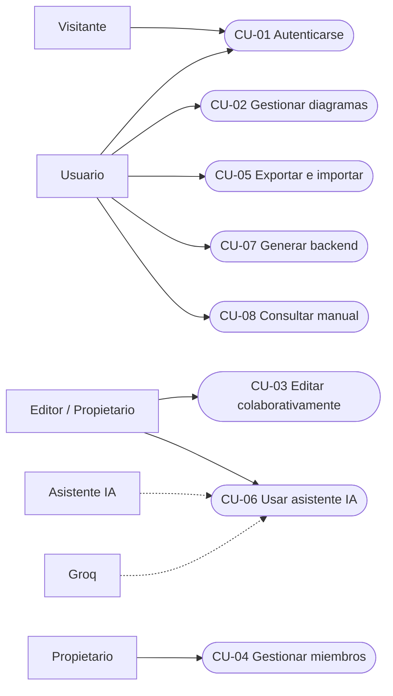

# Proceso de Desarrollo

## 1. Enfoque metodológico

El proyecto se desarrolló con un enfoque incremental inspirado en el **Proceso Unificado de Desarrollo de Software (PUDS)**. No se aplicó una ceremonia completa de RUP, sino una adaptación práctica para un proyecto académico:

- Casos de uso como unidad de planificación.
- Arquitectura como eje central.
- Iteraciones cortas con entregables verificables.
- Pruebas de integración al cierre de cada incremento.
- Documentación viva basada en el código y en la base de datos real.

### 1.1 Fases del PUDS aplicadas

| Fase | Objetivo | Evidencia en el proyecto |
|---|---|---|
| Inicio | Definir alcance, actores y valor | README, casos de uso y prototipo funcional |
| Elaboración | Estabilizar arquitectura y riesgos | Yjs, Express, JWT, ACL y modelo de datos |
| Construcción | Implementar incrementos y probar | Migración a PostgreSQL, IA con identidad y memoria |
| Transición | Validar, desplegar y documentar | Build, pruebas, Vercel, Railway y este vault |

### 1.2 Principios de trabajo

1. **Arquitectura primero:** las decisiones de colaboración y persistencia condicionan el resto del sistema.
2. **Trazabilidad:** cada caso de uso se relaciona con componentes, endpoints y tablas.
3. **Verificación temprana:** las pruebas de integración se ejecutan contra PostgreSQL, no solo con mocks.
4. **Compatibilidad:** se conservaron contratos y tipos de aristas para no romper diagramas existentes.
5. **Seguridad por defecto:** el WebSocket niega el acceso si falta token o rol.
6. **Documentación verificable:** las afirmaciones se contrastan con el esquema y el código.

## 2. Alcance del Segundo Parcial

El Segundo Parcial se concentra en dos capacidades:

1. **Asistente IA colaborativo con identidad y memoria contextual.**
2. **Persistencia sectorizada en PostgreSQL/Neon.**

Además, se consolidan la autenticación, las ACL, el dashboard, la edición colaborativa y la generación de backend.

## 3. Actores

| Actor | Tipo | Descripción |
|---|---|---|
| Visitante | Primario | Usuario no autenticado que puede registrarse o iniciar sesión |
| Usuario | Primario | Persona autenticada que accede al dashboard y a sus diagramas |
| Propietario | Primario | Usuario con rol `OWNER` sobre un diagrama |
| Editor | Primario | Usuario con rol `EDITOR` sobre un diagrama |
| Observador | Primario | Usuario con rol `VIEWER` sobre un diagrama |
| Asistente IA | Secundario | Servicio que interpreta comandos y propone mutaciones |
| Groq | Externo | Proveedor de modelos de texto, voz y visión |
| PostgreSQL | Externo | Base de datos Neon |
| Sistema de archivos | Externo | Descarga temporal del ZIP generado |

## 4. Requisitos funcionales

| Código | Requisito | Caso de uso |
|---|---|---|
| RF-01 | Registro con username, email y contraseña | CU-01 |
| RF-02 | Inicio y cierre de sesión con JWT | CU-01 |
| RF-03 | Listado de diagramas propios y compartidos | CU-02 |
| RF-04 | Creación, renombrado y eliminación de diagramas | CU-02 |
| RF-05 | Edición colaborativa de nodos y aristas | CU-03 |
| RF-06 | Presencia y soft-lock visual | CU-03 |
| RF-07 | Gestión de miembros y roles | CU-04 |
| RF-08 | Exportación e importación JSON/XMI | CU-05 |
| RF-09 | Comandos IA por texto | CU-06 |
| RF-10 | Comandos IA por voz | CU-06 |
| RF-11 | Generación desde imagen | CU-06 |
| RF-12 | Identidad del usuario en la respuesta IA | CU-06 |
| RF-13 | Memoria contextual del chat | CU-06 |
| RF-14 | Emisión de la respuesta IA en el chat colaborativo | CU-06 |
| RF-15 | Generación de backend Spring Boot + PostgreSQL | CU-07 |
| RF-16 | Manual de usuario embebido | CU-08 |

## 5. Requisitos no funcionales

| Código | Requisito | Criterio |
|---|---|---|
| RNF-01 | Colaboración en tiempo real | Los cambios se propagan por WebSocket sin recarga |
| RNF-02 | Durabilidad | El snapshot y el chat sobreviven al cierre del navegador |
| RNF-03 | Seguridad | Contraseñas con bcrypt; JWT firmado; ACL por diagrama |
| RNF-04 | Rendimiento | Historial de IA limitado a 15 mensajes; pool de 10 conexiones |
| RNF-05 | Mantenibilidad | Separación en capas y servicios con responsabilidad única |
| RNF-06 | Portabilidad | Frontend y backend desplegables por separado |
| RNF-07 | Usabilidad | Dashboard, toolbar, chat, ayuda y atajos |
| RNF-08 | Compatibilidad | Diagramas antiguos y tipos de arista persistidos siguen funcionando |
| RNF-09 | Recuperación | Errores de IA no deben mutar el diagrama de forma parcial |
| RNF-10 | Privacidad | El historial se consulta por diagrama y no se comparte entre salas |

## 6. Casos de uso

### 6.1 Inventario

| ID | Caso de uso | Actor principal | Prioridad | Resultado |
|---|---|---|---|---|
| CU-01 | Autenticarse en el sistema | Visitante / Usuario | Alta | Sesión JWT activa |
| CU-02 | Gestionar diagramas | Usuario | Alta | Diagrama creado, listado, renombrado o eliminado |
| CU-03 | Editar diagrama colaborativamente | Editor / Propietario | Alta | Grafo Yjs actualizado y sincronizado |
| CU-04 | Gestionar miembros y permisos | Propietario | Alta | ACL actualizada |
| CU-05 | Exportar e importar diagramas | Usuario | Media | Archivo JSON o XMI intercambiado |
| CU-06 | Usar asistente IA | Editor / Propietario | Alta | Respuesta contextual y mutaciones aplicadas |
| CU-07 | Generar backend Spring Boot | Usuario | Media | ZIP con proyecto ejecutable |
| CU-08 | Consultar manual de usuario | Usuario | Baja | Ayuda contextual visible |

### 6.2 Diagrama general de casos de uso



La IA y Groq son actores secundarios: participan en CU-06, pero no inician el caso de uso. El usuario inicia la interacción y el backend coordina a los participantes externos.

### 6.3 CU-01 Autenticarse en el sistema

**Objetivo:** establecer una identidad verificable para acceder a diagramas y a la IA.

**Precondiciones:** el backend está disponible y `AUTH_ENABLED=true` para el flujo completo.

**Flujo principal:**

1. El visitante abre `/register` o `/login`.
2. Ingresa username, email y contraseña, o username y contraseña.
3. El frontend llama a `POST /api/auth/register` o `POST /api/auth/login`.
4. El backend valida los datos.
5. bcrypt compara o genera el hash.
6. El backend firma un JWT con `userId` y `username`.
7. El frontend guarda el token en `localStorage`.
8. El usuario es redirigido al dashboard.

**Alternativas:**

- Credenciales inválidas: `401`.
- Username o email duplicado: `400`.
- Contraseña corta: `400`.
- Backend caído: el frontend mantiene el modo abierto si la configuración lo permite.

**Postcondiciones:** existe una sesión con token válido o se informa el error.

### 6.4 CU-02 Gestionar diagramas

**Objetivo:** administrar el ciclo de vida de los diagramas desde el dashboard.

**Flujo principal:**

1. El usuario autenticado abre `/dashboard`.
2. El frontend solicita `GET /api/diagrams`.
3. El backend devuelve `{ owned, shared }`.
4. El usuario crea un diagrama con `POST /api/diagrams`.
5. El backend crea la fila en `core.diagrams` y la ACL `OWNER`.
6. El usuario abre el editor, renombra o elimina según su rol.
7. El borrado elimina primero la ACL y luego el diagrama en una transacción.

**Reglas:**

- Solo el `OWNER` puede eliminar.
- El nombre no puede quedar vacío.
- Un diagrama compartido muestra su propietario.
- Los diagramas legacy sin ACL no se listan hasta ser migrados.

### 6.5 CU-03 Editar diagrama colaborativamente

**Objetivo:** modificar el modelo UML y ver los cambios de otros participantes.

**Flujo principal:**

1. El usuario abre `/diagram/<id>`.
2. El frontend carga el snapshot desde `GET /api/diagrams/:id`.
3. El snapshot se aplica a Yjs.
4. El usuario agrega una entidad, un atributo o una relación.
5. La acción escribe en el `Y.Map` correspondiente.
6. Yjs envía el update por WebSocket.
7. Los demás clientes reciben el update y actualizan React Flow.
8. Al seleccionar un nodo, se publica el soft-lock en `awareness`.

**Reglas:**

- El estado canónico es Yjs.
- Las aristas usan doble tipado: `edge.type` para render y `data.type` para semántica.
- Un `VIEWER` no debe arrastrar, conectar ni editar.
- El soft-lock expira a los 30 segundos.

### 6.6 CU-04 Gestionar miembros y permisos

**Objetivo:** compartir un diagrama con otros usuarios y asignar roles.

**Flujo principal:**

1. El `OWNER` abre `MembersPanel`.
2. Busca un usuario por username.
3. Selecciona `EDITOR` o `VIEWER`.
4. El frontend llama a `POST /api/diagrams/:id/members`.
5. El backend valida el rol y actualiza `auth.diagram_acl`.
6. El miembro puede abrir el diagrama según su rol.

**Reglas:**

- El `OWNER` no puede eliminarse a sí mismo.
- Un usuario solo puede tener un rol por diagrama.
- La clave única `(diagram_id, user_id)` evita duplicados.
- La actualización de rol se implementa como upsert.

### 6.7 CU-05 Exportar e importar diagramas

**Objetivo:** respaldar o intercambiar el modelo.

**Flujo principal:**

1. El usuario elige JSON o XMI.
2. El frontend serializa nodos, aristas y metadatos.
3. Se descarga un archivo.
4. Para importar, el usuario selecciona un archivo válido.
5. El frontend valida y carga los datos en una transacción Yjs.

**Reglas:**

- JSON conserva la información completa del editor.
- XMI prioriza interoperabilidad con Enterprise Architect.
- El vínculo de clase asociativa no se preserva en XMI; es una limitación documentada.

### 6.8 CU-06 Usar asistente IA

Este caso de uso se desarrolla en detalle en la sección 8.

### 6.9 CU-07 Generar backend Spring Boot

**Objetivo:** obtener un proyecto backend a partir del modelo UML.

**Flujo principal:**

1. El usuario pulsa **Generar**.
2. El frontend convierte el canvas en AST.
3. Envía `POST /api/generate` con el estado actual.
4. El backend valida que existan entidades.
5. El generador normaliza nombres y expande relaciones `* a *`.
6. Handlebars renderiza entidades, repositorios, servicios, controladores, DTO, migraciones y seguridad.
7. Archiver crea un ZIP.
8. El navegador descarga `backend-generado.zip`.
9. El archivo temporal se elimina.

**Reglas:**

- Las relaciones muchos-a-muchos se convierten en entidad intermedia explícita.
- La herencia JPA usa `JOINED` solo en la raíz.
- Los nombres de tabla se sanean para evitar palabras reservadas.
- Si no hay entidades, se devuelve `400`.

### 6.10 CU-08 Consultar manual de usuario

**Objetivo:** resolver dudas sin abandonar la aplicación.

**Flujo principal:**

1. El usuario pulsa **Ayuda** o presiona `F1`.
2. Se abre `HelpModal`.
3. El usuario navega por las secciones o busca texto.
4. El contenido se renderiza desde `data/manual.ts`.

**Reglas:**

- El manual no debe documentar funciones inexistentes.
- `Escape` o clic fuera cierran el modal.

## 7. Priorización

| Prioridad | Casos de uso | Justificación |
|---|---|---|
| Must | CU-01, CU-02, CU-03, CU-04, CU-06 | Núcleo del parcial y de la operación segura |
| Should | CU-05, CU-07 | Valor diferencial y generación de artefactos |
| Could | CU-08 | Mejora la adopción, no bloquea el flujo |
| Won't (esta entrega) | Invitaciones, PlantUML/SQL, app móvil | Fuera del alcance acordado |

## 8. CU-06 Usar asistente IA en detalle

### 8.1 Ficha

| Campo | Valor |
|---|---|
| Identificador | CU-06 |
| Nombre | Usar asistente IA |
| Actor principal | Editor o Propietario autenticado |
| Actores secundarios | Asistente IA, Groq, PostgreSQL, Yjs |
| Prioridad | Alta |
| Canal | Texto, voz o imagen |
| Precondición | Sesión válida y diagrama accesible |
| Postcondición | Respuesta persistida y, si corresponde, mutaciones aplicadas |

### 8.2 Objetivo

Permitir que el usuario construya o consulte el modelo en lenguaje natural, con una respuesta personalizada, consciente del estado del diagrama y del historial reciente, visible para todos los colaboradores.

### 8.3 Disparador

El usuario escribe un comando, dicta una instrucción o adjunta una imagen y confirma el envío.

### 8.4 Flujo principal

| Paso | Actor / componente | Acción |
|---|---|---|
| 1 | Usuario | Abre el chat del diagrama |
| 2 | Frontend | Recupera el `diagramId` y el estado actual de Yjs |
| 3 | Usuario | Escribe o dicta un comando |
| 4 | `ChatPanel` → `useAICommand` | Agrega el mensaje del usuario al chat Yjs |
| 5 | `nodesToAST` | Convierte nodos y aristas en un AST |
| 6 | `apiFetch` | Envía `POST /api/ai/command` con JWT, comando, AST y `diagramId` |
| 7 | `requireAuth` | Verifica el JWT y obtiene `userId` y `username` |
| 8 | `chatService` | Recupera los últimos 15 mensajes del diagrama |
| 9 | `chatService` | Persiste el mensaje del usuario con rol `user` |
| 10 | Backend | Construye el prompt con identidad, estado e historial |
| 11 | Groq | Devuelve `response` y `mutations` |
| 12 | Backend | Valida y normaliza la respuesta |
| 13 | `chatService` | Persiste la respuesta con autor `IA` y rol `assistant` |
| 14 | Backend | Emite la respuesta al chat Yjs de la sala |
| 15 | Frontend | Aplica las mutaciones en orden |
| 16 | Yjs / React Flow | Propaga y renderiza el nuevo estado |

### 8.5 Flujo alternativo: consulta teórica

1. El usuario pregunta por un concepto, por ejemplo: “¿qué es una clase abstracta?”.
2. El modelo clasifica la intención como consulta pedagógica.
3. Devuelve una explicación y `mutations: []`.
4. El diagrama no cambia.
5. La respuesta se persiste y se emite en el chat.

### 8.6 Flujo alternativo: comando ambiguo

1. El modelo no puede determinar si el usuario quiere teoría o acción.
2. Devuelve una solicitud de aclaración.
3. `mutations` queda vacío.
4. No se modifica el diagrama.

### 8.7 Flujo alternativo: error de IA o de red

1. Groq no responde o devuelve un formato inválido.
2. El backend intenta recuperar mutaciones del texto.
3. Si no es posible, responde con error.
4. El frontend informa el problema en el chat.
5. No se aplican mutaciones parciales no verificadas.

### 8.8 Reglas de negocio

| Regla | Descripción |
|---|---|
| RN-06.1 | La identidad se obtiene exclusivamente del JWT |
| RN-06.2 | El cliente no puede enviar el nombre del usuario en el cuerpo |
| RN-06.3 | El historial autoritativo se lee de `chat.messages` |
| RN-06.4 | Se usan como máximo 15 mensajes recientes |
| RN-06.5 | El mensaje del usuario se persiste antes de llamar a Groq |
| RN-06.6 | La respuesta del asistente se persiste con rol `assistant` |
| RN-06.7 | Las mutaciones se aplican en orden: entidad, atributo, relación, eliminación |
| RN-06.8 | Una consulta teórica nunca produce mutaciones |
| RN-06.9 | La respuesta se emite al chat Yjs para todos los colaboradores |
| RN-06.10 | El frontend evita duplicar la respuesta si `chatEmitted` es verdadero |
| RN-06.11 | Sin JWT válido, la IA responde `401` |
| RN-06.12 | El historial se consulta por `diagram_id`, sin mezclar salas |

### 8.9 Datos de entrada y salida

**Entrada:**

```json
{
  "command": "Crea la entidad Pedido con id y total",
  "currentState": {
    "entities": [],
    "relationships": []
  },
  "diagramId": "diagram-123"
}
```

**Salida:**

```json
{
  "mutations": [
    {
      "action": "addEntity",
      "entityName": "Pedido",
      "attributes": [
        {
          "name": "id",
          "type": "UUID",
          "isPk": true,
          "nullable": false,
          "unique": true
        }
      ]
    }
  ],
  "response": "Ana, agregué la entidad Pedido con su identificador.",
  "username": "Ana",
  "chatEmitted": true
}
```

### 8.10 Criterios de aceptación

1. La respuesta usa el username del JWT.
2. El historial enviado a Groq proviene de PostgreSQL.
3. El mensaje del usuario queda registrado.
4. La respuesta de la IA queda registrada.
5. Todos los colaboradores ven la respuesta en el chat.
6. Las entidades se crean antes que las relaciones.
7. Una consulta teórica no modifica el diagrama.
8. Un token inválido no puede invocar la IA.
9. Un error de Groq no deja mutaciones a medias.
10. El frontend no duplica la respuesta emitida por el backend.

### 8.11 Trazabilidad

| Elemento | Implementación |
|---|---|
| Interfaz de chat | `frontend/src/components/ChatPanel.tsx` |
| Control de envío | `frontend/src/hooks/useAICommand.ts` |
| Conversión a AST | `frontend/src/utils/ast.ts` |
| Endpoint | `backend/routes/ai.js`, `POST /api/ai/command` |
| Identidad | `backend/middleware/auth.js`, `req.user` |
| Historial | `backend/services/chatService.js` |
| Persistencia | `chat.messages` |
| Emisión colaborativa | `emitChatMessage` en `realtime/yjs.js` |
| Modelo externo | Groq `openai/gpt-oss-20b` |
| Tabla de chat | `chat.messages` |

## 9. Iteraciones del asistente IA

### 9.1 Iteración 1: identidad

**Problema:** la IA respondía de forma genérica y el cliente podía enviar cualquier nombre.

**Solución:** extraer `username` del JWT verificado y usarlo en el prompt y la respuesta.

**Resultado:** respuestas personalizadas y no suplantables.

### 9.2 Iteración 2: clasificación de intención y separación tutor/ejecutor

**Problema:** el asistente intentaba modificar el diagrama ante preguntas teóricas.

**Solución:** clasificar el mensaje en consulta teórica, comando de acción o ambiguo. El tutor responde; el ejecutor devuelve mutaciones solo cuando corresponde.

**Resultado:** menor riesgo de cambios no deseados y mejor valor pedagógico.

### 9.3 Iteración 3: chat colaborativo por Yjs

**Problema:** la respuesta de la IA solo la veía quien enviaba el comando.

**Solución:** persistir y emitir la respuesta al `Y.Array('chat')` de la sala.

**Resultado:** el asistente se comporta como un participante más.

### 9.4 Iteración 4: memoria contextual en PostgreSQL

**Problema:** el historial vivía en el frontend y podía perderse o manipularse.

**Solución:** leer los últimos 15 mensajes de `chat.messages` y persistir cada intervención.

**Resultado:** continuidad conversacional, auditoría y consistencia entre sesiones.

### 9.5 Iteración 5: correcciones P0 de seguridad y concurrencia

La auditoría técnica identificó riesgos que no podían posponerse. Se aplicó una fase P0 sin reescribir la arquitectura:

| Problema | Corrección aplicada | Archivo |
|---|---|---|
| El middleware creaba ACL al leer o conectar el WS | La ACL solo se consulta; no se crea en rutas de lectura | `backend/middleware/diagramAuth.js`, `backend/realtime/yjs.js` |
| Diagrama y ACL se insertaban en dos pasos | `createDiagramWithOwner` y `createDiagramWithOwnerIfAbsent` usan una transacción | `backend/services/diagramService.js`, `backend/routes/diagrams.js` |
| Un usuario podía reclamar un diagrama legacy sin ACL | Un diagrama existente sin ACL se rechaza; no hay auto-claim | `backend/middleware/diagramAuth.js`, `backend/realtime/yjs.js` |
| El cliente podía escribir antes de aplicar el snapshot Yjs | El socket se pausa; `ensureDocumentReady` espera `readyPromise`; luego se llama `setupWSConnection` | `backend/realtime/yjs.js` |
| El snapshot final podía competir con una nueva carga | `writeState` espera el snapshot; `bindState` espera escrituras pendientes | `backend/realtime/yjs.js` |
| No había validación runtime de IA, AST o ACL | Se añadió `validation.js` y validación de UUID en ACL | `backend/validation.js`, `backend/services/aclService.js` |
| La generación concurrente compartía ZIP y borraba todo `output` | Directorio temporal único por petición y limpieza de solo ese directorio | `backend/generator/generate.js` |
| No había cierre ordenado | `SIGTERM`/`SIGINT` cancelan timers, hacen flush, cierran WS y pool | `backend/realtime/yjs.js` |

**Decisión de compatibilidad:** el frontend ahora crea el primer diagrama mediante `POST /api/diagrams` antes de abrir el WebSocket. Así el diagrama y su ACL existen cuando el cliente intenta conectarse. La creación de diagramas nuevos sigue usando el mismo contrato REST.

**Verificación:**

- `npx tsc --noEmit` en frontend: sin errores.
- `npm run build` en frontend: compilación y generación de rutas correctas.
- `node --check` en archivos backend: sin errores de sintaxis.
- Validadores probados con payloads válidos e inválidos.
- Dos generaciones concurrentes produjeron ZIPs en directorios distintos.
- El lint del frontend conserva 154 problemas preexistentes; no se usó como criterio de cierre de esta fase.

### 9.6 Iteración 6: separación de capas y errores centralizados

La Fase 2 se enfocó en mantenibilidad y en aplicar SRP/DRY sin cambiar los contratos funcionales.

| Antes | Después | Responsabilidad |
|---|---|---|
| `server.js` con 884 líneas | `server.js` de 59 líneas | Bootstrap: carga de entorno, HTTP, base de datos, señales y apagado |
| Express, rutas e IA en `server.js` | `app.js` | Composición de Express, JSON, CORS, salud, rutas y middleware final |
| Yjs/WebSocket en `server.js` | `realtime/yjs.js` | Persistencia de snapshots, carga previa, autenticación WS y emisión de chat |
| Rutas de diagramas e IA inline | `routes/diagrams.js`, `routes/ai.js` | Endpoints REST y orquestación de casos de uso |
| Funciones de Groq en `server.js` | `services/aiService.js` | Prompts, llamada a Groq, parsing y recuperación de JSON |
| `try/catch` repetidos en rutas | `errors.js` + `middleware/errorHandler.js` | `asyncHandler`, `AppError`, 404, 400 JSON, multer y errores internos |
| `MembersPanel` con fetch y estado | `hooks/useDiagramMembers.ts` | Carga, invitación, cambio de rol y eliminación |
| `ChatPanel` y `Toolbar` con lógica de negocio | Componentes controlados por props/hooks | Render y eventos de UI |

**Decisiones:**

- `createApp()` permite probar Express sin abrir un puerto ni crear el WebSocket.
- `attachRealtime(server)` encapsula el ciclo de vida del WebSocket.
- Los servicios lanzan `AppError` con estado HTTP; el middleware decide el formato final.
- Los errores 5xx desconocidos no exponen mensajes internos.
- `fileSize` de JSON se elevó a 1 MB para admitir AST académicos sin relajar la validación.

**Verificación:** `node --check` en 22 archivos, `npx tsc --noEmit`, `npm run build`, smoke de `/health`, `/ready`, 404 JSON y respuestas 400/401. El lint del frontend bajó de 154 a 150 problemas preexistentes.

## 10. Riesgos del proceso

| Riesgo | Impacto | Mitigación |
|---|---|---|
| Respuestas IA en formato inválido | Alto | Validación runtime, extracción de mutaciones y respuesta `502` sin cambios parciales |
| Crecimiento del historial | Medio | Límite de 15 mensajes y recorte de texto |
| Cambios incompatibles en Yjs | Alto | Pruebas de snapshot y compatibilidad de tipos |
| Escritura antes de cargar el snapshot | Alto | `ws.pause()`, `readyPromise` y `setupWSConnection` posterior |
| Diagrama sin ACL reclamado por tercero | Alto | ACL de solo lectura y creación transaccional |
| Exposición de secretos | Alto | `.env.local` ignorado y variables de despliegue |
| WebSocket inestable | Medio | Reconexión del provider y estado en Yjs |
| Migración de datos legacy | Medio | Script idempotente y verificación de conteos |
| Pruebas antiguas obsoletas | Medio | Documentar su estado y usar pruebas de integración nuevas |

## 11. Criterios de cierre del parcial

- Ocho casos de uso documentados y trazables.
- CU-06 implementado con identidad, intención, chat y memoria.
- Persistencia PostgreSQL operativa en los tres esquemas.
- Migración de datos legacy verificada.
- Build y typecheck sin errores nuevos.
- Pruebas de integración aprobadas.
- Documentación exportable a Word o PDF.

Continuar con [[03_Analisis]].
