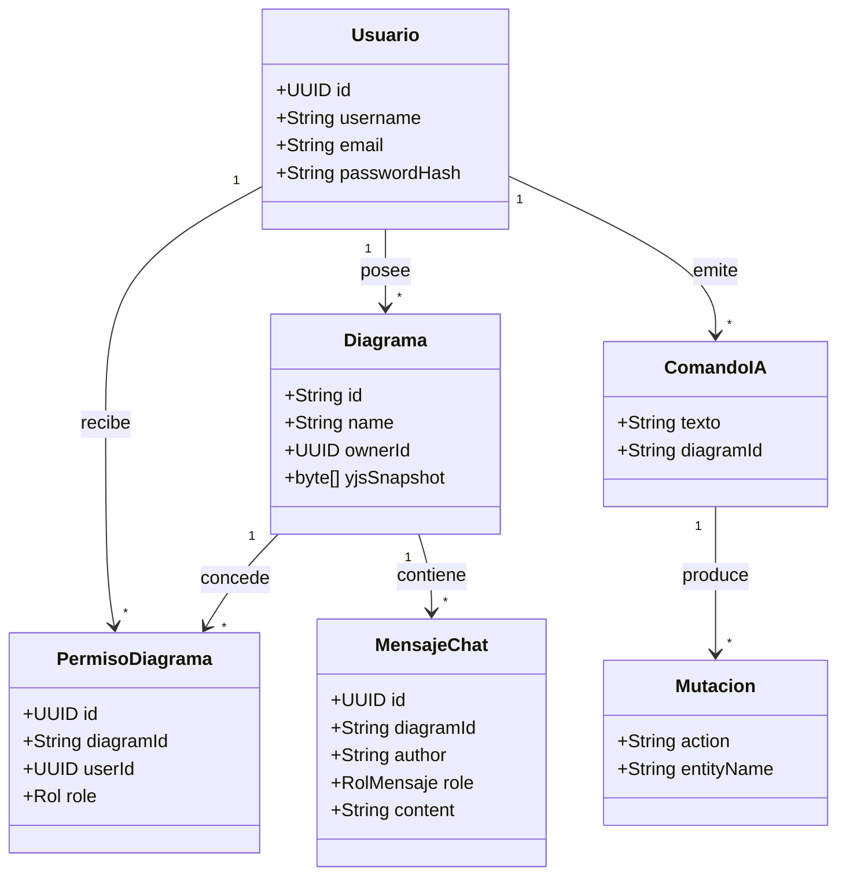
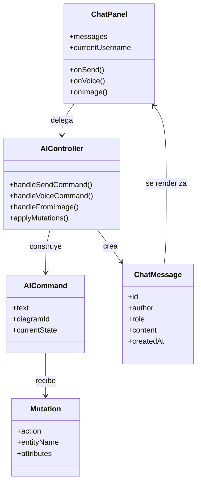
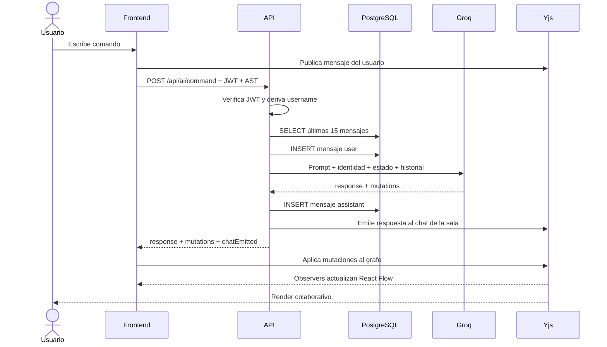
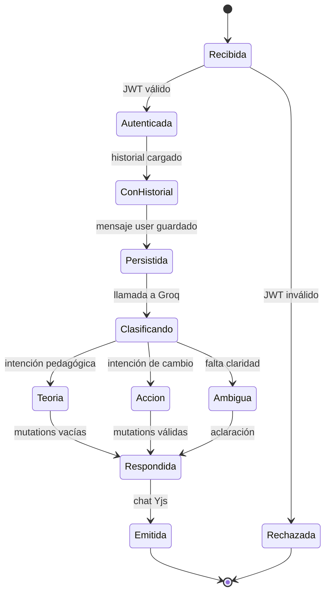

# Análisis

## 1. Propósito

Este documento transforma los requisitos del Segundo Parcial en un modelo de análisis comprensible antes de entrar en el diseño detallado. El foco está en:

- Identificar las clases conceptuales del dominio.
- Delimitar paquetes y responsabilidades.
- Aplicar el patrón Frontera-Control-Entidad (BCE).
- Analizar el flujo del asistente IA con identidad y memoria.
- Definir contratos y reglas verificables.

El análisis no describe todavía la implementación concreta; busca explicar **qué debe hacer el sistema** y **qué conceptos maneja**.

## 2. Modelo conceptual

### 2.1 Clases del dominio

| Clase | Responsabilidad conceptual | Atributos principales |
|---|---|---|
| Usuario | Representa una identidad autenticada | id, username, email, passwordHash, createdAt |
| Diagrama | Documento UML colaborativo | id, name, ownerId, snapshot, createdAt, updatedAt |
| PermisoDiagrama | Relación entre usuario y diagrama con un rol | id, diagramId, userId, role, grantedAt |
| MensajeChat | Intervención de usuario o IA en un diagrama | id, diagramId, author, role, content, createdAt |
| ComandoIA | Instrucción en lenguaje natural | texto, diagramId, usuario, estadoActual |
| Mutacion | Cambio propuesto por la IA | action, entityName, attributes, relationship |
| SnapshotYjs | Estado binario del documento colaborativo | bytea |
| ProyectoGenerado | Artefacto Spring Boot producido | ZIP, entidades, relaciones |
| SeccionManual | Contenido de ayuda | título, cuerpo, palabras clave |

### 2.2 Relaciones conceptuales



### 2.3 Enumeraciones

| Enumeración | Valores |
|---|---|
| Rol | `OWNER`, `EDITOR`, `VIEWER` |
| RolMensaje | `user`, `assistant`, `system` |
| AcciónMutación | `addEntity`, `addAttribute`, `addRelationship`, `removeEntity`, `removeRelationship` |
| IntenciónIA | `theoretical`, `action`, `ambiguous` |

## 3. Paquetes de análisis

```text
┌─────────────────────────────────────────────────────────────┐
│ Presentación                                                │
│ Login, Register, Dashboard, Editor, ChatPanel, HelpModal    │
└───────────────────────┬─────────────────────────────────────┘
                        │
┌───────────────────────▼─────────────────────────────────────┐
│ Autenticación y autorización                                │
│ AuthContext, API JWT, ACL, roles, gates HTTP/WS             │
└───────────────────────┬─────────────────────────────────────┘
                        │
┌───────────────────────▼─────────────────────────────────────┐
│ Edición colaborativa                                        │
│ Y.Doc, nodos, aristas, presencia, snapshots                 │
└───────────────┬───────────────────────────────┬─────────────┘
                │                               │
┌───────────────▼──────────────┐  ┌─────────────▼─────────────┐
│ Asistente IA                 │  │ Generación de backend     │
│ Intención, tutor, mutaciones │  │ AST, plantillas, ZIP      │
└───────────────┬──────────────┘  └─────────────┬─────────────┘
                │                               │
┌───────────────▼───────────────────────────────▼─────────────┐
│ Persistencia y servicios externos                           │
│ PostgreSQL Neon, Groq, archivos temporales                  │
└─────────────────────────────────────────────────────────────┘
```

### 3.1 Paquete de presentación

Contiene las fronteras con el usuario:

- Formularios de autenticación.
- Dashboard y tarjetas de diagramas.
- Canvas, toolbar, paleta y paneles.
- Chat y ayuda.

No contiene reglas de persistencia. Se comunica mediante hooks y clientes de API.

### 3.2 Paquete de autenticación y autorización

Agrupa:

- Registro, login y sesión.
- Firma y verificación del JWT.
- Consulta de roles.
- Restricciones de edición por rol.
- Gate del WebSocket.

### 3.3 Paquete de edición colaborativa

Contiene el documento Yjs, los helpers de nodos y aristas, la presencia y la persistencia del snapshot. Es el núcleo de la colaboración.

### 3.4 Paquete del asistente IA

Contiene la conversión del canvas a AST, el envío del comando, la clasificación de intención, la generación de mutaciones, la aplicación de cambios y la memoria conversacional.

### 3.5 Paquete de generación

Transforma el AST en un proyecto Spring Boot. No debe confundirse con el asistente: la IA propone cambios en el diagrama; el generador produce código a partir del diagrama ya validado.

### 3.6 Paquete de persistencia

Implementa el acceso a PostgreSQL, las transacciones y la migración. También encapsula el pool y la normalización de identificadores.

## 4. Análisis Frontera-Control-Entidad

### 4.1 BCE por caso de uso

| Caso de uso | Frontera | Control | Entidad |
|---|---|---|---|
| CU-01 Autenticarse | LoginPage, RegisterPage | AuthContext, `routes/auth.js` | Usuario |
| CU-02 Gestionar diagramas | DashboardPage, DiagramCard | `routes/diagrams.js`, `diagramService` | Diagrama, PermisoDiagrama |
| CU-03 Editar colaborativamente | EditorPage, Toolbar, Palette | `useCollaborativeFlow`, `useNodeLocks` | Y.Doc, Nodo, Arista |
| CU-04 Gestionar miembros | MembersPanel | `routes/acl.js`, `aclService` | PermisoDiagrama, Usuario |
| CU-05 Exportar e importar | Toolbar, exportadores | `diagramExportImport`, `xmiExporter`, `xmiImporter` | Diagrama |
| CU-06 Usar asistente IA | ChatPanel | `useAICommand`, `routes/ai.js` (`/api/ai/*`) | MensajeChat, ComandoIA, Mutacion |
| CU-07 Generar backend | Toolbar | `routes/ai.js` (`/api/generate`), `generator/generate.js` | ProyectoGenerado, Diagrama |
| CU-08 Consultar manual | HelpModal | `useHelpModal` | SeccionManual |

### 4.2 BCE detallado de CU-06



#### Frontera: `ChatPanel`

Responsabilidades:

- Mostrar mensajes y autores.
- Capturar texto, voz o imagen.
- Indicar si el usuario es observador.
- Informar errores al usuario.
- No decidir reglas de negocio ni persistencia.

#### Control: `AIController` / `useAICommand`

Responsabilidades:

- Convertir el canvas en AST.
- Enviar el comando con el JWT.
- Aplicar mutaciones en orden.
- Evitar duplicados cuando el backend ya emitió la respuesta.
- Gestionar los estados de procesamiento, grabación y análisis de imagen.

#### Entidad: `ChatMessage`

Representa una intervención persistida o efímera. En el análisis se distinguen dos manifestaciones:

- **Mensaje vivo:** dentro de `Y.Array('chat')`, visible en tiempo real.
- **Mensaje durable:** fila de `chat.messages`, usada para la memoria de la IA.

Esta duplicidad es intencional: Yjs ofrece colaboración; PostgreSQL ofrece persistencia y contexto.

### 4.3 Fronteras del backend

| Frontera | Control | Entidad |
|---|---|---|
| `POST /api/ai/command` | `requireAuth` + lógica de IA | ComandoIA, Mutacion |
| `POST /api/ai/transcribe` | Multer + Groq Whisper | Audio |
| `POST /api/ai/from-image` | Multer + Groq Vision | Imagen |
| `GET /api/diagrams/:id` | `requireDiagramMember` | Diagrama, MensajeChat |

## 5. Análisis del flujo CU-06

### 5.1 Secuencia conceptual

La secuencia solicitada se interpreta así: el usuario interactúa con el frontend; el frontend llama a la API; la API consulta a Groq; luego la API publica en Yjs. La base de datos participa antes y después de Groq para la memoria y la persistencia.



### 5.2 Orden de responsabilidades

1. **Captura:** el usuario expresa una intención.
2. **Representación:** el frontend convierte el canvas en un AST, no en coordenadas.
3. **Autorización:** la API verifica el JWT y obtiene la identidad.
4. **Memoria:** la API lee el historial autoritativo.
5. **Persistencia del turno:** se guarda el mensaje del usuario.
6. **Inferencia:** Groq clasifica y responde.
7. **Persistencia de la respuesta:** se guarda la intervención del asistente.
8. **Colaboración:** la respuesta se publica en Yjs.
9. **Aplicación:** el frontend ejecuta las mutaciones.
10. **Render:** los observadores actualizan la vista.

### 5.3 Por qué el AST es una frontera de análisis

El modelo de lenguaje no debe recibir coordenadas ni detalles de React Flow. El AST expresa entidades y relaciones, que son conceptos del dominio. Esto permite:

- Probar la conversión sin navegador.
- Cambiar la representación visual sin cambiar el prompt.
- Validar mutaciones contra nombres de entidades.
- Reutilizar el mismo AST para el generador Spring Boot.

### 5.4 Por qué la memoria no vive en el frontend

Si el frontend enviara el historial:

- Un cliente podría alterarlo.
- El contexto dependería de la pestaña abierta.
- Otro colaborador no tendría la misma memoria.
- La IA perdería continuidad tras una recarga.

Por eso la memoria se consulta en `chat.messages` y se limita en el servidor.

## 6. Estados del análisis

### 6.1 Estado de una solicitud IA



### 6.2 Estado del mensaje

| Estado | Significado |
|---|---|
| Creado | El frontend lo agregó al chat vivo |
| Persistido | Existe en `chat.messages` |
| Emitido | Fue publicado en Yjs |
| Renderizado | El usuario lo ve en el panel |

Un mensaje puede estar creado y no persistido si falla la red. Esa diferencia debe ser visible para el análisis de errores.

## 7. Contratos de análisis

### 7.1 Comando IA

```text
POST /api/ai/command
Authorization: Bearer <jwt>
Content-Type: application/json

{
  command: string,
  currentState: {
    entities: Entity[],
    relationships: Relationship[]
  },
  diagramId: string
}
```

**Respuesta exitosa:**

```text
{
  mutations: Mutation[],
  response: string,
  username: string,
  chatEmitted: boolean
}
```

**Errores:**

| Código | Causa |
|---|---|
| 400 | Faltan `command` o `currentState` |
| 401 | Token ausente o inválido |
| 500 | Error de Groq, formato inválido o fallo interno |

### 7.2 Mutaciones

| Acción | Campos obligatorios | Efecto |
|---|---|---|
| `addEntity` | `entityName`, `attributes` | Crea un nodo |
| `addAttribute` | `entityName`, `attribute` | Agrega un atributo |
| `addRelationship` | `sourceEntity`, `targetEntity`, `type` | Crea una arista |
| `removeEntity` | `entityName` | Elimina un nodo |
| `removeRelationship` | `sourceEntity`, `targetEntity` | Elimina una arista |

### 7.3 Historial

```text
SELECT id, author, content AS text, role, created_at
FROM (
  SELECT ...
  FROM chat.messages
  WHERE diagram_id = $1
  ORDER BY created_at DESC
  LIMIT $2
) recent
ORDER BY created_at ASC
```

El contrato garantiza:

- Aislamiento por diagrama.
- Orden cronológico.
- Límite máximo.
- Autor y rol visibles para el prompt.

## 8. Diccionario de datos conceptual

| Concepto | Tipo conceptual | Regla |
|---|---|---|
| Identificador de usuario | UUID | Generado por la base |
| Username | Texto | Único, mínimo 3 caracteres |
| Email | Texto | Único, formato válido |
| Contraseña | Secreto | Nunca se almacena en claro |
| Hash | Texto | bcrypt con 10 rondas |
| Identificador de diagrama | Texto saneado | Solo letras, números, guion y guion bajo |
| Nombre de diagrama | Texto | No vacío |
| Rol | Enumeración | OWNER, EDITOR, VIEWER |
| Snapshot | Binario | Estado Yjs codificado |
| Mensaje | Texto | No vacío, recortado |
| Rol de mensaje | Enumeración | user, assistant, system |
| Autor | Texto | Máximo 50 caracteres en persistencia |
| Fecha | Timestamp con zona | Generada por la base |

## 9. Análisis de requisitos no funcionales

| Atributo | Análisis |
|---|---|
| Rendimiento | El historial de 15 mensajes evita prompts crecientes; el pool limita conexiones |
| Disponibilidad | Depende de Groq y Neon; se requieren timeouts y mensajes de error claros |
| Seguridad | La identidad no se acepta del cliente; el WebSocket es fail-closed |
| Consistencia | Fuerte en usuarios, ACL y chat; eventual en el grafo |
| Auditabilidad | `chat.messages` conserva autor, rol, contenido y fecha |
| Mantenibilidad | Servicios pequeños y contratos explícitos |
| Escalabilidad | El servidor WS es un punto a escalar horizontalmente en el futuro |
| Usabilidad | El chat muestra autor, estado de procesamiento y errores |

## 10. Riesgos y decisiones de análisis

| Riesgo | Análisis | Decisión |
|---|---|---|
| Suplantación de identidad | El body podría contener un username falso | Derivar siempre del JWT |
| Contexto incorrecto | Historial de otra sala | Filtrar por `diagram_id` |
| Respuestas inconsistentes | Groq puede devolver prosa | Validar JSON y recuperar mutaciones |
| Duplicación de mensajes | Persistencia y emisión Yjs | Bandera `chatEmitted` |
| Cambios parciales | Mutaciones aplicadas una a una | Orden fijo y validación previa |
| Diagramas enormes | Prompt demasiado grande | AST y recorte de historial |
| Fallo de base | Pérdida de memoria | Persistir antes y después de Groq |

## 11. Trazabilidad de CU-06

| Requisito | Análisis | Diseño | Implementación |
|---|---|---|---|
| RF-09 Texto | ComandoIA → API → Groq | Contrato `/api/ai/command` | `useAICommand` + `routes/ai.js` |
| RF-10 Voz | Audio → transcripción → comando | Endpoint `/api/ai/transcribe` | MediaRecorder + Whisper |
| RF-11 Imagen | Imagen → visión → mutaciones | Endpoint `/api/ai/from-image` | Multer + Qwen |
| RF-12 Identidad | Usuario desde JWT | `req.user.username` | `aiService.aiUsername()` |
| RF-13 Memoria | Historial por diagrama | `chatService.getRecentMessages` | `chat.messages` |
| RF-14 Chat colaborativo | Respuesta visible | Emisión Yjs | `emitChatMessage` |
| RNF-03 Seguridad | Token obligatorio | `requireAuth` | Middleware JWT |
| RNF-04 Rendimiento | Límite de contexto | 15 mensajes | `LIMIT` acotado |
| RNF-09 Recuperación | Sin cambios parciales | Validación y orden | `applyMutations` |

## 12. Conclusiones del análisis

El análisis confirma que el asistente IA no es un simple cliente de un modelo de lenguaje. Es un componente del dominio colaborativo que necesita:

- Identidad confiable.
- Estado actual del diagrama.
- Memoria durable.
- Un contrato de mutaciones seguro.
- Un canal de publicación compartido.

La separación entre Yjs y PostgreSQL no es redundante: Yjs resuelve la colaboración en tiempo real y PostgreSQL resuelve la durabilidad, la autorización y la memoria. El diseño debe preservar esa separación.

Continuar con [[04_Diseno]].
