# Diseño de Arquitectura

## 1. Visión general

La Herramienta CASE Colaborativa con IA es un sistema web para modelar diagramas UML en tiempo real, con asistencia de inteligencia artificial y generación automática de un backend Spring Boot con PostgreSQL. Su arquitectura separa la interfaz de edición, la lógica de dominio, la colaboración en tiempo real, la persistencia duradera y los servicios externos de IA.

La idea arquitectónica central es que **el estado canónico del diagrama vive en un documento Yjs replicado**. React Flow no es la fuente de verdad: es una vista derivada del documento colaborativo. Los cambios se escriben en Yjs y los observadores actualizan React. La base de datos conserva un snapshot binario de ese documento, además de usuarios, permisos y mensajes del chat.

```text
┌────────────────────────────── FRONTEND ──────────────────────────────┐
│ Next.js 16 + React 19 + React Flow                                   │
│                                                                      │
│  Páginas              Componentes             Estado                 │
│  /login               Toolbar / Palette       Y.Doc                  │
│  /register            EntityNode / UmlEdge      ├─ nodes: Y.Map      │
│  /dashboard           ChatPanel / Panels        ├─ edges: Y.Map      │
│  /diagram/[id]        HelpModal                 └─ chat: Y.Array     │
│                                                                      │
│  Hooks: useCollaborativeFlow, useAICommand, useDiagramRole, useAuth  │
└───────────────┬───────────────────────────────┬──────────────────────┘
                │ HTTPS / REST + JWT            │ WebSocket Yjs + JWT
                ▼                               ▼
┌────────────────────────────── BACKEND ───────────────────────────────┐
│ Node.js + Express + y-websocket + Handlebars                         │
│                                                                      │
│  Rutas REST           Middleware             Servicios               │
│  auth                 requireAuth            userService             │
│  diagrams             requireDiagramMember   aclService              │
│  acl                  requireDiagramRole     diagramService          │
│  ai                   requireDiagramWrite    chatService              │
│  generate                                    generador Spring Boot   │
└───────────────┬───────────────────────────────┬──────────────────────┘
                │ SQL / TLS                     │ HTTPS
                ▼                               ▼
┌───────────────────────────────┐   ┌──────────────────────────────────┐
│ PostgreSQL en Neon            │   │ Groq API                         │
│                               │   │ texto, voz y visión              │
│ auth.users                    │   └──────────────────────────────────┘
│ auth.diagram_acl              │
│ core.diagrams                 │
│ chat.messages                 │
└───────────────────────────────┘
```

## 1.8. Estilo Arquitectónico: Clean Architecture (Capas)

La arquitectura principal del backend es **Clean Architecture aplicada como arquitectura en capas**. El código real se organiza en cuatro capas con una regla de dependencia unidireccional: las rutas conocen a los servicios, los servicios usan la persistencia y solo la persistencia conoce el motor PostgreSQL/Neon. Ninguna capa externa contiene reglas de negocio.

| Capa | Archivos reales | Responsabilidad | Depende de |
|---|---|---|---|
| Infraestructura / Rutas | `app.js`, `routes/auth.js`, `routes/diagrams.js`, `routes/acl.js`, `routes/accessRequests.js`, `routes/ai.js` | Componer Express, exponer endpoints, validar contratos HTTP y construir respuestas | Servicios y adaptadores |
| Adaptadores / Middlewares | `middleware/auth.js`, `middleware/diagramAuth.js`, `middleware/errorHandler.js`, `middleware/upload.js` | Verificar JWT, resolver roles por diagrama, centralizar errores y procesar archivos | Servicios, `errors.js` |
| Casos de Uso / Servicios | `services/userService.js`, `aclService.js`, `diagramService.js`, `chatService.js`, `accessRequestService.js`, `aiService.js` | Reglas de negocio, transacciones, snapshots, permisos, memoria y prompts de IA | Persistencia y utilidades |
| Persistencia / Repositorios | `db.js`, `scripts/` y SQL parametrizado encapsulado por servicio | Pool, transacciones, migraciones y acceso a PostgreSQL/Neon | Driver `pg` y base de datos |

La dependencia permitida es:

```text
Ruta → Servicio → Repositorio → Base de Datos
```

Las rutas no ejecutan SQL ni conocen `pg`; los servicios no construyen respuestas HTTP; `db.js` no conoce Express. Esta frontera permite sustituir PostgreSQL por otro motor cambiando `db.js` y las consultas parametrizadas de persistencia, sin reescribir los casos de uso ni los contratos de las rutas. La composición del proceso queda en `server.js`, que no contiene reglas de negocio.

**Clean Architecture concéntrica.** Las entidades del dominio ocupan el centro; los casos de uso coordinan la aplicación; los adaptadores traducen HTTP, JWT y errores; y los frameworks/drivers (Express, Yjs, Groq, Neon) quedan en el borde. Las dependencias apuntan siempre hacia el centro.

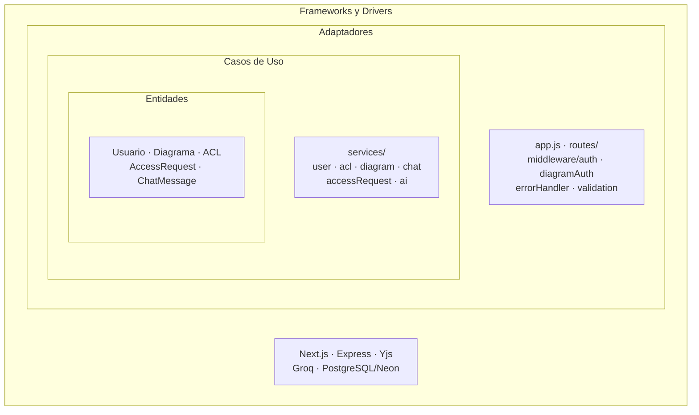

Las vistas de despliegue y procesos se presentan más adelante como **apoyo operativo** para describir la ejecución del sistema, no como estilos rectores. La estructura de dependencias se documenta en la sección 1.8.6.

La decisión central de datos se mantiene: **Yjs es el estado canónico del grafo** y PostgreSQL conserva el snapshot durable. React Flow es una proyección de la vista, no la fuente de verdad.

### 1.8.1. Arquitectura del Backend (Node.js)

El backend implementa **Clean Architecture en capas** con dependencias dirigidas hacia el dominio y la persistencia, sin introducir capas vacías. La composición se concentra en dos puntos de entrada: `server.js` para el ciclo de vida del proceso y `app.js` para la aplicación HTTP.

| Capa | Archivos | Responsabilidad | Depende de |
|---|---|---|---|
| Infraestructura / Rutas | `app.js`, `routes/auth.js`, `routes/diagrams.js`, `routes/acl.js`, `routes/accessRequests.js`, `routes/ai.js` | Montar Express, validar entrada HTTP y construir respuestas | Servicios, middleware |
| Adaptadores / Middlewares | `middleware/auth.js`, `middleware/diagramAuth.js`, `middleware/errorHandler.js`, `middleware/upload.js` | JWT, ACL por diagrama, errores uniformes y carga de archivos | Servicios, `errors.js` |
| Casos de Uso / Servicios | `services/userService.js`, `aclService.js`, `diagramService.js`, `chatService.js`, `accessRequestService.js`, `aiService.js` | Reglas de negocio, transacciones, snapshots, permisos, memoria y prompts | Persistencia, utilidades |
| Persistencia / Repositorios | `db.js`, `scripts/` y SQL parametrizado por servicio | Pool, transacciones, migraciones y consultas a PostgreSQL/Neon | `pg` |
| Soporte transversal | `realtime/yjs.js`, `validation.js`, `errors.js`, `generator/` | WebSocket Yjs, validación runtime, errores y generación Spring Boot | Casos de uso y persistencia |

La capa de persistencia se concentra en `db.js` para el pool y las transacciones; las consultas parametrizadas viven junto al caso de uso que las necesita. Esto mantiene una frontera explícita: cambiar el motor de base de datos exige adaptar `db.js` y el SQL de persistencia, pero no los contratos de `routes/` ni las reglas de `services/`.

**Principios aplicados:**

- **Regla de dependencia:** `routes/` → `services/` → `db.js` → PostgreSQL. Ninguna flecha apunta hacia afuera.
- **SRP:** `server.js` compone el proceso; `app.js` compone HTTP; `realtime/yjs.js` encapsula la colaboración; `aiService` encapsula los proveedores de IA.
- **DIP:** las rutas dependen de funciones de servicio, no de `pg`; la configuración de la base se resuelve en `db.js`.
- **OCP:** agregar un endpoint implica una ruta y un servicio, sin modificar el bootstrap.
- **Cohesión alta:** cada servicio agrupa un único agregado (usuario, ACL, diagrama, chat, solicitudes, IA).
- **Acoplamiento bajo:** el dominio no conoce Express ni el formato HTTP; los errores de negocio se expresan con `AppError`.

#### Race Condition de Yjs

`y-websocket` crea el `Y.Doc` mediante `getYDoc()` y ejecuta `persistence.bindState()` de forma asíncrona. Si `setupWSConnection()` se llamara inmediatamente, el cliente podría enviar su *sync step 1* antes de que el snapshot de PostgreSQL se hubiera aplicado, escribiendo sobre un documento vacío o generando una pérdida de estado.

La solución implementada en `realtime/yjs.js` es una barrera de preparación:

1. `wss.on('connection')` ejecuta `ws.pause()` antes de cualquier `await`.
2. Se valida el JWT, el rol ACL y la existencia del diagrama.
3. `ensureDocumentReady()` crea o recupera el `Y.Doc` y espera `ydoc.readyPromise`.
4. Si la carga del snapshot falla, se cierra con `1011` y no se permite escritura.
5. Solo entonces se ejecuta `setupWSConnection()` y `ws.resume()`.

Además, `bindState` espera cualquier `writeState` pendiente y `writeState` espera `readyPromise`, evitando que una nueva conexión cargue un snapshot anterior mientras la conexión previa todavía está persistiendo el suyo.

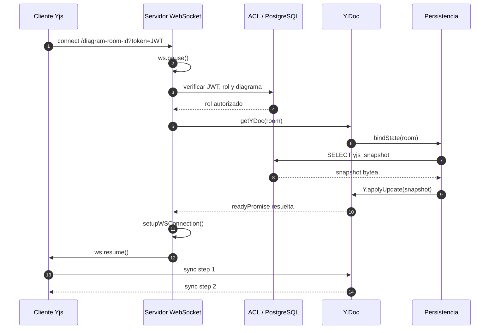

### 1.8.2. Arquitectura del Frontend (Next.js)

El frontend usa **Next.js 16 con App Router**, React 19, React Flow y Yjs Client. La organización separa páginas, componentes de presentación, hooks de aplicación y utilidades puras.

- `app/diagram/[id]/page.tsx` actúa como orquestador de la pantalla: compone Toolbar, Sidebar, ChatPanel, MembersPanel y React Flow.
- `hooks/useCollaborativeFlow.ts` encapsula `Y.Doc`, `WebsocketProvider`, presencia, chat y mutaciones del grafo.
- `hooks/useAICommand.ts` controla el comando de texto, voz e imagen.
- `hooks/useDiagramMembers.ts` encapsula la API de miembros; `MembersPanel` queda como vista.
- `ChatPanel` y `Toolbar` son componentes controlados por props: no ejecutan fetch ni aplican reglas de negocio.
- `lib/apiClient.ts` centraliza el token, `API_BASE` y las peticiones autenticadas.

El acoplamiento se controla mediante contratos en `types/diagram.ts` y utilidades puras (`nodesToAST`, `applyMutations`, helpers Yjs). La deuda pendiente es la extracción adicional del orquestador de página en hooks de catálogo, acciones y exportación; se documenta en la sección de limitaciones.

### 1.8.3. Arquitectura de Datos

La persistencia usa **PostgreSQL en Neon** con TLS y un pool acotado (`PG_POOL_MAX`, por defecto 10). El modelo se sectoriza lógicamente en tres esquemas:

| Esquema | Tablas | Responsabilidad |
|---|---|---|
| `auth` | `users`, `diagram_acl` | Identidad, credenciales y autorización por diagrama |
| `core` | `diagrams` | Metadatos del diagrama y snapshot Yjs (`bytea`) |
| `chat` | `messages` | Historial durable del asistente y del chat colaborativo |

La sectorización reduce el acoplamiento entre identidad, colaboración y conversación. Las operaciones que afectan a más de una tabla usan `withTransaction`:

- creación de diagrama + ACL `OWNER` en una sola transacción;
- borrado de ACL + diagrama;
- reemplazo completo de ACL.

El grafo vivo no se normaliza: se serializa con `Y.encodeStateAsUpdate` y se guarda en `core.diagrams.yjs_snapshot`. El chat sí se normaliza en `chat.messages` para consultas, memoria de IA y auditoría. Esta separación evita descomponer un CRDT en filas y preserva sus relojes lógicos.

### 1.8.4. Vista de despliegue

> La vista de despliegue responde dónde se ejecuta cada nodo; el estilo rector sigue siendo Clean Architecture.

| Nodo | Plataforma | Responsabilidad | Consideración |
|---|---|---|---|
| Frontend | Vercel | Servir Next.js, assets y rutas de la aplicación | Variables `NEXT_PUBLIC_*` |
| Backend | Railway | Express, WebSocket Yjs, IA y generación ZIP | Requiere proceso persistente y WebSocket |
| Base de datos | Neon | PostgreSQL administrado con TLS | Pool, respaldos y latencia |
| IA | Groq | Texto, voz y visión | Dependencia externa con timeout y errores controlados |

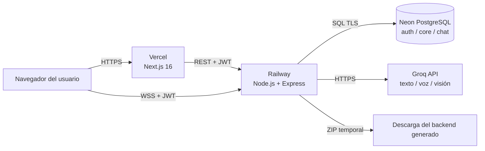

El backend no puede desplegarse como función serverless pura porque mantiene documentos Yjs en memoria y un WebSocket persistente. Por ello Railway es el nodo adecuado. La limitación de escalado horizontal se documenta en la sección 13.

### 1.8.5. Diagrama de Componentes

```mermaid
flowchart TB
    subgraph Cliente["Cliente / Navegador"]
        UI["Next.js App Router<br/>React 19 + React Flow"]
        HOOKS["Hooks de aplicación<br/>useCollaborativeFlow<br/>useAICommand<br/>useDiagramMembers"]
        YCLIENT["Y.Doc + WebsocketProvider"]
    end

    subgraph Vercel["Vercel"]
        NEXT["Frontend Next.js<br/>/login /dashboard /diagram/:id"]
    end

    subgraph Railway["Railway"]
        APP["app.js<br/>Express + CORS + JSON"]
        ROUTES["routes/<br/>auth · diagrams · acl · ai"]
        SERVICES["services/<br/>user · acl · diagram · chat · ai"]
        REALTIME["realtime/yjs.js<br/>ws.pause + readyPromise"]
        ERRORS["errors.js + errorHandler"]
        GEN["generator/<br/>Spring Boot + ZIP"]
    end

    subgraph Neon["Neon PostgreSQL"]
        AUTH[("auth.users<br/>auth.diagram_acl")]
        CORE[("core.diagrams<br/>yjs_snapshot bytea")]
        CHAT[("chat.messages")]
    end

    GROQ["Groq API"]

    UI --> NEXT
    HOOKS --> UI
    YCLIENT <-->|WSS + JWT| REALTIME
    NEXT -->|REST + JWT| APP
    APP --> ROUTES
    ROUTES --> SERVICES
    ROUTES --> ERRORS
    SERVICES --> AUTH
    SERVICES --> CORE
    SERVICES --> CHAT
    REALTIME --> CORE
    REALTIME --> CHAT
    SERVICES -->|HTTPS| GROQ
    ROUTES --> GEN
```

> La sección 1.8 define el estilo principal: **Clean Architecture en capas**. Las secciones 5 a 9 descomponen la implementación por capa (frontend, backend, datos, IA y despliegue). Las vistas de despliegue (1.8.4) y procesos (1.8.7) son apoyo operativo y no sustituyen la regla de dependencia.

### 1.8.6. Dependencia unidireccional de capas

La arquitectura se expresa como un flujo de dependencias, no como un modelo de datos: cada capa solo conoce la inmediatamente inferior. El modelo de clases persistente se conserva en `04_Diseno_UML.md` y en el diagrama `Modelo de Dominio - CASE` de Enterprise Architect.

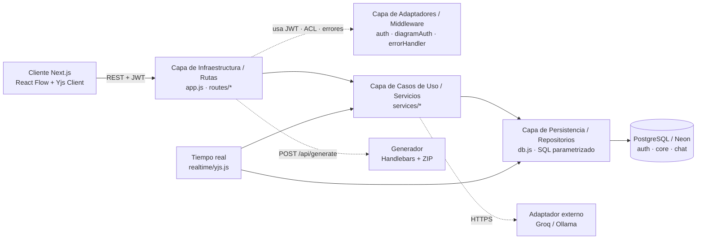

`routes/` no importa `pg`, `services/` no importa `express` y `db.js` no conoce HTTP. Por eso el motor PostgreSQL puede reemplazarse adaptando `db.js` y las consultas de persistencia, mientras los contratos de las rutas y las reglas de los casos de uso permanecen estables. La separación entre `ChatMessage` y el snapshot Yjs también es deliberada: el chat se normaliza para memoria y auditoría, mientras el grafo se conserva como CRDT binario.

### 1.8.7. Vista de procesos y concurrencia

> La vista de procesos describe concurrencia en tiempo de ejecución; no sustituye la separación de capas.

La vista de procesos modela la concurrencia de dos clientes y la coordinación del backend. Yjs resuelve la convergencia; el servidor WebSocket autentica, sincroniza y persiste snapshots; PostgreSQL conserva el estado durable.

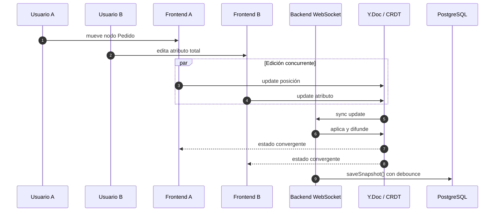

El servidor no ordena las operaciones del grafo: delega la convergencia al CRDT y usa `ws.pause()` + `readyPromise` para garantizar que el snapshot se cargue antes de aceptar escrituras. El debounce de 2 segundos reduce la presión sobre Neon.

### 1.8.8. Escenarios (casos de uso)

| CU | Escenario | Componentes principales |
|---|---|---|
| CU-01 | Autenticarse | `routes/auth.js`, `userService`, `AuthContext` |
| CU-02 | Gestionar diagramas | `routes/diagrams.js`, `diagramService`, dashboard |
| CU-03 | Editar colaborativamente | `useCollaborativeFlow`, `realtime/yjs.js` |
| CU-04 | Gestionar miembros | `MembersPanel`, `useDiagramMembers`, `aclService` |
| CU-05 | Exportar/importar | `Toolbar`, utilidades JSON/XMI |
| CU-06 | Interactuar con el Agente IA | `ChatPanel`, `useAICommand`, `aiService` |
| CU-07 | Generar backend Spring Boot | `routes/ai.js`, `generator/generate.js` |
| CU-08 | Consultar manual | `HelpModal`, `useHelpModal`, `data/manual.ts` |

Cada escenario atraviesa las capas de Clean Architecture: la ruta adapta la petición, el middleware aplica identidad/ACL, el servicio ejecuta el caso de uso y `db.js` persiste el cambio. Las vistas de procesos y despliegue de 1.8.4 y 1.8.7 describen operación y concurrencia, no la estructura principal del diseño.

### 1.8.9. Diagrama de paquetes

La estructura de carpetas mantiene separados el cliente, el backend por capas y la documentación.

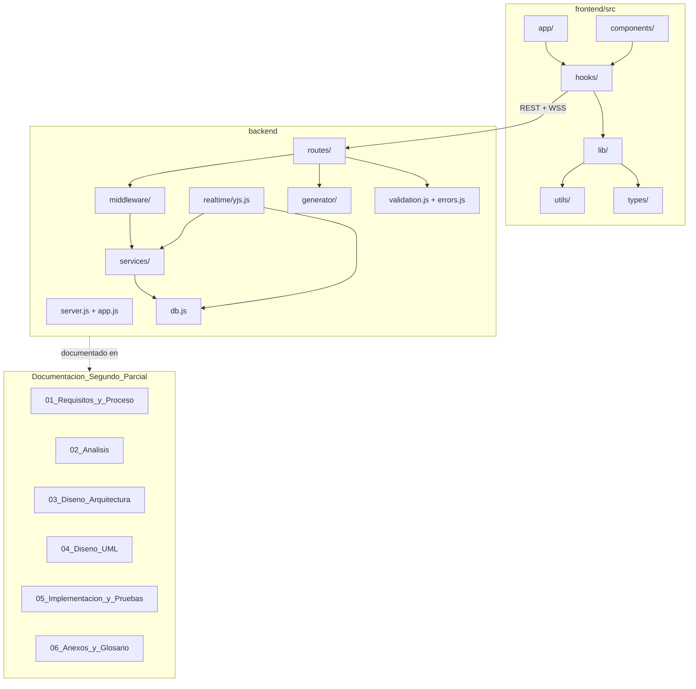

La carpeta `routes/` concentra la infraestructura HTTP, `middleware/` los adaptadores de seguridad/errores, `services/` los casos de uso y `db.js` la persistencia. El frontend se comunica solo con `routes/`; no conoce `db.js` ni los detalles de PostgreSQL.

### 1.9. Patrón Strategy y Configuración BYOK

El asistente IA soporta dos proveedores intercambiables mediante el patrón **Strategy**:

- **Groq (nube):** API compatible con OpenAI, autenticada con `GROQ_API_KEY`.
- **Ollama (local):** API compatible con OpenAI en `OLLAMA_URL`, con `OLLAMA_MODEL`.

`aiService.js` resuelve el proveedor por petición (`groq` u `ollama`) sin mutar `process.env`, evitando condiciones de carrera entre usuarios. Si no se envía una preferencia, se usa `AI_PROVIDER` como valor por defecto.

La configuración BYOK se divide deliberadamente en dos planos:

| Dato | Ubicación | Motivo |
|---|---|---|
| Proveedor, `ollamaUrl`, `ollamaModel` | `localStorage` del navegador | Son preferencias no secretas y deben persistir entre recargas |
| `GROQ_API_KEY` | Variables de entorno del backend | Nunca se expone al navegador; evita robo por XSS o inspección del cliente |
| `JWT_SECRET`, `DATABASE_URL` | Variables de entorno del backend | Secretos de infraestructura |

El modal **Configuración Avanzada de IA** envía `provider`, `ollamaUrl` y `ollamaModel` al endpoint `/api/ai/command`. El backend valida que la URL sea `http://` o `https://` y la usa solo para esa petición. La clave de Groq jamás viaja al frontend: el navegador solo elige el motor y, si aplica, la URL/modelo local.

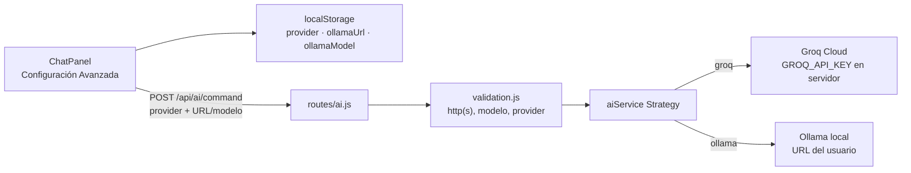

### 1.10. Integración con el Ecosistema Local (Service Discovery)

La integración con Ollama incorpora un mecanismo de **Service Discovery** limitado: el frontend no asume qué modelos están instalados; el backend consulta el catálogo del proveedor local y lo devuelve a la interfaz.

Flujo:

1. El usuario escribe la URL base de Ollama en **Configuración Avanzada de IA**.
2. El frontend llama a `GET /api/ai/ollama-models?url=...`, un endpoint protegido por JWT.
3. El backend valida la URL con `validateOllamaUrl`: solo `http://` o `https://`, URL parseable, host presente, longitud máxima y sin credenciales embebidas.
4. Se elimina el sufijo `/v1` de la URL porque `/v1` pertenece a la API OpenAI-compatible; el catálogo nativo de Ollama vive en `/api/tags`.
5. El backend ejecuta `GET {base}/api/tags`, extrae `models[].name`, elimina duplicados y devuelve un arreglo de strings.
6. Si `localhost` falla, se intenta `127.0.0.1` como fallback para entornos donde Ollama solo escucha en IPv4.
7. Si la conexión falla, se devuelve `503` con un mensaje descriptivo; el frontend lo muestra en el modal.

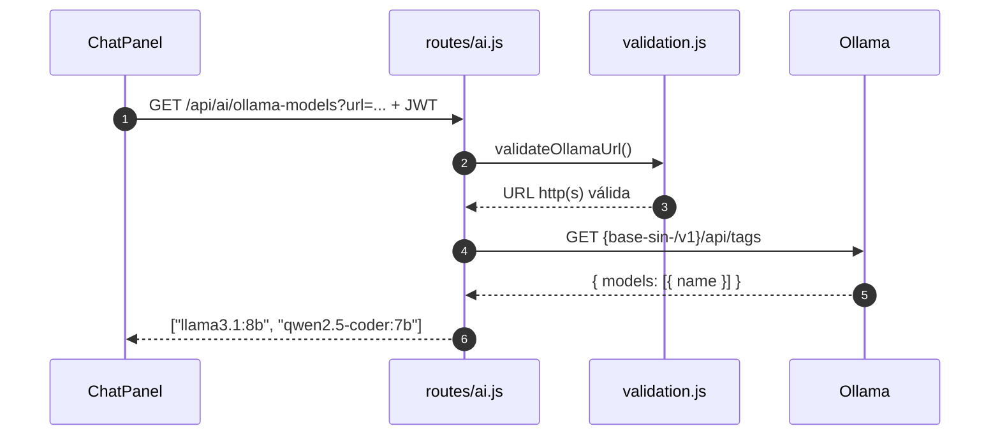

**Prevención de SSRF:** la validación restringe protocolos, rechaza credenciales en la URL y limita el tamaño. El diseño permite explícitamente hosts locales o túneles privados porque el caso de uso es conectar Ollama; por ello la URL debe ser elegida por el usuario y no construirse desde datos no confiables. La petición se ejecuta server-side, con timeout de 7 segundos y sin exponer la respuesta cruda del proveedor.

## 1.11. Modelo C4 de la Arquitectura

El modelo C4 describe la arquitectura desde el contexto hasta el código. Los niveles 1–3 se documentan aquí; el nivel 4 se materializa en el modelo de clases de `04_Diseno_UML.md`.

### 1.11.1. C4 Nivel 1: Contexto del sistema

El Sistema CASE es usado por tres actores humanos y depende de proveedores externos de IA y de PostgreSQL. Groq y Ollama no son actores que inician casos de uso: son sistemas externos consumidos por el backend.

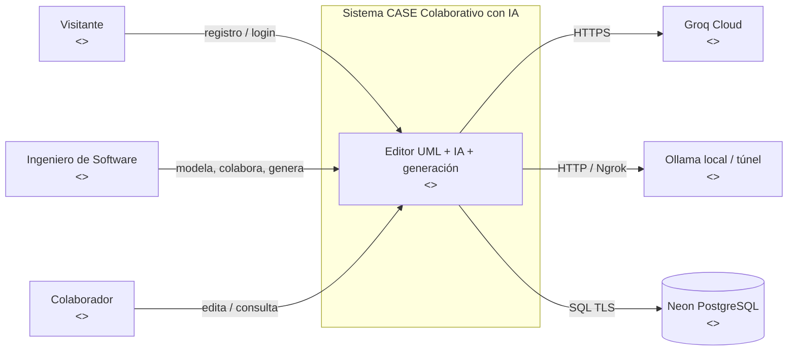

### 1.11.2. C4 Nivel 2: Contenedores

El frontend se ejecuta en Vercel; el backend REST + WebSocket en Railway; PostgreSQL en Neon; y la inferencia puede usar Groq Cloud u Ollama. La base de datos conserva usuarios, ACL, snapshots y chat.

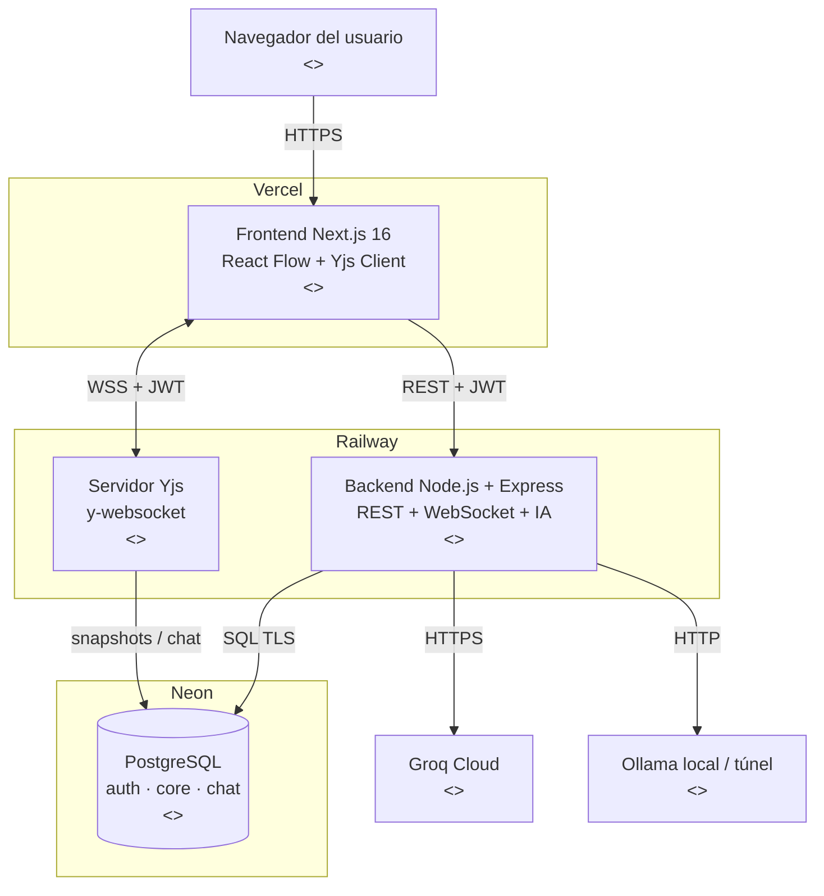

### 1.11.3. C4 Nivel 3: Componentes

Dentro del backend, las rutas adaptan HTTP; el middleware aplica identidad, ACL y errores; los servicios ejecutan los casos de uso; `db.js` encapsula la persistencia; y el WebSocket reutiliza los servicios y la persistencia.

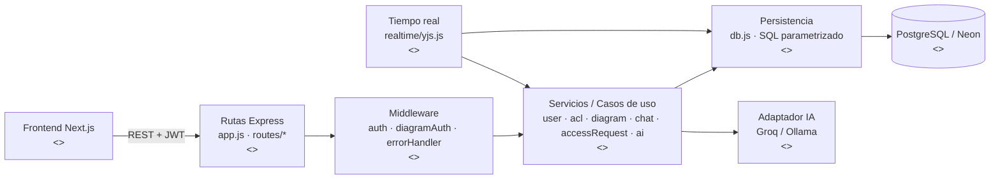

### 1.11.4. C4 Nivel 4: Código y clases

El nivel 4 se documenta con los diagramas de clases de `04_Diseno_UML.md`: modelo de dominio, DTOs, repositorios y clases del backend Spring Boot generado. La regla se mantiene: las clases de dominio no dependen de Express ni de `pg`.

### 1.11.5. Decisión: monolito modular

Se adopta un **monolito modular** y no microservicios. El backend es un único proceso Node que sirve REST y WebSocket, pero su código se separa en capas y módulos por dominio (`auth`, `core`, `chat`, `access_requests`, `ai`, `generator`). Esto reduce complejidad operativa, evita latencia entre servicios y conserva la posibilidad de extraer módulos en el futuro. La separación se demuestra en el nivel 3 y en la estructura de paquetes.

## 2. Objetivos arquitectónicos

1. **Colaboración sin conflictos manuales.** Yjs aporta convergencia eventual mediante un CRDT, sin un servidor central que ordene operaciones.
2. **Persistencia duradera.** PostgreSQL conserva el snapshot del documento, los usuarios, las ACL y el historial del chat.
3. **Identidad verificable.** El backend obtiene el usuario desde el JWT, no desde datos enviados por el cliente.
4. **Memoria contextual del asistente.** La IA recibe los últimos mensajes persistidos del diagrama para mantener continuidad.
5. **Separación de responsabilidades.** Frontend, API, dominio, persistencia y generación tienen límites claros.
6. **Despliegue independiente.** El frontend puede publicarse en Vercel y el backend con WebSocket en un servicio Node persistente.
7. **Degradación controlada.** El modo `AUTH_ENABLED=false` permite desarrollo y demostración sin autenticación, sin borrar las validaciones del código.

## 3. Requisitos arquitectónicamente significativos

| Código | Requisito | Decisión arquitectónica |
|---|---|---|
| RAS-01 | Varios usuarios editan el mismo diagrama | Yjs + `y-websocket`; estado canónico replicado |
| RAS-02 | Los cambios deben sobrevivir a la desconexión | Snapshot Yjs en `core.diagrams.yjs_snapshot` |
| RAS-03 | Cada diagrama tiene propietario y roles | ACL en `auth.diagram_acl` y gates HTTP/WS |
| RAS-04 | La IA debe dirigirse al usuario correcto | Identidad derivada del JWT en el backend |
| RAS-05 | La IA debe recordar la conversación | Historial de `chat.messages` inyectado en el prompt |
| RAS-06 | El chat debe ser colaborativo | Respuesta emitida al `Y.Array('chat')` de la sala |
| RAS-07 | El sistema debe generar un backend ejecutable | Generador con Handlebars y plantillas Spring Boot |
| RAS-08 | El frontend y el backend se despliegan por separado | REST + WebSocket con URLs configurables |
| RAS-09 | No se deben exponer credenciales | Secretos fuera de git y hash bcrypt para contraseñas |

## 4. Estilo arquitectónico

El estilo principal del backend es **Clean Architecture expresada como arquitectura en capas**:

- **Infraestructura/Rutas:** `app.js` y `routes/` adaptan HTTP a los casos de uso.
- **Adaptadores/Middlewares:** `middleware/` resuelve JWT, ACL, errores y archivos.
- **Casos de Uso/Servicios:** `services/` concentra reglas de negocio, transacciones y coordinación.
- **Persistencia/Repositorios:** `db.js` encapsula pool, transacciones y el acceso a PostgreSQL/Neon.

La regla es unidireccional: `Ruta → Servicio → Repositorio → Base de Datos`. Las capas externas pueden cambiar sin reescribir las reglas internas; por ejemplo, reemplazar PostgreSQL exige adaptar `db.js` y el SQL de persistencia, no los contratos de `routes/` ni los casos de uso de `services/`.

Sobre esa base se añaden dos preocupaciones complementarias:

- **CRDT y eventos** para la edición colaborativa en tiempo real (`realtime/yjs.js`).
- **Persistencia híbrida** para separar el grafo vivo en Yjs del snapshot durable en PostgreSQL.

No se trata de una arquitectura de microservicios. El backend es un único proceso Node que sirve REST y WebSocket sobre el mismo servidor HTTP. Esta decisión reduce la complejidad operativa, evita problemas de CORS entre APIs y simplifica el desarrollo local. La separación interna se mantiene por capas, con dependencias dirigidas hacia el dominio y la persistencia.

## 5. Arquitectura del frontend

### 5.1 Tecnologías

| Tecnología | Uso |
|---|---|
| Next.js 16 | App Router, rutas `/login`, `/register`, `/dashboard`, `/diagram/[id]` |
| React 19 | Componentes de interfaz y composición de hooks |
| React Flow 11 | Canvas, nodos, aristas, selección, zoom y minimapa |
| Yjs 13 | Documento colaborativo y tipos compartidos |
| y-websocket 1.4 | Sincronización del documento y awareness |
| Tailwind CSS 4 | Estilos y sistema de diseño |
| TypeScript | Contratos de dominio y verificación estática |

### 5.2 Organización

```text
frontend/src/
├── app/                 Rutas y páginas
├── components/          Canvas, paneles, toolbar, chat y ayuda
├── contexts/            AuthContext
├── hooks/               Colaboración, IA, roles, bloqueos y sesión
├── lib/                 Cliente HTTP con JWT y presencia
├── utils/               AST, helpers Yjs, XMI, aristas y asociación
├── types/               Contratos TypeScript
└── styles/              Design system
```

### 5.3 Flujo de estado

1. `useCollaborativeFlow` crea el `Y.Doc`, el `WebsocketProvider` y los mapas `nodes`, `edges` y `chat`.
2. La página del editor carga el diagrama mediante REST.
3. El snapshot se aplica a Yjs en una sola transacción.
4. `observeDeep` detecta cambios y reconstruye los arreglos de React Flow.
5. Las acciones del usuario escriben en Yjs, no directamente en el estado canónico de React.

```text
Acción del usuario
      │
      ▼
Hook / utilidad Yjs
      │  set/update en Y.Map
      ▼
Y.Doc local ── update ──► WebSocket ──► otros clientes
      │
      └── observeDeep ──► setNodes / setEdges ──► React Flow
```

### 5.4 Presencia y soft-lock

La presencia no se persiste. Se publica en `awareness`:

- `user`: identidad visible, color y nombre.
- `editing`: nodo seleccionado y timestamp.

Los bloqueos visuales expiran a los 30 segundos. Un nodo bloqueado por otro usuario no es arrastrable, pero el bloqueo es visual y no transaccional.

## 6. Arquitectura del backend

### 6.1 Tecnologías

| Tecnología | Uso |
|---|---|
| Node.js 20+ | Runtime |
| Express | API REST |
| `ws` + `y-websocket` | Servidor WebSocket y protocolo Yjs |
| `pg` | Pool PostgreSQL |
| `jsonwebtoken` | Firma y verificación JWT |
| `bcryptjs` | Hash de contraseñas |
| `multer` | Carga de audio e imágenes en memoria |
| Handlebars | Plantillas del backend generado |
| Archiver | Empaquetado ZIP |

### 6.2 Capas internas (Clean Architecture)

| Capa | Archivos | Responsabilidad |
|---|---|---|
| Bootstrap / composición | `server.js` | Entorno, HTTP, base de datos, señales y apagado |
| Infraestructura / Rutas | `app.js`, `routes/*` | Componer Express, exponer endpoints y adaptar HTTP |
| Adaptadores / Middlewares | `middleware/auth.js`, `middleware/diagramAuth.js`, `middleware/errorHandler.js`, `middleware/upload.js` | JWT, ACL, errores y archivos |
| Casos de Uso / Servicios | `services/*` | Reglas de usuarios, ACL, diagramas, chat, solicitudes e IA |
| Persistencia / Repositorios | `db.js`, `scripts/` | Pool SQL, transacciones, migraciones y consultas |
| Soporte | `realtime/yjs.js`, `generator/`, `validation.js`, `errors.js` | WebSocket, generación, validación y errores |

La dirección de dependencia es `routes/` → `services/` → `db.js` → PostgreSQL. La capa de persistencia no conoce Express y las rutas no ejecutan SQL. El backend mantiene los documentos Yjs en memoria mientras una sala está activa, pero la fuente durable del grafo es el snapshot persistido. La escritura del snapshot se realiza con debounce de 2 segundos, y el chat se guarda en `chat.messages`.

### 6.3 Servidor único para REST y WebSocket

`server.js` crea el `http.Server` y adjunta el WebSocket; `app.js` compone Express y `realtime/yjs.js` encapsula Yjs. Esto permite:

- Un solo puerto (`1234` por defecto).
- Un solo proceso en desarrollo.
- Autenticación coherente para HTTP y WebSocket.
- Menos configuración de red y CORS.

El WebSocket usa el room `diagram-room-<id>` y recibe el token mediante `?token=`. El servidor aplica un gate de acceso antes de entregar la conexión a `setupWSConnection`.

## 7. Arquitectura de datos

### 7.1 Persistencia híbrida

| Estado | Ubicación | Motivo |
|---|---|---|
| Grafo vivo | `Y.Doc` en clientes y servidor | Colaboración en tiempo real |
| Snapshot del grafo | `core.diagrams.yjs_snapshot` | Durabilidad del estado CRDT |
| Metadatos | `core.diagrams` | Nombre, propietario y fechas |
| Usuarios | `auth.users` | Identidad y credenciales |
| Permisos | `auth.diagram_acl` | Roles por diagrama |
| Chat durable | `chat.messages` | Memoria de IA e historial |
| Presencia | `awareness` | Estado efímero, no persistente |

### 7.2 Sectorización por esquemas

La base se dividió en tres esquemas:

- **`auth`:** usuarios y control de acceso.
- **`core`:** diagramas y snapshots.
- **`chat`:** mensajes del asistente y de usuarios.

La sectorización evita mezclar responsabilidades y permite razonar sobre permisos y respaldo por dominio. Además, aísla las tablas del proyecto de otras tablas existentes en el esquema `public` de la base Neon compartida.

### 7.3 Snapshot Yjs

El grafo no se descompone en tablas de nodos y aristas. Se guarda como `bytea` porque:

- Yjs ya contiene la estructura, los identificadores y los relojes lógicos.
- Se evita duplicar el modelo CRDT en SQL.
- La rehidratación es directa mediante `Y.applyUpdate`.
- Los conteos para el dashboard se obtienen decodificando el snapshot.

Esta decisión es deliberada: PostgreSQL conserva el documento, no reemplaza al CRDT.

## 8. Arquitectura del asistente IA

### 8.1 Componentes

```text
ChatPanel
   │
   ▼
useAICommand
   ├─ nodesToAST: convierte el canvas en un AST de entidades y relaciones
   ├─ apiFetch: adjunta el JWT
   └─ applyMutations: aplica cambios en el orden permitido
          │
          ▼
POST /api/ai/command
   ├─ requireAuth: obtiene userId y username del token
   ├─ chatService.getRecentMessages: últimos 15 mensajes del diagrama
   ├─ chatService.addMessage: persiste el mensaje del usuario
   ├─ getMutationsFromAI: construye prompt y llama a Groq
   ├─ chatService.addMessage: persiste la respuesta del asistente
   └─ emitChatMessage: publica la respuesta en Yjs
          │
          ▼
Groq API
```

### 8.2 Identidad

El nombre del usuario se extrae de `req.user.username`, que proviene del JWT verificado. El cliente no puede imponer otro nombre en el cuerpo de la petición. El prompt exige que la respuesta comience con el nombre del usuario.

### 8.3 Memoria contextual

La memoria se obtiene de `chat.messages` con `getRecentMessages(diagramId, 15)`:

1. La subconsulta selecciona los 15 mensajes más recientes.
2. El `ORDER BY` exterior los devuelve en orden cronológico ascendente.
3. El backend los formatea y los incluye en el prompt.
4. Los mensajes se limitan y se recortan para controlar el tamaño del contexto.

La memoria autoritativa está en PostgreSQL. El frontend no envía el historial, lo que evita manipulación y duplicación de estado.

### 8.4 Chat colaborativo

La respuesta del asistente se persiste y, además, se emite al chat Yjs de la sala. El frontend solo agrega la respuesta localmente si el backend no pudo emitirla, usando `chatEmitted` para evitar duplicados. Así, todos los participantes ven la intervención de la IA.

### 8.5 Contrato de mutaciones

La IA no modifica el canvas directamente. Devuelve un JSON con:

- `response`: explicación o confirmación dirigida al usuario.
- `mutations`: lista ordenada de acciones.

Acciones permitidas:

- `addEntity`
- `addAttribute`
- `addRelationship`
- `removeEntity`
- `removeRelationship`

El orden obligatorio es: entidades, atributos, relaciones y eliminaciones. Esto evita referencias a nodos que todavía no existen.

## 9. Arquitectura de despliegue

```text
┌──────────────────────┐        HTTPS         ┌──────────────────────┐
│ Navegador            │ ───────────────────► │ Vercel               │
│ Next.js cliente      │                      │ Frontend Next.js     │
└──────────┬───────────┘                      └──────────────────────┘
           │
           │ REST + WebSocket
           ▼
┌──────────────────────┐        SQL/TLS      ┌──────────────────────┐
│ Railway              │ ───────────────────► │ Neon PostgreSQL      │
│ Backend Node         │                      │ auth / core / chat   │
│ Express + WS         │                      └──────────────────────┘
└──────────┬───────────┘
           │ HTTPS
           ▼
┌──────────────────────┐
│ Groq API             │
│ texto, voz, visión   │
└──────────────────────┘
```

### 9.1 Decisiones de despliegue

- **Vercel para el frontend:** optimizado para Next.js y para el build del App Router.
- **Railway para el backend:** necesita un proceso persistente y conexiones WebSocket abiertas; un entorno serverless tradicional no es adecuado para `y-websocket`.
- **Neon para PostgreSQL:** base administrada con TLS, branching y conexión compatible con `pg`.
- **Groq para IA:** API compatible con OpenAI, sin SDK propio, invocada con `fetch`.

### 9.2 Variables de entorno

| Servicio | Variables |
|---|---|
| Backend | `DATABASE_URL`, `GROQ_API_KEY`, `GROQ_MODEL`, `GROQ_VISION_MODEL`, `JWT_SECRET`, `JWT_EXPIRATION`, `AUTH_ENABLED`, `PORT` |
| Frontend | `NEXT_PUBLIC_API_URL`, `NEXT_PUBLIC_WS_URL` |

`DATABASE_URL` y las claves se guardan en `backend/.env.local` o en el gestor de secretos del proveedor. Nunca se versionan.

## 10. Seguridad

### 10.1 Autenticación

- Registro con validación de username, email y contraseña.
- Hash con bcrypt y 10 rondas.
- JWT firmado con secreto de al menos 32 caracteres.
- Expiración configurable, por defecto `7d`.
- El token se envía en `Authorization: Bearer` para REST y en `?token=` para WebSocket.

### 10.2 Autorización

| Rol | Permisos |
|---|---|
| `OWNER` | Ver, editar, renombrar, eliminar y administrar miembros |
| `EDITOR` | Ver y editar |
| `VIEWER` | Solo ver |

Los roles se consultan en `auth.diagram_acl`. El WebSocket es fail-closed: sin token responde `4401`; sin rol responde `4403`.

### 10.3 Protección de datos

- El `password_hash` nunca se devuelve en las respuestas.
- Los identificadores de diagrama se sanean antes de usarse en rutas y consultas.
- Las consultas usan parámetros, no concatenación de SQL.
- Los archivos de audio e imagen se procesan en memoria con límite de 10 MB.
- Las credenciales no se incluyen en la documentación ni en el repositorio.

## 11. Atributos de calidad

| Atributo | Evaluación |
|---|---|
| Colaboración | Alta: convergencia CRDT y chat compartido |
| Durabilidad | Alta para snapshots y chat; depende del proveedor |
| Consistencia | Eventual en el grafo, fuerte en identidad y ACL |
| Escalabilidad | Moderada; un proceso WS y un pool de 10 conexiones |
| Mantenibilidad | Buena separación por capas y servicios |
| Seguridad | JWT, bcrypt y ACL; pendiente el read-only real en Yjs |
| Disponibilidad | Depende de Vercel, Railway, Neon y Groq |
| Observabilidad | Logs de errores; sin trazas distribuidas |

## 12. Decisiones arquitectónicas

| ID | Decisión | Justificación | Consecuencia |
|---|---|---|---|
| ADR-01 | Yjs como fuente de verdad del grafo | Convergencia sin servidor de operaciones | El grafo no se normaliza en SQL |
| ADR-02 | Snapshot binario en PostgreSQL | Simplicidad y fidelidad del CRDT | Menos consultas relacionales sobre nodos |
| ADR-03 | Chat durable en PostgreSQL | Memoria consistente para la IA | Se duplica el chat en Yjs y en SQL con fines distintos |
| ADR-04 | Identidad desde JWT | Evita suplantación | Requiere autenticación para usar la IA |
| ADR-05 | Historial de 15 mensajes | Contexto útil con costo controlado | No hay memoria ilimitada |
| ADR-06 | Respuesta IA emitida por Yjs | Todos los colaboradores la ven | Requiere manejar `chatEmitted` para no duplicar |
| ADR-07 | Backend único para REST y WS | Menos complejidad operativa | Un solo punto de fallo |
| ADR-08 | Esquemas `auth`, `core`, `chat` | Separación de dominios y aislamiento | Mayor disciplina en consultas y migraciones |

## 13. Limitaciones conocidas

- El bloqueo de nodos es visual, no transaccional.
- Un `VIEWER` no está aislado por completo a nivel de actualizaciones Yjs.
- La IA depende de Groq y de la disponibilidad de red.
- El historial se limita a 15 mensajes y a un recorte de caracteres.
- La generación de backend cubre el modelo actual; no todo UML 2.5.
- El despliegue del backend requiere un host con WebSocket persistente.
- No hay observabilidad distribuida ni métricas de uso.

## 14. Referencias internas

- `README.md`
- `docs/FLUJOS_Y_ARQUITECTURA.md`
- `frontend/src/hooks/useCollaborativeFlow.ts`
- `frontend/src/hooks/useAICommand.ts`
- `frontend/src/hooks/useDiagramMembers.ts`
- `backend/server.js`
- `backend/app.js`
- `backend/realtime/yjs.js`
- `backend/errors.js`
- `backend/middleware/errorHandler.js`
- `backend/db.js`
- `backend/services/aiService.js`
- `backend/services/chatService.js`
- `backend/services/diagramService.js`
- `backend/services/aclService.js`
- `backend/services/userService.js`

Continuar con [[04_Diseno_UML]].
