# Diseño

## 1. Propósito y principios

El diseño traduce el análisis en una solución técnica concreta. Se rige por cinco principios:

1. **Separación de responsabilidades:** presentación, API, dominio, persistencia y generación no se mezclan.
2. **Estado canónico único:** el grafo vive en Yjs; React Flow es una vista derivada.
3. **Persistencia híbrida:** el documento CRDT se guarda como snapshot; los datos de negocio se normalizan en SQL.
4. **Seguridad en el servidor:** la identidad y los roles se verifican en el backend.
5. **Contratos explícitos:** los endpoints, mutaciones y esquemas tienen forma definida.

## 2. Diseño de despliegue

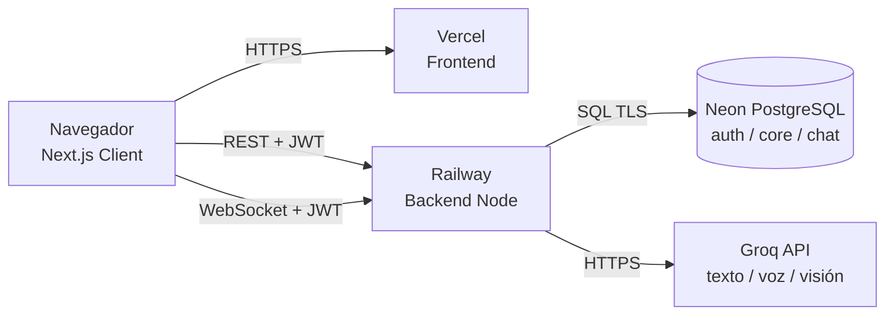

### 2.1 Nodos de despliegue

| Nodo | Tecnología | Responsabilidad |
|---|---|---|
| Cliente | Navegador moderno | Interfaz, Yjs, React Flow, chat |
| Frontend | Vercel + Next.js | Entrega de páginas y assets |
| Backend | Railway + Node.js | REST, WebSocket, IA y generación |
| Base de datos | Neon PostgreSQL | Persistencia durable |
| IA | Groq API | Inferencia de texto, audio y visión |

### 2.2 Comunicaciones

| Origen | Destino | Protocolo | Autenticación |
|---|---|---|---|
| Navegador | Frontend | HTTPS | Sesión del navegador |
| Navegador | Backend | HTTPS REST | `Authorization: Bearer` |
| Navegador | Backend | WebSocket | `?token=` |
| Backend | Neon | PostgreSQL TLS | `DATABASE_URL` |
| Backend | Groq | HTTPS | `GROQ_API_KEY` |

### 2.3 Configuración

El frontend usa `NEXT_PUBLIC_API_URL` y `NEXT_PUBLIC_WS_URL`. El backend usa `PORT`, `DATABASE_URL`, `JWT_SECRET`, `AUTH_ENABLED`, `GROQ_API_KEY`, `GROQ_MODEL` y `GROQ_VISION_MODEL`.

## 3. Diseño de componentes

### 3.1 Frontend

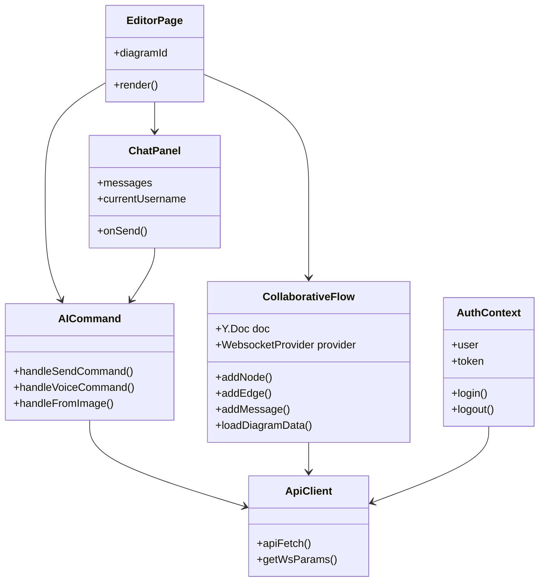

### 3.2 Backend

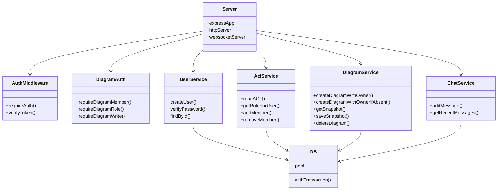

### 3.3 Responsabilidades

| Componente | Responsabilidad | No debe hacer |
|---|---|---|
| `server.js` | Bootstrap: entorno, HTTP, PostgreSQL, señales y apagado | Definir rutas o lógica de negocio |
| `app.js` | Componer Express, CORS, JSON, salud y rutas | Escuchar puertos o abrir WebSockets |
| `realtime/yjs.js` | WebSocket, snapshots, autenticación WS y chat Yjs | Validar cuerpos REST |
| `routes/auth.js` | Registro, login, sesión | Acceder directamente a SQL |
| `routes/diagrams.js` | CRUD de diagramas y chat inicial | Crear ACL sin transacción |
| `routes/ai.js` | Orquestar comandos, voz, imagen y generación | Construir prompts o llamar Groq directamente |
| `routes/acl.js` | Gestionar miembros | Modificar el grafo |
| `middleware/auth.js` | Verificar JWT | Decidir roles de diagrama |
| `middleware/diagramAuth.js` | Validar membresía y rol | Persistir datos |
| `middleware/errorHandler.js` | Formato único de errores y 404 | Conocer reglas de negocio |
| `userService` | Usuarios y contraseñas | Firmar tokens |
| `aclService` | ACL y roles | Guardar snapshots |
| `diagramService` | Diagramas y snapshots | Conocer Groq |
| `chatService` | Mensajes y memoria | Llamar a Groq |
| `aiService` | Prompts, cliente Groq y parsing | Responder HTTP directamente |

## 4. Diseño de clases del asistente IA

### 4.1 Clases conceptuales de diseño

| Clase | Método / campo | Responsabilidad |
|---|---|---|
| `ChatPanel` | `messages`, `currentUsername`, `onSend` | Frontera de chat, sin API |
| `Toolbar` | props de acciones y archivos | Frontera de comandos, sin API |
| `MembersPanel` | render de owner/miembros | Delegar datos a `useDiagramMembers` |
| `useDiagramMembers` | cargar, invitar, cambiar rol y eliminar | Renderizar |
| `useAICommand` | `sendCommandText`, `handleVoiceCommand`, `handleFromImage` | Control de la interacción |
| `nodesToAST` | función pura | Convertir canvas en dominio |
| `applyMutations` | función pura | Aplicar mutaciones en orden |
| `apiFetch` | función | Adjuntar JWT y ejecutar HTTP |
| `ChatService` | `addMessage`, `getRecentMessages` | Persistencia del chat |
| `AiService` | `getMutationsFromAI`, `formatChatHistory` | Adaptador del proveedor |
| `AIController` | `routes/ai.js`, `/api/ai/command` | Orquestación del turno |
| `YjsPublisher` | `emitChatMessage` en `realtime/yjs.js` | Publicar respuesta en la sala |

### 4.2 Flujo de objetos del asistente

```text
ChatPanel
  └─ useAICommand
       ├─ nodesToAST(nodes, edges)
       ├─ apiFetch(POST /api/ai/command)
       │    └─ app.js -> routes/ai.js
       │         ├─ requireAuth
       │         ├─ chatService.getRecentMessages
       │         ├─ chatService.addMessage(user)
       │         ├─ aiService.getMutationsFromAI
       │         ├─ chatService.addMessage(assistant)
       │         └─ realtime/yjs.js: emitChatMessage
       └─ applyMutations
            └─ Yjs (addNode/addEdge/update/remove)
```

### 4.3 Decisiones del asistente

| Decisión | Alternativa descartada | Motivo |
|---|---|---|
| Identidad desde JWT | Enviar username en el body | Evita suplantación |
| Historial en PostgreSQL | Enviar historial desde el frontend | Evita manipulación y pérdida |
| Límite de 15 mensajes | Historial completo | Controla costo y latencia |
| Mutaciones tipadas | Modificar el canvas desde la IA | Permite validar y aplicar de forma segura |
| Emisión por Yjs | Solo respuesta HTTP | Todos los colaboradores ven la IA |
| Fallback de texto | Fallar ante JSON inválido | Mejora la recuperación de consultas teóricas |

## 5. Diseño de la base de datos

### 5.1 Sectorización

```text
neondb
├── auth
│   ├── users
│   └── diagram_acl
├── core
│   └── diagrams
├── chat
│   └── messages
└── public
    └── tablas ajenas al proyecto
```

La base Neon es compartida con otras tablas en `public`. Por eso el proyecto usa esquemas propios y nunca asume que `public` le pertenece.

### 5.2 Modelo relacional

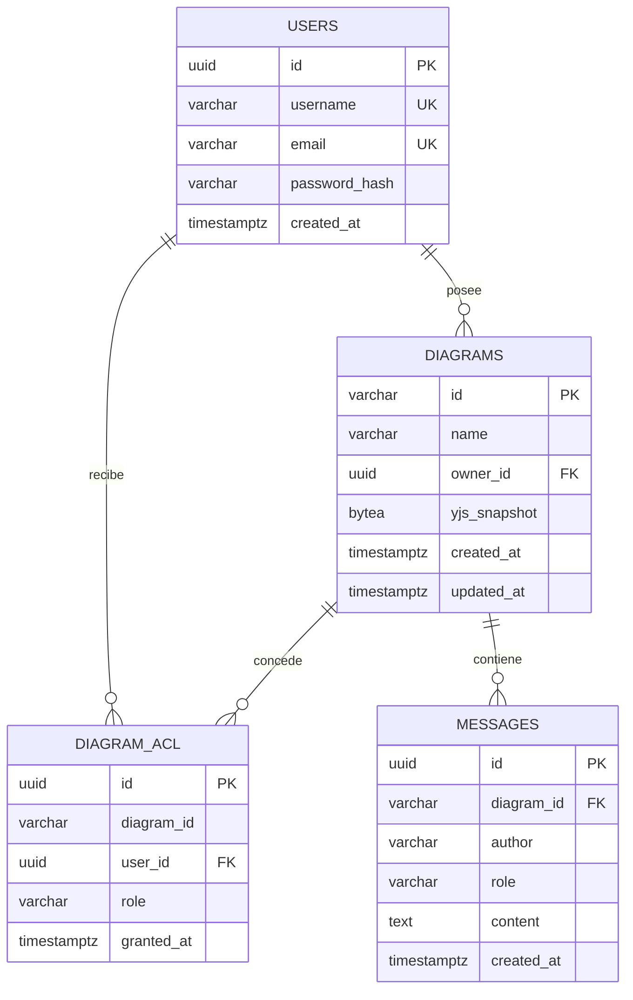

### 5.3 `auth.users`

| Columna | Tipo | Nulabilidad | Restricción |
|---|---|---|---|
| `id` | `uuid` | NOT NULL | PK, default `uuid_generate_v4()` |
| `username` | `varchar` | NOT NULL | UNIQUE |
| `email` | `varchar` | NOT NULL | UNIQUE |
| `password_hash` | `varchar` | NOT NULL | Hash bcrypt |
| `created_at` | `timestamptz` | NULL | default `CURRENT_TIMESTAMP` |

### 5.4 `auth.diagram_acl`

| Columna | Tipo | Nulabilidad | Restricción |
|---|---|---|---|
| `id` | `uuid` | NOT NULL | PK, default `uuid_generate_v4()` |
| `diagram_id` | `varchar` | NOT NULL | Sin FK física en el esquema actual |
| `user_id` | `uuid` | NULL | FK a `auth.users(id)` ON DELETE CASCADE |
| `role` | `varchar` | NOT NULL | CHECK `OWNER`, `EDITOR`, `VIEWER` |
| `granted_at` | `timestamptz` | NULL | default `CURRENT_TIMESTAMP` |

Restricción única: `(diagram_id, user_id)`.

> **Decisión:** la integridad de `diagram_id` se garantiza en la capa de servicio. `deleteDiagram` elimina primero la ACL y después el diagrama dentro de una transacción. No existe FK física de `auth.diagram_acl.diagram_id` a `core.diagrams.id` en el esquema entregado.

### 5.5 `core.diagrams`

| Columna | Tipo | Nulabilidad | Restricción |
|---|---|---|---|
| `id` | `varchar` | NOT NULL | PK |
| `name` | `varchar` | NOT NULL | Nombre visible |
| `owner_id` | `uuid` | NULL | FK a `auth.users(id)` ON DELETE CASCADE |
| `yjs_snapshot` | `bytea` | NULL | Estado Yjs codificado |
| `created_at` | `timestamptz` | NULL | default `CURRENT_TIMESTAMP` |
| `updated_at` | `timestamptz` | NULL | default `CURRENT_TIMESTAMP` |

### 5.6 `chat.messages`

| Columna | Tipo | Nulabilidad | Restricción |
|---|---|---|---|
| `id` | `uuid` | NOT NULL | PK, default `uuid_generate_v4()` |
| `diagram_id` | `varchar` | NULL | FK a `core.diagrams(id)` ON DELETE CASCADE |
| `author` | `varchar` | NOT NULL | Nombre visible |
| `role` | `varchar` | NOT NULL | CHECK `user`, `assistant`, `system` |
| `content` | `text` | NOT NULL | Contenido del mensaje |
| `created_at` | `timestamptz` | NULL | default `CURRENT_TIMESTAMP` |

### 5.7 DDL de referencia

```sql
CREATE SCHEMA IF NOT EXISTS auth;
CREATE SCHEMA IF NOT EXISTS core;
CREATE SCHEMA IF NOT EXISTS chat;

CREATE TABLE auth.users (
  id uuid PRIMARY KEY DEFAULT uuid_generate_v4(),
  username varchar NOT NULL UNIQUE,
  email varchar NOT NULL UNIQUE,
  password_hash varchar NOT NULL,
  created_at timestamptz DEFAULT CURRENT_TIMESTAMP
);

CREATE TABLE core.diagrams (
  id varchar PRIMARY KEY,
  name varchar NOT NULL,
  owner_id uuid REFERENCES auth.users(id) ON DELETE CASCADE,
  yjs_snapshot bytea,
  created_at timestamptz DEFAULT CURRENT_TIMESTAMP,
  updated_at timestamptz DEFAULT CURRENT_TIMESTAMP
);

CREATE TABLE auth.diagram_acl (
  id uuid PRIMARY KEY DEFAULT uuid_generate_v4(),
  diagram_id varchar NOT NULL,
  user_id uuid REFERENCES auth.users(id) ON DELETE CASCADE,
  role varchar NOT NULL CHECK (role IN ('OWNER', 'EDITOR', 'VIEWER')),
  granted_at timestamptz DEFAULT CURRENT_TIMESTAMP,
  UNIQUE (diagram_id, user_id)
);

CREATE TABLE chat.messages (
  id uuid PRIMARY KEY DEFAULT uuid_generate_v4(),
  diagram_id varchar REFERENCES core.diagrams(id) ON DELETE CASCADE,
  author varchar NOT NULL,
  role varchar NOT NULL CHECK (role IN ('user', 'assistant', 'system')),
  content text NOT NULL,
  created_at timestamptz DEFAULT CURRENT_TIMESTAMP
);
```

> El DDL asume que la extensión `uuid-ossp` está disponible, porque el esquema real usa `uuid_generate_v4()`.

### 5.8 Integridad referencial

| Relación | FK | Borrado |
|---|---|---|
| `core.diagrams.owner_id` | `auth.users.id` | CASCADE |
| `auth.diagram_acl.user_id` | `auth.users.id` | CASCADE |
| `chat.messages.diagram_id` | `core.diagrams.id` | CASCADE |
| `auth.diagram_acl.diagram_id` | No física | Gestión en servicio |

### 5.9 Normalización

El modelo está en **tercera forma normal** para los datos relacionales:

- Cada tabla tiene clave primaria.
- Los atributos no clave dependen de la clave completa.
- No hay dependencias transitivas.
- La relación usuario-diagrama se resuelve con una tabla intermedia.
- El rol y la fecha de concesión dependen de la pareja diagrama-usuario, no de una de las entidades por separado.

**Excepción deliberada:** `yjs_snapshot` es un objeto binario opaco. No se normaliza porque representa un documento CRDT completo, con relojes lógicos e identificadores internos. Descomponerlo destruiría la semántica de colaboración.

## 6. Aplicación de las reglas de Rumbaugh

Las reglas de transformación del modelo de objetos al modelo relacional se aplican en cuatro pasos explícitos.

### 6.1 Regla 1: clase persistente → tabla

Cada clase con identidad y ciclo de vida propio se transforma en una tabla:

| Clase | Tabla |
|---|---|
| Usuario | `auth.users` |
| Diagrama | `core.diagrams` |
| PermisoDiagrama | `auth.diagram_acl` |
| MensajeChat | `chat.messages` |

La clase `SnapshotYjs` no se convierte en una tabla independiente porque es un valor interno de `Diagrama`. Se representa como la columna `yjs_snapshot`.

### 6.2 Regla 2: atributo → columna

Cada atributo persistente se convierte en una columna con dominio, nulabilidad y valor por defecto:

| Atributo conceptual | Columna | Dominio |
|---|---|---|
| Identificador de usuario | `auth.users.id` | `uuid` |
| Username | `auth.users.username` | `varchar` único |
| Email | `auth.users.email` | `varchar` único |
| Contraseña | `auth.users.password_hash` | `varchar` |
| Nombre del diagrama | `core.diagrams.name` | `varchar` no nulo |
| Rol | `auth.diagram_acl.role` | `varchar` con CHECK |
| Contenido | `chat.messages.content` | `text` no nulo |
| Fecha | `created_at`, `granted_at` | `timestamptz` |

### 6.3 Regla 3: asociación → clave foránea o tabla intermedia

- **Asociación 1:N:** un usuario posee muchos diagramas. Se resuelve con `core.diagrams.owner_id` como FK a `auth.users.id`.
- **Asociación N:M:** un usuario puede participar en muchos diagramas y un diagrama puede tener muchos usuarios. Se resuelve con la tabla intermedia `auth.diagram_acl`.
- **Asociación con atributos:** `auth.diagram_acl` no es una tabla puente mínima; contiene `role` y `granted_at`, que pertenecen a la relación y no a una de las entidades.
- **Composición:** un diagrama contiene mensajes. Se resuelve con `chat.messages.diagram_id` y `ON DELETE CASCADE`.

### 6.4 Regla 4: generalización → estrategia relacional

El modelo persistente no requiere una jerarquía de tablas. Los roles `OWNER`, `EDITOR` y `VIEWER` no son subtipos con atributos propios; son valores de un dominio acotado. Por eso se modelan con una columna `role` y una restricción `CHECK`, en lugar de una tabla por rol.

Si en el futuro los roles adquirieran atributos o comportamientos distintos, la generalización podría transformarse en tablas relacionadas por clave primaria. Esa decisión no se justifica en el alcance actual.

### 6.5 Reglas complementarias de claves y acciones referenciales

| Regla | Aplicación | Resultado |
|---|---|---|
| Clave primaria | Identificadores únicos | UUID o varchar según el agregado |
| Clave única | Evitar duplicados | `username`, `email`, `(diagram_id, user_id)` |
| FK con cascada | Mantener integridad al borrar | `owner_id`, `user_id`, `messages.diagram_id` |
| Integridad en servicio | ACL sin FK a diagrama | Borrado transaccional de ACL y diagrama |

### 6.6 Justificación de la tabla intermedia

`PermisoDiagrama` no es una simple tabla de unión. Tiene atributos propios:

- `role`: OWNER, EDITOR o VIEWER.
- `granted_at`: momento de la concesión.
- `id`: identificador propio.

Por eso se modela como una **clase asociativa persistente**, no como una tabla puente mínima.

### 6.7 Desviaciones controladas

1. **Snapshot Yjs:** se conserva como `bytea` en lugar de tablas de nodos y aristas.
2. **`diagram_id` sin FK en ACL:** se mantiene por compatibilidad con el esquema entregado; la integridad se refuerza en el servicio.
3. **Roles como CHECK:** no se crea una tabla de roles porque el conjunto es fijo y pequeño.

## 7. Diseño de secuencias

### 7.1 Secuencia CU-06: comando IA con memoria

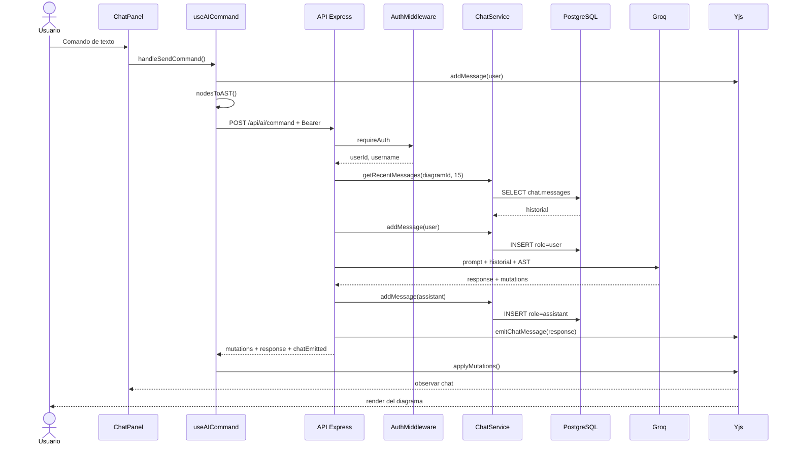

### 7.2 Secuencia de persistencia Yjs

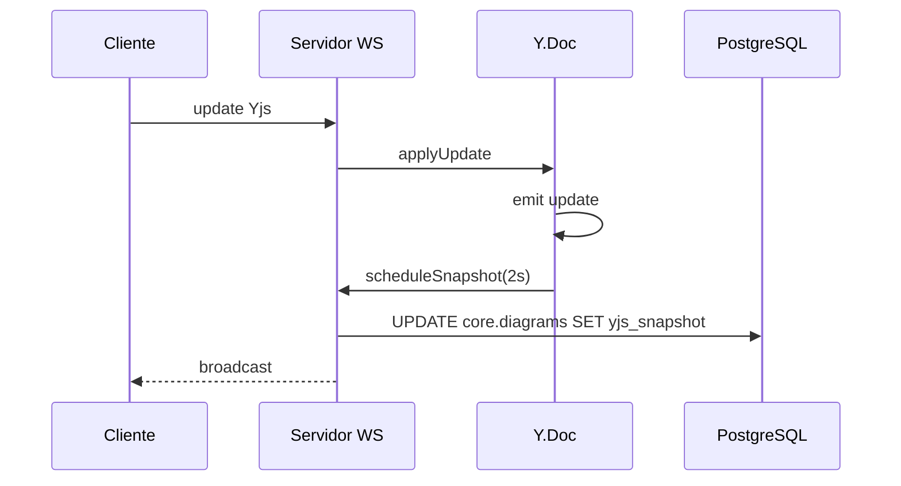

El debounce de 2 segundos agrupa ráfagas de cambios. Además, `writeState` fuerza un guardado final al cerrar el documento.

### 7.3 Secuencia de generación de backend

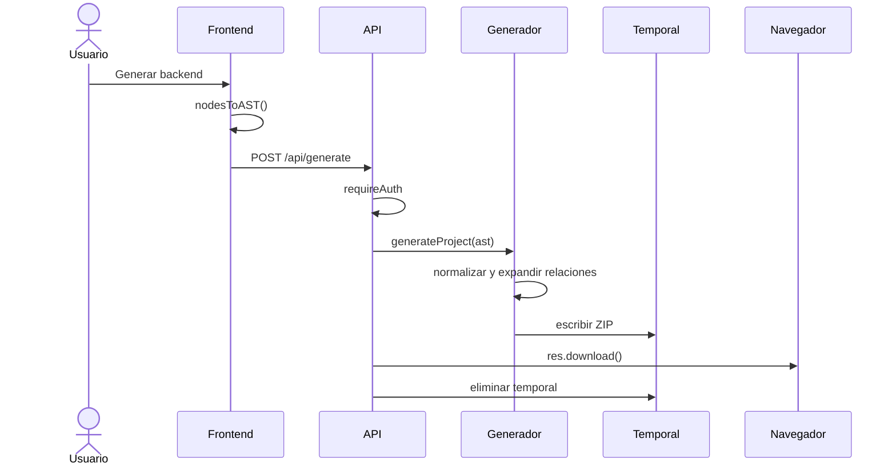

## 8. Diseño de estados

### 8.1 Documento del diagrama

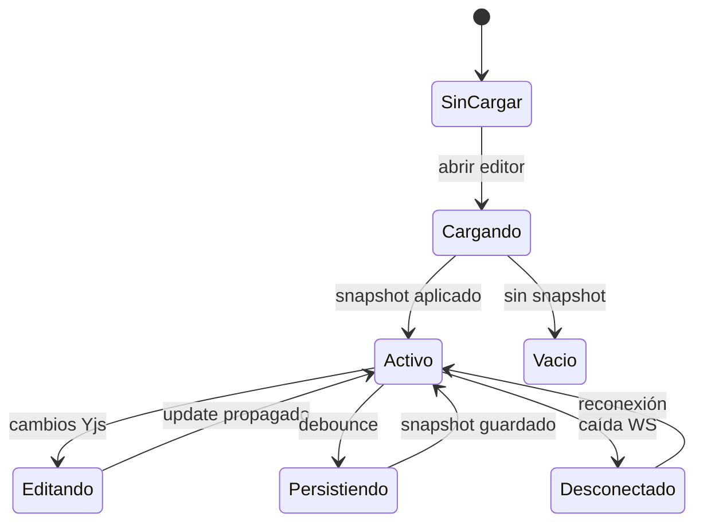

### 8.2 Mensaje de chat

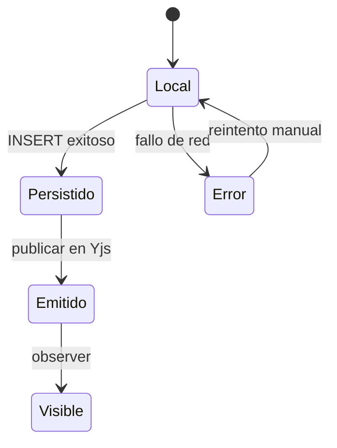

## 9. Diseño de API

| Método | Ruta | Entrada | Salida | Seguridad |
|---|---|---|---|---|
| POST | `/api/auth/register` | username, email, password | token, user | Pública |
| POST | `/api/auth/login` | username, password | token, user | Pública |
| GET | `/api/auth/me` | — | user | JWT |
| GET | `/api/diagrams` | — | owned, shared | JWT |
| POST | `/api/diagrams` | name | id, name | JWT |
| GET | `/api/diagrams/:id` | — | name, chat | Miembro |
| POST | `/api/diagrams/:id` | name | ok | Escritura |
| PUT | `/api/diagrams/:id/rename` | name | ok, name | Escritura |
| DELETE | `/api/diagrams/:id` | — | 204 | OWNER |
| GET | `/api/diagrams/:id/role` | — | role | Miembro |
| POST | `/api/diagrams/:id/members` | username, role | ACL | OWNER |
| PATCH | `/api/diagrams/:id/members/:userId` | role | ACL | OWNER |
| DELETE | `/api/diagrams/:id/members/:userId` | — | ACL | OWNER o self |
| POST | `/api/ai/command` | command, currentState, diagramId | mutations, response | JWT |
| POST | `/api/ai/transcribe` | audio | text | JWT |
| POST | `/api/ai/from-image` | image, currentState | mutations | JWT |
| POST | `/api/generate` | currentState | ZIP | JWT |
| GET | `/health` | — | OK | Pública |
| WS | `/diagram-room-<id>?token=` | protocolo Yjs | updates | Gate 4401/4403/4404 |

## 10. Diseño de seguridad

### 10.1 Flujo de autenticación

```text
Credenciales
   │
   ▼
userService.verifyPassword
   │ bcrypt.compare
   ▼
signToken({ userId, username })
   │
   ▼
Cliente: localStorage
   │
   ├─ REST: Authorization: Bearer
   └─ WS: ?token=
```

### 10.2 Reglas de autorización

| Operación | OWNER | EDITOR | VIEWER |
|---|---|---|---|
| Ver diagrama | Sí | Sí | Sí |
| Editar nodos | Sí | Sí | No |
| Renombrar | Sí | Sí | No |
| Eliminar | Sí | No | No |
| Gestionar miembros | Sí | No | No |
| Usar IA | Sí | Sí | No |

### 10.3 Controles

- El token se verifica en cada petición protegida.
- El WebSocket cierra con `4401` si falta token.
- El WebSocket cierra con `4403` si no hay rol.
- El WebSocket cierra con `4404` si el diagrama no existe.
- El WebSocket espera el snapshot antes de aceptar mensajes del cliente.
- La IA exige autenticación.
- Los secretos se mantienen fuera del repositorio.

## 11. Diseño de errores y transacciones

| Escenario | Comportamiento |
|---|---|
| Falla la IA | Error `502` si el formato es inválido; no se aplican mutaciones sin validar |
| Falla la persistencia del mensaje assistant | Se registra el error; la respuesta puede emitirse igualmente |
| Falla la carga del snapshot | El WebSocket se rechaza con `1011`; no se abre un documento vacío |
| Falla la persistencia del snapshot | Se registra el error; el documento vivo conserva el estado |
| Borrado de diagrama | Transacción: ACL y diagrama |
| Creación de diagrama | Transacción única: diagrama + ACL OWNER |
| Rol inválido | Error de validación |
| ID de usuario inválido en ACL | Se rechaza; no se normaliza a anónimo |
| ID inválido | Se valida; si no cumple el formato, se rechaza |
| Token expirado | `401` |

### 11.1 Atomicidad de creación de diagrama y ACL

La creación ya no se ejecuta en dos pasos independientes. `POST /api/diagrams` usa `createDiagramWithOwner`, que abre una transacción PostgreSQL, inserta `core.diagrams` y la fila `OWNER` en `auth.diagram_acl`; si cualquiera de las dos operaciones falla, se hace `ROLLBACK`.

`POST /api/diagrams/:id` usa `createDiagramWithOwnerIfAbsent` para el caso de un id nuevo. Si el diagrama ya existe, no se crea una ACL nueva: se consulta el rol y solo `OWNER` o `EDITOR` pueden modificarlo. Un diagrama existente sin ACL se rechaza; ya no puede ser reclamado por el primer usuario que lo abra.

La validación de ACL dejó de tener efectos secundarios: `requireDiagramMember`, `requireDiagramRole`, `requireDiagramWrite` y la autenticación WebSocket solo consultan `getRoleForUser`. La creación de ACL es exclusiva de la creación del diagrama o de una migración explícita.

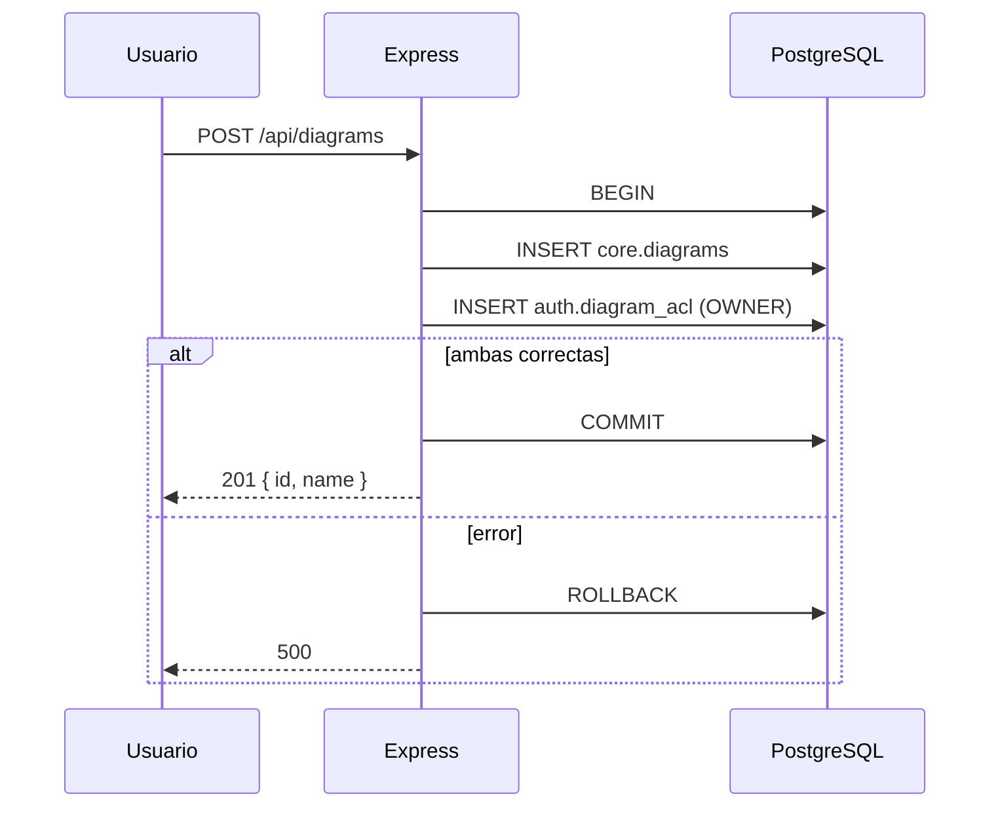

### 11.2 Carga del snapshot antes de aceptar clientes Yjs

El adaptador de persistencia carga `core.diagrams.yjs_snapshot` y expone `ydoc.readyPromise`. El servidor pausa el socket al recibir la conexión, valida token, rol y existencia del diagrama, y solo entonces espera `ensureDocumentReady()`.

Flujo:

1. `wss.on('connection')` ejecuta `ws.pause()`.
2. Se valida el JWT y la ACL sin crear filas.
3. `ensureDocumentReady()` crea o recupera el `Y.Doc` y espera la carga del snapshot.
4. Si la carga falla, se cierra con `1011`; no se permite escribir sobre un documento vacío.
5. Solo después se llama `setupWSConnection()` y se hace `ws.resume()`.

Además, `writeState` espera a `readyPromise` y `bindState` espera cualquier escritura final pendiente. Así se evita que una nueva conexión cargue un snapshot anterior mientras la conexión previa todavía está persistiendo el suyo.

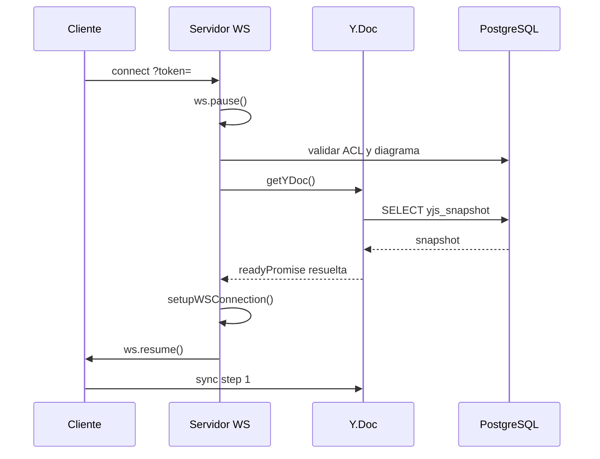

### 11.3 Validación de entradas y mutaciones

Se incorporó `backend/validation.js` con validadores manuales sin dependencias nuevas:

- Comandos IA: texto máximo, AST con límites de entidades, relaciones y atributos.
- Mutaciones IA: allowlist de acciones y campos, tipos de relación, cardinalidades y atributos.
- Generación: AST con al menos una entidad y límites de tamaño.
- Imagen/voz: MIME esperado y tamaño máximo de `multer`.
- Autenticación: longitudes de username, email y password.
- ACL: UUID estricto para `userId`; un valor inválido no se convierte en anónimo.

Los errores de validación responden `400`. Si la IA devuelve una mutación no permitida, la API responde `502` y no aplica cambios parciales.

### 11.4 Cierre ordenado

`SIGTERM` y `SIGINT` ejecutan un apagado controlado: cancelan timers de debounce, hacen flush de snapshots, cierran clientes WebSocket, esperan escrituras pendientes, cierran el pool y terminan. Existe un timeout de seguridad de 15 segundos.

La generación de backends también usa un directorio temporal único por petición (`fs.mkdtempSync`) y guarda el ZIP dentro de ese directorio; la limpieza elimina solo el directorio de esa petición, no todo `generator/output`.

### 11.5 Manejo centralizado de errores

`errors.js` define `AppError`, `httpError` y `asyncHandler`. Las rutas se declaran como:

```js
router.post('/command', requireAuth, asyncHandler(async (req, res) => {
  // validar, delegar, responder
}));
```

`middleware/errorHandler.js` recibe cualquier rechazo, multer o JSON inválido y construye una respuesta uniforme:

- `400` para validación o JSON inválido.
- `401/403/404` para autenticación y permisos.
- `502/503/504` para fallos seguros del proveedor de IA.
- `500` genérico para errores desconocidos, con log interno.
- `404` JSON para rutas inexistentes.

Los servicios lanzan `httpError` para reglas de negocio; no construyen respuestas HTTP. Esto elimina los `try/catch` repetidos y respeta SRP.

## 12. Decisiones de diseño

| ID | Decisión | Consecuencia |
|---|---|---|
| DD-01 | `Y.Map` anidados para nodos y aristas | Updates finos y menor conflicto |
| DD-02 | Snapshot completo en `bytea` | Persistencia fiel del CRDT |
| DD-03 | Chat en Yjs y en SQL | Tiempo real y memoria durable |
| DD-04 | Identidad derivada del token | Seguridad y personalización |
| DD-05 | Historial de 15 mensajes | Contexto acotado |
| DD-06 | Emisión de respuesta por el backend | Consistencia entre colaboradores |
| DD-07 | Mutaciones ordenadas | Evita referencias colgadas |
| DD-08 | Esquemas separados | Aislamiento y claridad |
| DD-09 | Generador con plantillas | Código mantenible y testeable |
| DD-10 | Un solo proceso REST+WS | Simplicidad operativa |
| DD-11 | Diagrama + ACL en una transacción | No quedan diagramas sin propietario |
| DD-12 | Snapshot cargado antes de `setupWSConnection` | Elimina la ventana de escritura sobre un documento vacío |
| DD-13 | ACL de solo lectura en middleware | Evita el auto-claim de diagramas existentes sin ACL |
| DD-14 | Validación runtime antes de PostgreSQL/Groq | Rechaza datos malformados y mutaciones no permitidas |
| DD-15 | `app.js` separado de `server.js` | Express se prueba sin abrir puerto ni WebSocket |
| DD-16 | `realtime/yjs.js` encapsula WebSocket y snapshots | Bootstrap y tiempo real evolucionan por separado |
| DD-17 | `AppError` + `asyncHandler` + error handler | Un solo formato de error y rutas sin try/catch repetidos |
| DD-18 | `useDiagramMembers` para MembersPanel | La vista no conoce URLs, fetch ni estados de red |

## 13. Trazabilidad de diseño

| Requisito | Componente de diseño | Tabla / archivo |
|---|---|---|
| RF-12 Identidad IA | `requireAuth` + `aiUsername` | `backend/services/aiService.js` |
| RF-13 Memoria | `ChatService` | `chat.messages` |
| RF-14 Chat colaborativo | `emitChatMessage` + Yjs | `realtime/yjs.js`, `useCollaborativeFlow.ts` |
| RF-05 Edición | `useCollaborativeFlow` | `Y.Doc` |
| RF-07 Roles | `aclService` + `diagramAuth` | `auth.diagram_acl` |
| RF-15 Generación | `generateProject` | `backend/generator` |
| RNF-02 Durabilidad | `saveSnapshot` | `core.diagrams` |
| RNF-03 Seguridad | JWT + bcrypt + ACL | `auth` |
| RNF-04 Rendimiento | Límite de historial y debounce | `chatService`, `realtime/yjs.js` |
| RNF-05 Mantenibilidad | `app.js` + `server.js` + rutas + middleware de errores | `backend/` |

## 14. Conclusión del diseño

El diseño mantiene dos planos deliberadamente separados:

- **Plano colaborativo:** Yjs, WebSocket y awareness.
- **Plano durable y de negocio:** PostgreSQL, JWT y servicios.

El asistente IA atraviesa ambos planos: usa la identidad y la memoria del plano durable, y publica su respuesta en el plano colaborativo. Esa intersección es la aportación central del Segundo Parcial y la razón por la que el diseño no puede reducirse a un simple endpoint de chat.

Continuar con [[05_Implementacion]].
