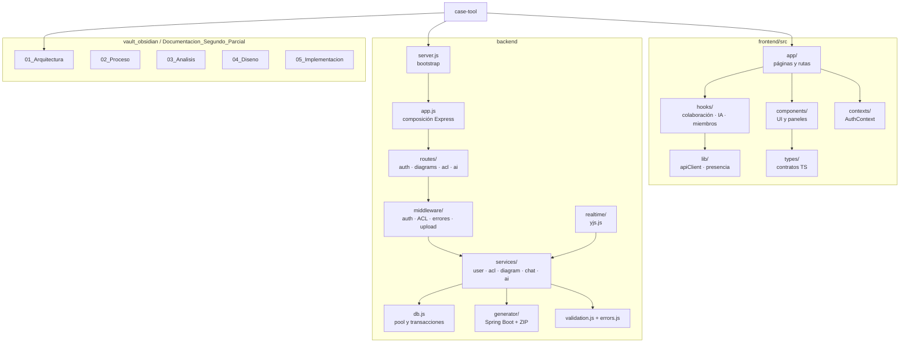
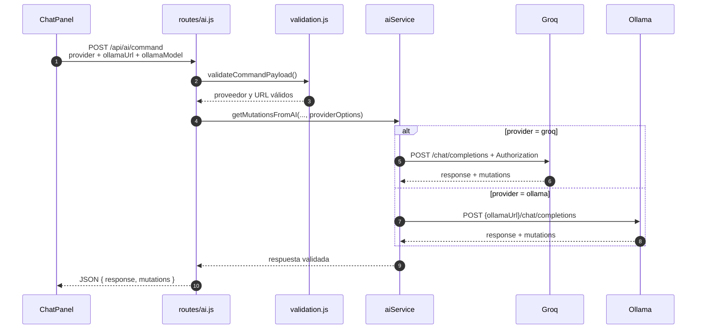

# Implementación

## 1. Estado de la implementación

El Segundo Parcial quedó implementado sobre el repositorio `case-tool` con estos cambios principales:

- Persistencia del backend migrada de archivos JSON a PostgreSQL en Neon.
- Nuevo acceso a datos con `pg`, pool y transacciones.
- Servicios de usuarios, ACL, diagramas y chat reescritos sobre SQL.
- Snapshots Yjs persistidos en `core.diagrams.yjs_snapshot`.
- Historial del chat persistido en `chat.messages`.
- Asistente IA con identidad derivada del JWT.
- Memoria contextual de los últimos 15 mensajes.
- Respuesta del asistente emitida al chat colaborativo Yjs.
- Frontend adaptado para no enviar historial ni guardar el grafo por REST.
- Script de migración de datos legacy.
- Verificación de build, tipos, pruebas de integración y snapshots.

## 2. Organización del repositorio

```text
case-tool/
├── frontend/
│   ├── src/app/                    Páginas y rutas
│   ├── src/components/             Canvas, paneles, chat y ayuda
│   ├── src/hooks/                  Colaboración, IA, roles y sesión
│   ├── src/lib/                    Cliente HTTP y presencia
│   ├── src/utils/                  AST, Yjs, XMI y aristas
│   └── src/types/                  Contratos TypeScript
├── backend/
│   ├── server.js                   Bootstrap HTTP, DB, señales y apagado
│   ├── app.js                      Composición Express, rutas y middleware
│   ├── realtime/                   WebSocket, snapshots Yjs y chat
│   ├── db.js                       Pool PostgreSQL y transacciones
│   ├── errors.js                   AppError, httpError y asyncHandler
│   ├── loadEnv.js                  Carga de variables de entorno
│   ├── validation.js               Validación runtime de entrada
│   ├── routes/                     auth, diagrams, acl, ai
│   ├── middleware/                 JWT, ACL, upload y error handler
│   ├── services/                   user, acl, diagram, chat, ai
│   ├── scripts/                    Migración JSON → PostgreSQL
│   ├── generator/                  Generador Spring Boot
│   └── tests/                      Pruebas legacy
├── docs/                           Documentación de ingeniería
└── Documentacion_Segundo_Parcial/  Este vault
```

## 3. Capas internas del backend

### 3.1 Capa 1: transporte

**Archivos:** `app.js`, `server.js`, `routes/auth.js`, `routes/diagrams.js`, `routes/acl.js`, `routes/ai.js`.

**Responsabilidades:**

- `server.js` compone HTTP, base de datos, WebSocket y apagado.
- `app.js` compone Express y monta rutas.
- Las rutas definen endpoints, validan parámetros y delegan.
- `middleware/errorHandler.js` centraliza respuestas de error.
- `realtime/yjs.js` monta el WebSocket y la persistencia de snapshots.

**Endpoints principales:**

| Método | Ruta | Implementación |
|---|---|---|
| POST | `/api/auth/register` | `routes/auth.js` |
| POST | `/api/auth/login` | `routes/auth.js` |
| GET | `/api/auth/me` | `routes/auth.js` |
| GET | `/api/diagrams` | `routes/diagrams.js` |
| POST | `/api/diagrams` | `routes/diagrams.js` |
| GET | `/api/diagrams/:id` | `routes/diagrams.js` |
| POST | `/api/diagrams/:id` | `routes/diagrams.js` |
| PUT | `/api/diagrams/:id/rename` | `routes/diagrams.js` |
| DELETE | `/api/diagrams/:id` | `routes/diagrams.js` |
| POST | `/api/ai/command` | `routes/ai.js` |
| POST | `/api/ai/transcribe` | `routes/ai.js` |
| POST | `/api/ai/from-image` | `routes/ai.js` |
| POST | `/api/generate` | `routes/ai.js` |

### 3.2 Capa 2: seguridad

**Archivos:** `middleware/auth.js`, `middleware/diagramAuth.js`.

**Responsabilidades:**

- Extraer y verificar el Bearer token.
- Adjuntar `req.user`.
- Resolver el rol del usuario en el diagrama.
- Bloquear operaciones de lectura, escritura o administración.
- Validar el token del WebSocket.

**Comportamiento:**

- `AUTH_ENABLED=true`: se exige token.
- `AUTH_ENABLED=false`: se inyecta el usuario anónimo para desarrollo.
- Sin token en WS: cierre `4401`.
- Sin rol en WS: cierre `4403`.
- Sala desconocida: cierre `4403`.

### 3.3 Capa 3: dominio y servicios

**Archivos:** `services/userService.js`, `services/aclService.js`, `services/diagramService.js`, `services/chatService.js`.

**Responsabilidades:**

| Servicio | Funciones principales |
|---|---|
| `userService` | `createUser`, `findByUsername`, `findByEmail`, `findById`, `verifyPassword` |
| `aclService` | `readACL`, `writeACL`, `getOrCreateACL`, `getRoleForUser`, `addMember`, `updateMemberRole`, `removeMember`, `deleteACL` |
| `diagramService` | `listVisibleForUser`, `getDiagram`, `createDiagram`, `ensureDiagram`, `upsertDiagram`, `renameDiagram`, `deleteDiagram`, `getSnapshot`, `saveSnapshot` |
| `chatService` | `addMessage`, `getRecentMessages` |

### 3.4 Capa 4: persistencia y generación

**Archivos:** `db.js`, `scripts/migrate-json-to-postgres.js`, `generator/*`.

**Persistencia:**

- Pool de conexiones PostgreSQL.
- Transacciones con `BEGIN`, `COMMIT` y `ROLLBACK`.
- Normalización de identificadores de usuario.
- Usuario anónimo técnico.
- Consultas parametrizadas.

**Generación:**

- Normalización del AST.
- Expansión de relaciones muchos-a-muchos.
- Renderizado con Handlebars.
- Empaquetado ZIP.
- Limpieza de temporales.

## 4. Arranque del backend

`server.js` importa primero `loadEnv.js` y delega la composición de Express a `app.js`:

```js
require('./loadEnv');
```

`loadEnv.js` establece la prioridad:

1. Variables del proceso.
2. `backend/.env.local`.
3. `backend/.env`.

El secreto real de `DATABASE_URL` se guarda en `backend/.env.local`, que está ignorado por git. `backend/.env.example` sirve como plantilla sin secretos.

## 5. Pool y transacciones

`db.js` crea un pool con:

- Máximo de 10 conexiones por defecto, configurable con `PG_POOL_MAX`.
- `idleTimeoutMillis` de 30 segundos.
- `connectionTimeoutMillis` de 10 segundos.
- TLS cuando la cadena incluye `sslmode=require`.

```js
const pool = new Pool({
  connectionString,
  max: Number(process.env.PG_POOL_MAX) || 10,
  idleTimeoutMillis: 30000,
  connectionTimeoutMillis: 10000,
  ssl: connectionString && connectionString.includes('sslmode=require')
    ? { rejectUnauthorized: false }
    : undefined,
});
```

La función `withTransaction` garantiza:

- `BEGIN` antes de la operación.
- `COMMIT` si todo sale bien.
- `ROLLBACK` ante error.
- Liberación del cliente en `finally`.

### 5.1 Usuario anónimo

Cuando `AUTH_ENABLED=false`, el sistema necesita un UUID válido para propietarios y ACL. Se crea de forma idempotente:

```text
id: 00000000-0000-0000-0000-000000000001
username: anonymous
email: anonymous@local.invalid
password_hash: !
```

`normalizeUserId` convierte cualquier identificador inválido en ese UUID técnico. Esto evita errores de tipo en PostgreSQL y mantiene la compatibilidad del modo abierto.

## 6. Servicios implementados

### 6.1 Usuarios

`userService.createUser`:

1. Valida username de al menos 3 caracteres.
2. Valida email con `@`.
3. Exige contraseña de al menos 6 caracteres.
4. Verifica duplicados.
5. Genera el hash con bcrypt y 10 rondas.
6. Inserta en `auth.users`.
7. Devuelve el usuario sin `password_hash`.

`verifyPassword` busca por username y compara con bcrypt. Nunca devuelve el hash.

### 6.2 ACL

Las rutas de lectura y el WebSocket usan `aclService.getRoleForUser` y `readACL`; no crean filas. La creación de la ACL ocurre únicamente dentro de la transacción de creación del diagrama.

`getOrCreateACL` se conserva solo para scripts de migración explícitos. Ya no se invoca desde middleware, lectura REST ni conexión WebSocket, por lo que un diagrama existente sin ACL no puede ser reclamado por el primer usuario que lo abra.

`addMember` valida que el rol sea `EDITOR` o `VIEWER`, exige un UUID de usuario válido, verifica que el diagrama exista y aplica un upsert sobre `(diagram_id, user_id)`.

### 6.3 Diagramas

`diagramService`:

- Lista diagramas visibles mediante `JOIN` con ACL.
- Cuenta entidades y relaciones decodificando el snapshot.
- Crea el diagrama y su ACL `OWNER` en una sola transacción (`createDiagramWithOwner`).
- Crea un diagrama si el id no existe (`createDiagramWithOwnerIfAbsent`) sin reclamar diagramas existentes sin ACL.
- Renombra y actualiza `updated_at`.
- Elimina ACL y diagrama en una transacción.
- Recupera y guarda el snapshot binario.

La lectura del snapshot usa un `Y.Doc` temporal para contar nodos y aristas:

```js
const doc = new Y.Doc();
Y.applyUpdate(doc, new Uint8Array(snapshot));
const entityCount = doc.getMap('nodes').size;
const relationshipCount = doc.getMap('edges').size;
```

### 6.4 Chat

`chatService.addMessage`:

- Valida el diagrama.
- Valida que el rol sea `user`, `assistant` o `system`.
- Recorta el contenido y el autor.
- Inserta y devuelve la fila creada.

`chatService.getRecentMessages`:

- Sanea el límite entre 1 y 100.
- Selecciona los más recientes en orden descendente.
- Los devuelve en orden ascendente.
- Alias `content AS text` para el prompt.

## 7. Persistencia Yjs

`realtime/yjs.js` configura `setPersistence` de `y-websocket` y encapsula el WebSocket:

1. `attachRealtime(server)` crea el `WebSocket.Server`.
2. Al enlazar un documento, obtiene el `diagramId` del room.
3. Carga `yjs_snapshot` y expone `readyPromise`.
4. El servidor pausa el socket y espera el snapshot antes de `setupWSConnection`.
5. Aplica el snapshot con `Y.applyUpdate`.
6. Escucha los updates y programa un guardado con debounce de 2 segundos.
7. Guarda `Y.encodeStateAsUpdate(ydoc)` en `core.diagrams`.
8. En `writeState`, espera el snapshot y el turno de escrituras pendientes.
9. `SIGTERM`/`SIGINT` ejecutan flush y cierran clientes.

```text
update Yjs
   │
   ▼
scheduleSnapshot(2000 ms)
   │
   ▼
Y.encodeStateAsUpdate(ydoc)
   │
   ▼
UPDATE core.diagrams SET yjs_snapshot = $2
```

El debounce reduce la carga sobre Neon durante ráfagas de cambios, por ejemplo al arrastrar o al aplicar varias mutaciones de IA.

## 8. Implementación de CU-06

### 8.1 Frontend: `useAICommand`

El hook:

1. Mantiene el texto del comando.
2. Evita envíos duplicados con `processingRef`.
3. Agrega el mensaje del usuario al chat.
4. Convierte el canvas en AST.
5. Envía el comando con `apiFetch`.
6. Aplica las mutaciones.
7. Agrega la respuesta local solo si el backend no la emitió.
8. Limpia el campo y restaura el estado de procesamiento.

Fragmento conceptual:

```ts
const ast = nodesToAST(opts.nodes, opts.edges);
const response = await apiFetch(`${API_BASE}/api/ai/command`, {
  method: 'POST',
  headers: { 'Content-Type': 'application/json' },
  body: JSON.stringify({
    command: trimmed,
    currentState: ast,
    diagramId: opts.diagramId,
  }),
});

if (Array.isArray(data.mutations) && data.mutations.length > 0) {
  applyMutations(data.mutations, context);
}

if (data.chatEmitted !== true) {
  opts.addMessage('ia', aiText || fallbackText, 'IA');
}
```

### 8.2 Identidad en el backend

La identidad no se toma del body:

```js
const username = aiUsername(req.user);
```

`aiUsername` lee `req.user.username`, que proviene del JWT verificado. Si el usuario es `anonymous`, usa `Usuario`.

El prompt exige:

- Dirigirse al usuario por su nombre.
- No inventar otro nombre.
- Comenzar la respuesta con ese nombre.

### 8.3 Memoria contextual

Antes de llamar a Groq:

```js
const dbHistory = await chatService.getRecentMessages(safeDiagramId, 15);
historyPrompt = formatChatHistory(dbHistory);

await chatService.addMessage({
  diagramId: safeDiagramId,
  author: username,
  role: 'user',
  content: command,
});
```

`formatChatHistory`:

- Ignora entradas vacías.
- Normaliza espacios.
- Recorta el autor a 80 caracteres.
- Recorta cada mensaje a 600 caracteres.
- Limita el bloque total a 6000 caracteres.
- Devuelve el historial en orden cronológico.

### 8.4 Llamada a Groq

`getMutationsFromAI`:

1. Comprueba `GROQ_API_KEY`.
2. Elige el modelo de texto o visión.
3. Construye el system prompt con identidad, estado e historial.
4. Envía el comando como mensaje de usuario.
5. Limpia bloques Markdown de la respuesta.
6. Parsea el JSON.
7. Si falta `mutations`, acepta una respuesta teórica con `mutations: []`.
8. Si el JSON es inválido, intenta recuperar mutaciones del texto.
9. Si solo hay prosa, la devuelve como respuesta del tutor.
10. Si no puede recuperar nada, lanza error.

### 8.5 Persistencia de la respuesta y emisión Yjs

```js
await chatService.addMessage({
  diagramId: safeDiagramId,
  author: 'IA',
  role: 'assistant',
  content: response,
});

chatEmitted = emitChatMessage(safeDiagramId, {
  id: `msg_${Date.now()}_...`,
  sender: 'ia',
  author: 'IA',
  text: response,
  timestamp: Date.now(),
});
```

La respuesta HTTP incluye `chatEmitted`. El frontend usa esa bandera para no duplicar el mensaje en el chat.

### 8.6 Aplicación de mutaciones

`applyMutations` respeta el orden:

1. `addEntity`
2. `addAttribute`
3. `addRelationship`
4. `removeEntity`
5. `removeRelationship`

Cada mutación se traduce a operaciones sobre Yjs. Las entidades deben existir antes de crear relaciones, y las eliminaciones se hacen al final para no dejar referencias colgadas.

### 8.7 Voz

1. `MediaRecorder` captura audio webm/opus.
2. Se envía como `FormData` a `/api/ai/transcribe`.
3. Multer lo mantiene en memoria.
4. El backend llama a Groq Whisper con `whisper-large-v3`.
5. El texto se coloca en el input.
6. Se autoenvía después de 400 ms.
7. El usuario puede editar antes del envío.

### 8.8 Imagen

1. El usuario selecciona una imagen.
2. Se envía como `FormData` junto con el AST.
3. Multer limita a 10 MB.
4. El backend usa el modelo de visión.
5. Se devuelven mutaciones.
6. El frontend las aplica y resume el resultado.

## 9. Implementación del frontend

### 9.1 `useCollaborativeFlow`

Responsabilidades:

- Crear `Y.Doc` y `WebsocketProvider`.
- Suscribirse a `nodes`, `edges` y `chat`.
- Convertir `Y.Map` a arreglos de React Flow.
- Exponer writers para nodos, aristas y mensajes.
- Cargar el snapshot inicial.
- Publicar presencia y soft-lock.
- Limpiar awareness antes de destruir el provider.

### 9.2 Identidad y presencia

`resolvePresenceIdentity` usa el usuario autenticado si existe. Para anónimos, genera una identidad estable por sesión. El color se deriva del identificador para mantener consistencia entre reconexiones.

### 9.3 Chat

`ChatPanel`:

- Muestra autor, inicial y color.
- Distingue mensajes propios, de otros usuarios y de la IA.
- Permite texto, micrófono e imagen.
- Se desactiva en modo `VIEWER`.
- No aplica reglas de negocio.

### 9.4 Miembros del diagrama

`MembersPanel` es una vista controlada. La lógica de red y estado vive en `useDiagramMembers`:

- `load`: `GET /api/diagrams/:id/acl`.
- `invite`: `POST /api/diagrams/:id/members`.
- `changeRole`: `PATCH /api/diagrams/:id/members/:userId`.
- `removeMember`: `DELETE /api/diagrams/:id/members/:userId`.
- Expone `owner`, `members`, `loading`, `error` y `busy`.

`ChatPanel` y `Toolbar` son componentes de presentación: reciben mensajes, comandos, estado de conexión y callbacks; no llaman a la API ni aplican reglas de negocio.

### 9.5 Cambios de compatibilidad

- `useAICommand` ya no envía `history` al backend.
- `page.tsx` ya no guarda el grafo por REST periódicamente.
- `useCollaborativeFlow` ya no expone `getSnapshot`.
- Se eliminó `frontend/src/lib/chatHistory.ts` por quedar obsoleto.

### 9.6 Refactorización P0 y P1

La implementación se estabilizó en dos bloques de refactorización. El bloque P0 eliminó riesgos de seguridad, concurrencia y consistencia; el bloque P1 mejoró la mantenibilidad sin alterar los contratos de la API.

| Bloque | Cambio | Archivos | Resultado |
|---|---|---|---|
| P0 | ACL de solo lectura; sin auto-claim | `middleware/diagramAuth.js`, `realtime/yjs.js` | Un diagrama existente sin ACL se rechaza |
| P0 | Diagrama + ACL atómicos | `services/diagramService.js`, `routes/diagrams.js` | No quedan diagramas huérfanos |
| P0 | Snapshot antes de aceptar clientes | `realtime/yjs.js` | `ws.pause()` + `readyPromise` + `setupWSConnection()` |
| P0 | Validación runtime de IA, AST y ACL | `validation.js`, `services/aclService.js` | Mutaciones inválidas no se aplican |
| P0 | Generación concurrente aislada | `generator/generate.js` | ZIP temporal único por petición |
| P0 | Cierre ordenado | `server.js`, `realtime/yjs.js` | Flush de snapshots y cierre de pool |
| P1 | `server.js` como bootstrap | `server.js` (59 líneas) | Baja cohesión eliminada del punto de entrada |
| P1 | `app.js` + `realtime/yjs.js` | `app.js`, `realtime/yjs.js` | Express y WebSocket se componen por separado |
| P1 | Errores centralizados | `errors.js`, `middleware/errorHandler.js` | `AppError`, `asyncHandler`, 404 y 500 uniformes |
| P1 | Hooks de React | `useDiagramMembers.ts`; `ChatPanel`, `Toolbar` | Componentes de presentación sin API propia |

**Métricas de la refactorización:** `server.js` pasó de 884 a 59 líneas; el backend quedó con 22 archivos verificables con `node --check`; el lint del frontend bajó de 154 a 150 problemas preexistentes.

### 9.7 Trazabilidad de las iteraciones PUDS

| Iteración PUDS | Objetivo | Implementación verificable | Evidencia de cierre |
|---|---|---|---|
| Iteración 1 — Inicio | Identidad no suplantable | `requireAuth`, `aiUsername`, prompt con `username` del JWT | Respuestas dirigidas al usuario autenticado |
| Iteración 2 — Elaboración | Separar teoría de acción | Prompt de clasificación, `{response, mutations}`, `validateMutations` | Consulta teórica sin mutaciones; acción validada |
| Iteración 3 — Construcción | Evitar pérdida de snapshots y ACL huérfanas | `ws.pause()`, `readyPromise`, `createDiagramWithOwner`, validación | Sin escrituras antes del snapshot; transacciones atómicas |
| Iteración 4 — Transición | Resolver referencias conversacionales | `getRecentMessages(...,15)`, `formatChatHistory`, emisión Yjs | “bórralo” resuelve el turno anterior; chat visible para A y B |

### 9.8 Mecanismos de aprendizaje (Requisito C)

**Agente Tutor.** `aiService` actúa como tutor y moderador: clasifica la intención, responde consultas teóricas con lenguaje didáctico, conserva la identidad del usuario y usa el historial público como contexto. Cuando la intención es una acción, devuelve mutaciones ordenadas y validadas; cuando es teoría o ambigüedad, no modifica el diagrama.

> **Agente Tutor con Conciencia Contextual (Context-Aware Tutoring)**
>
> Para potenciar el mecanismo de aprendizaje, el Agente IA no solo responde consultas teóricas generales, sino que implementa una **Tutoría Contextual**.
>
> 1. **Lectura del Foco de Atención:** el frontend captura el elemento del diagrama (clase, atributo o relación) que el usuario tiene seleccionado y lo envía junto con la consulta en el campo `selectedElement`.
> 2. **Respuestas Basadas en el Modelo del Alumno:** el *system prompt* del LLM inyecta este elemento seleccionado. Si el usuario pregunta *"¿Qué es una relación de agregación?"* mientras tiene seleccionada una relación específica, la IA responde: *"La relación que has seleccionado entre [Entidad A] y [Entidad B] es de agregación porque..."*.
> 3. **Aprendizaje Situado:** esta técnica pedagógica (aprendizaje basado en el contexto) permite que el usuario comprenda los conceptos abstractos de UML 2.5 aplicados directamente a su propio diseño, facilitando la asimilación y corrección de errores en tiempo real.
>
> **Implementación:** `useAICommand.ts` construye `SelectedElementContext` desde el nodo o arista seleccionada; `validation.js` valida y acota la metadata; `routes/ai.js` la propaga a `aiService.getMutationsFromAI`; el prompt incluye la sección **FOCO DE ATENCIÓN DEL USUARIO** con reglas de tutoría contextual.

**Manual de usuario embebido.** `HelpModal` y `data/manual.ts` ofrecen ayuda contextual sin abandonar el editor. Se abre con el botón Ayuda o `F1`, permite navegar secciones y se cierra con `Escape` o clic fuera. El contenido se mantiene alineado con las funciones reales.

**Feedback visual UI/UX.**

- `isProcessing`, `isRecording` e `isFromImage` comunican el estado del asistente y deshabilitan acciones incompatibles.
- Los mensajes `system` informan transcripción, errores y pasos intermedios.
- El modo `VIEWER` deshabilita comandos y edición, con un aviso explícito.
- `PresencePanel` y el soft-lock muestran quién está conectado y qué nodo está editando cada usuario.
- El estado de conexión y los errores de API se presentan en la interfaz, evitando fallos silenciosos.

### 9.9 Diagrama de Paquetes (estructura de carpetas)

El diagrama evidencia la modularidad del repositorio: frontend, backend y bóveda documental son paquetes independientes con dependencias explícitas.



**Lectura de modularidad:** `frontend/src/app` compone páginas; `components` contiene presentación; `hooks` concentra estado y casos de uso; `backend/routes` actúa como transporte; `services` contiene dominio; `middleware` aplica políticas transversales; `realtime` encapsula Yjs. La bóveda es un paquete documental independiente del código ejecutable.

## 10. Migración de datos legacy

El script `backend/scripts/migrate-json-to-postgres.js` se ejecuta con:

```bash
npm run migrate-json
```

Proceso:

1. Lee los archivos de `backend/data/diagrams`.
2. Omite archivos ACL.
3. Migra usuarios de `users.json`.
4. Migra diagramas y snapshots.
5. Migra ACL.
6. Es idempotente mediante `ON CONFLICT`.
7. Verifica conteos al finalizar.

Resultado de la ejecución:

- 11 diagramas migrados.
- 2 usuarios migrados.
- Verificación posterior: 3 usuarios, 13 ACL, 11 diagramas y 0 mensajes tras limpiar datos de prueba.
- El usuario adicional es el usuario técnico anónimo.

## 11. Verificación y Validación (V&V)

La estrategia distingue **validación** (¿se construyó el producto correcto?) de **verificación** (¿se construyó correctamente?). La validación se apoya en escenarios de uso reales; la verificación, en compilación, auditoría estática y pruebas de regresión.

### 11.1 Pruebas de integración PostgreSQL

Se ejecutó una suite de integración contra Neon con 23 verificaciones aprobadas:

- Conexión y usuario anónimo.
- Registro y login.
- Búsqueda de usuario.
- Creación de diagrama.
- ACL y roles.
- Actualización de miembro.
- Eliminación de miembro.
- Persistencia de mensajes.
- Lectura del historial.
- Aislamiento por diagrama.
- Guardado y recuperación de snapshot.
- Conteo de entidades y relaciones.
- Borrado en cascada.

### 11.2 Verificación de Yjs

Se comprobó:

- Persistencia del snapshot tras cambios.
- Recarga en un cliente nuevo.
- Reconstrucción de nodos y aristas.
- Conservación del chat.
- Recuperación del documento tras reconexión.

### 11.3 Verificación del frontend

| Comprobación | Resultado |
|---|---|
| `npx tsc --noEmit` | Sin errores |
| `npm run build` | Correcto |
| ESLint dirigido a `useAICommand.ts` | Errores preexistentes de `any`/refs, sin regresiones nuevas |
| Carga del editor | Correcta |
| Chat IA | Correcto |
| Aplicación de mutaciones | Correcta |
| Exportación/importación | Sin cambios funcionales |

### 11.4 Verificación de la refactorización Fase 2

- `node --check` sobre 22 archivos backend.
- `npx tsc --noEmit` sin errores.
- `npm run build` correcto.
- Smoke de `/health`, `/ready`, 404 JSON, `400` de validación y `401` de autenticación.
- El lint del frontend bajó de 154 a 150 problemas preexistentes.
- `server.js` quedó en 59 líneas, solo con bootstrap.
- No se modificaron los contratos de API ni el formato de las mutaciones.

### 11.5 Validación manual y regresión del chat IA

**Validación con dos usuarios en tiempo real:**

1. El Usuario A inicia sesión y abre un diagrama.
2. El Usuario B inicia sesión, recibe la invitación y abre el mismo diagrama.
3. A crea una entidad; B observa el nodo sin recargar.
4. B mueve el nodo; A recibe la nueva posición y el soft-lock.
5. A envía “crea la entidad Pedido”.
6. B observa el mensaje del usuario, la respuesta del asistente y la mutación aplicada.
7. A envía “agrégale total”; el backend recupera el historial y resuelve el pronombre.
8. Ambos recargan la página y verifican que el grafo y el chat persisten.

**Validación de memoria contextual:**

- El historial se consulta por `diagram_id`; no se mezcla entre salas.
- El límite de 15 mensajes mantiene el contexto acotado.
- La respuesta de la IA se persiste en `chat.messages` y se emite por `Y.Array('chat')`.
- El cliente no duplica la respuesta cuando `chatEmitted=true`.

**Regresión del chat IA:** se ejecutó la suite de regresión del asistente con **32/32 verificaciones aprobadas**, cubriendo identidad, clasificación, consultas teóricas, mutaciones válidas, mutaciones rechazadas, memoria, emisión colaborativa y errores del proveedor.

### 11.6 Auditoría de seguridad y transacciones

| Control | Verificación | Resultado |
|---|---|---|
| ACL sin efectos secundarios | GET y WS no crean filas ACL | Correcto |
| Creación atómica | Diagrama + ACL en una transacción | Correcto |
| Borrado atómico | ACL + diagrama en una transacción | Correcto |
| Token WS | Token inválido cierra con `4401` | Correcto |
| Rol insuficiente | Cierre `4403` o HTTP `403` | Correcto |
| Diagrama inexistente | Cierre `4404` o HTTP `404` | Correcto |
| UUID de miembro | UUID inválido rechazado, no convertido a anónimo | Correcto |
| Mutaciones IA | Allowlist y validación antes de aplicar | Correcto |
| Errores internos | `500` genérico sin mensajes de PostgreSQL/Groq | Correcto |

### 11.7 Pruebas legacy

Los archivos `backend/tests/*.js` basados en persistencia de archivos quedaron obsoletos. No deben ejecutarse como validación del backend actual porque esperan archivos JSON y un modelo anterior.

Las pruebas del generador en `backend/generator/tests/` siguen siendo útiles para las reglas de transformación y el routing visual.

### 11.8 Resultado de la auditoría QA de robustez y UX

La auditoría final cubrió el Agente Tutor y el editor UML. El reporte completo se conserva en `AUDIT_QA.md`; los resultados principales son:

| Área | Resultado |
|---|---|
| Tutoría sin selección | PASS: responde de forma general |
| Referencias al elemento seleccionado | PASS: `selectedElement` se valida y se inyecta en el prompt |
| Ambigüedad | PASS: pide aclaración y no inventa mutaciones |
| Preguntas fuera de contexto | PASS: redirige al diseño UML |
| Nombre vacío | PASS: se normaliza a `NuevaClase` o `NuevaInterfaz` |
| Nombres duplicados | PASS: se advierte y se conserva la identidad por ID |
| Self-loop por clic y por arrastre | PASS: ambos generan `selfloop` |
| Borrado de nodo con relaciones | PASS: elimina aristas incidentes |
| Posiciones tras recarga | PASS: `position.x` y `position.y` se conservan en Yjs |
| Build y typecheck | PASS |
| ESLint | 148 problemas preexistentes; sin regresiones nuevas |

**Correcciones aplicadas:** reglas de foco contextual y explicación didáctica en `aiService.js`, validación de `selectedElement` en `validation.js`, self-loop por arrastre en `page.tsx`, normalización de nombres y advertencia de duplicados en `EntityEditorPanel`, y fallback visual en `EntityNode`.

### 11.9 Auditoría QA Integral

La auditoría integral cubrió autenticación, ACL, colaboración Yjs, generación Spring Boot e importación/exportación. El reporte completo se conserva en `AUDIT_QA_FULL.md`.

| Módulo | Evidencia | Estado |
|---|---|---|
| Autenticación | Email duplicado `400`, campos vacíos `400`, contraseña débil `400`, `/me` sin token `401` | PASS |
| JWT | Token solo contiene `userId` y `username`; `/me` no expone `password_hash` | PASS |
| ACL | EDITOR no puede borrar (`403`), usuario ajeno recibe `403`, WS cierra `4403` | PASS |
| Integridad de borrado | Diagrama temporal: antes `OWNER`; después `diagram=false`, `role=NONE` | PASS |
| Colaboración Yjs | Ediciones concurrentes convergen en JSON válido; snapshot y posiciones se conservan | PASS |
| WebSocket | Carga de snapshot antes de `setupWSConnection`; reconexión por `y-websocket` | PASS por diseño |
| Generador | AST vacío rechazado; ZIP con `pom.xml`, properties y 4 capas; N:M genera tabla intermedia | PASS |
| Importación JSON | Validación antes de limpiar Yjs; rechaza nodos/aristas malformados e IDs duplicados | PASS (corregido) |
| Exportación XMI | IDs XMI basados en `node.id` y `edge.id`, sin colisión por nombres duplicados | PASS (corregido) |
| Importación XMI inválida | `parsererror` con alerta y rechazo capturado en la página | PASS |

**Correcciones:** validación previa de JSON en `useCollaborativeFlow`, IDs XMI estables en `xmiExporter`, captura de errores de importación XMI en `page.tsx`, y refuerzo del prompt de tutoría y la validación de `selectedElement`.

### 11.10 Auditoría Maestra del Agente IA

El System Prompt de `aiService.js` se amplió con un **Perfil de Arquitectura del Proyecto** y reglas de tono adaptativo, cero alucinaciones, contexto y seguridad. El agente ahora puede explicar:

- Frontend: Next.js, React Flow y Yjs/CRDT.
- Backend: Node.js + Express con Clean Architecture pragmática.
- Datos: PostgreSQL en Neon con esquemas `auth`, `core` y `chat`.
- Generación: Handlebars → backend Spring Boot.
- Despliegue: Vercel + Railway + Neon.

Se auditaron **15 escenarios** agrupados en preguntas técnicas, negocio, tutoría contextual, consultas maliciosas y contexto operativo. Todos los escenarios de tutoría mantienen `mutations: []`; las acciones siguen pasando por validación. La matriz completa, las respuestas simuladas y los riesgos residuales están en `AUDIT_AI_MASTER.md`.

**Resultado:** PASS en claridad, precisión, tono adaptativo, uso del elemento seleccionado y rechazo de solicitudes maliciosas.

### 11.11 Validación de Seguridad y Manejo de Errores (QA)

La etapa final consolidó controles defensivos y estados de interfaz verificables:

| Área | Control implementado | Evidencia |
|---|---|---|
| SSRF en Ollama | `validateOllamaUrl` exige `http://` o `https://`, URL parseable, host, longitud máxima y sin credenciales embebidas | `backend/validation.js` |
| Aislamiento por petición | La URL/modelo de Ollama se pasan a `resolveAiProvider` sin mutar `process.env` | `backend/services/aiService.js` |
| Fallo de conexión local | Error `503` controlado: “No se pudo conectar a la URL de Ollama proporcionada…” | `aiService.js`, `ChatPanel` |
| Sesión expirada | Un `401` en solicitudes del dashboard limpia la sesión y redirige a `/login` | `dashboard/page.tsx`, `AuthContext.tsx` |
| Empty State | Con contador en 0 se muestra “No hay solicitudes pendientes”, sin banner rojo contradictorio | `dashboard/page.tsx` |
| Error de actualización | El banner de reintento solo aparece si ya hay solicitudes visibles | `dashboard/page.tsx` |
| Fuzz Testing del generador | Nombres con números iniciales, keywords, símbolos, acentos, ñ, espacios y cadenas largas compilan con Maven | `AUDIT_FUZZ_GENERATOR.md` |
| Generación Spring Boot | `mvn clean package -DskipTests` sobre AST mixto terminó en `BUILD SUCCESS` | `AUDIT_FUZZ_GENERATOR.md` |
| Solicitudes de acceso | Aprobación transaccional, verificación de `OWNER`, ACL `VIEWER`/`EDITOR` y estado actualizado | `accessRequestService.js` |

**Criterio de cierre:** los errores esperados usan `400`, `401`, `403`, `404` o `503`; no se exponen secretos ni mensajes internos; el dashboard no presenta estados contradictorios; el generador resiste entradas extremas.

### 11.12 Matriz Requisito → Prueba → Resultado

| Requisito | Prueba / evidencia | Resultado |
|---|---|---|
| CU-01 Autenticación | Integración PostgreSQL y HTTP: registro, login, `/me`, token expirado | PASS |
| CU-02 Gestión de diagramas | Integración de listado, creación, renombrado y borrado | PASS |
| CU-03 Edición colaborativa | Prueba A/B de dos pestañas, convergencia Yjs y recarga de snapshot | PASS |
| CU-04 ACL y miembros | Pruebas de roles, `403` para editor/viewer y borrado transaccional | PASS |
| CU-05 Importación/exportación | Validación JSON previa a Yjs, IDs XMI estables y archivos inválidos | PASS |
| CU-06 Agente IA | Regresión 32/32, prompt con `selectedElement`, matriz `AUDIT_AI_MASTER.md` | PASS |
| CU-07 Generación Spring Boot | `mvn clean package -DskipTests` sobre AST mixto y N:M | PASS |
| CU-08 Manual de usuario | Apertura, búsqueda y cierre del modal | PASS |
| Solicitudes de acceso | Solicitud, duplicado, aprobación `VIEWER`, rechazo y cascada | PASS |
| Seguridad SSRF | URL `http(s)`, credenciales rechazadas, URL caída `503` | PASS |
| Fuzz Testing | Nombres extremos, keywords, ñ, símbolos y cadenas largas | PASS |
| Build y typecheck | `npm run build`, `npx tsc --noEmit`, `node --check` | PASS |

Los reportes fuente son `AUDIT_QA_FULL.md`, `AUDIT_FUZZ_GENERATOR.md` y `AUDIT_AI_MASTER.md`.

### 11.13 Patrón Strategy y configuración por petición

`aiService.js` implementa dos estrategias con el mismo contrato OpenAI:

- **Groq:** `baseUrl = GROQ_API_URL`, `apiKey = GROQ_API_KEY`, modelos `GROQ_MODEL`/`GROQ_VISION_MODEL`.
- **Ollama:** `baseUrl = ollamaUrl` enviada por el cliente o `OLLAMA_URL`, modelo `ollamaModel` o `OLLAMA_MODEL`, sin API key.

El frontend guarda `provider`, `ollamaUrl` y `ollamaModel` en `localStorage`; la clave de Groq permanece únicamente en el backend. El comando envía esos valores a `/api/ai/command`, `validation.js` valida proveedor y URL, y `resolveAiProvider()` construye la estrategia para esa petición. No se modifica `process.env`, por lo que dos usuarios pueden usar proveedores distintos concurrentemente. Una URL local inaccesible devuelve `503` con un mensaje accionable.



### 11.14 Mejora de UX: Auto-detección de Modelos de IA Locales

El modal **Configuración Avanzada de IA** incorpora un botón **Detectar** junto al campo de modelo de Ollama. Al pulsarlo:

1. El frontend llama a `GET /api/ai/ollama-models?url={ollamaUrl}` con el JWT de la sesión.
2. El backend valida la URL y normaliza la base quitando el sufijo `/v1`.
3. Consulta `GET {base}/api/tags` en Ollama y extrae `models[].name`.
4. Devuelve un arreglo de strings, por ejemplo `["llama3.1:8b", "qwen2.5-coder:7b"]`.
5. El modal reemplaza el `<input>` de modelo por un `<select>` con los modelos detectados.

**Seguridad y errores:**

- El endpoint está protegido por `requireAuth`.
- La URL se valida con `validateOllamaUrl` (`http`/`https`, host, sin credenciales, límite de longitud).
- Se intenta `127.0.0.1` como fallback si `localhost` no responde por resolución IPv6.
- Si Ollama no está disponible, se devuelve `503` con mensaje descriptivo y el modal muestra “No se detectaron modelos. Asegúrate de que Ollama esté corriendo.” o el mensaje del backend.
- Se registra en consola la URL exacta consultada para diagnóstico.

**Evidencia:** mock de `/api/tags` devolvió `["llama3.1:8b", "qwen2.5-coder:7b"]`; URL inaccesible devolvió `503`; URL `ftp` devolvió `400`.

## 12. Despliegue

### 12.1 Frontend en Vercel

- `vercel.json` define install, build y output.
- El directorio raíz del proyecto en Vercel es `frontend`.
- `NEXT_PUBLIC_API_URL` apunta al backend.
- `NEXT_PUBLIC_WS_URL` apunta al WebSocket.
- `types/y-websocket.d.ts` evita el error TS7016 sin desactivar el typecheck.

### 12.2 Backend en Railway

El backend necesita un proceso persistente porque mantiene conexiones WebSocket. Variables requeridas:

```text
DATABASE_URL
GROQ_API_KEY
GROQ_MODEL
GROQ_VISION_MODEL
JWT_SECRET
JWT_EXPIRATION
AUTH_ENABLED
PORT
```

El puerto debe coincidir con el configurado por el proveedor.

### 12.3 Base de datos en Neon

- Proyecto: `snowy-tooth-15591961`.
- Base: `neondb`.
- Esquemas del proyecto: `auth`, `core`, `chat`.
- Conexión con TLS.
- Las tablas ajenas permanecen en `public`.

### 12.4 Consideraciones de producción

- No versionar `.env.local`.
- Configurar CORS para el dominio real.
- Verificar que el WebSocket use `wss://` en producción.
- Revisar el tiempo de expiración del JWT.
- Supervisar el tamaño de `yjs_snapshot` y `chat.messages`.
- Programar respaldos o snapshots de Neon.

## 13. Seguridad implementada

| Control | Implementación |
|---|---|
| Hash de contraseñas | bcrypt, 10 rondas |
| Token | JWT firmado, expiración configurable |
| REST | `Authorization: Bearer` |
| WebSocket | `?token=` |
| ACL | `auth.diagram_acl`, consulta sin efectos secundarios |
| Gate WS | `4401` sin token, `4403` sin rol, `4404` diagrama inexistente |
| Snapshot | Cargado antes de `setupWSConnection`; error de carga rechaza el WS |
| Validación | `backend/validation.js` para comandos, AST, mutaciones, auth y ACL |
| Transacciones | Diagrama + ACL y borrado de ACL + diagrama |
| Sanitización de ID | `safeId` + validación de formato |
| Consultas | Parámetros SQL |
| Archivos | Multer en memoria, 10 MB y MIME esperado |
| Secretos | `.env.local` y variables del proveedor |

## 14. Limitaciones conocidas

1. El soft-lock es visual, no un bloqueo transaccional.
2. El modo `VIEWER` no descarta updates Yjs a nivel de protocolo.
3. `auth.diagram_acl.diagram_id` no tiene FK física a `core.diagrams`.
4. La IA depende de Groq y de la red.
5. El historial se limita a 15 mensajes y a un recorte de caracteres.
6. No hay pruebas automatizadas permanentes para toda la integración; parte de la verificación fue manual.
7. El backend WebSocket no escala horizontalmente sin un adaptador de rooms compartido.
8. El generador cubre el subconjunto UML implementado, no todo UML 2.5.
9. No hay observabilidad distribuida.
10. El lint del frontend conserva 154 problemas preexistentes, principalmente `any`.

## 15. Trabajo futuro

- Añadir FK de `auth.diagram_acl.diagram_id` y migración controlada.
- Implementar read-only real en Yjs.
- Añadir invitaciones y solicitudes de acceso.
- Incorporar pruebas automatizadas de integración al repositorio.
- Añadir rate limiting a autenticación e IA.
- Añadir métricas y trazas.
- Exportar a PlantUML y SQL.
- Mejorar la memoria de IA con resúmenes o recuperación semántica.
- Añadir paginación y limpieza de mensajes antiguos.
- Endurecer CORS y límites de tasa.

## 16. Trazabilidad de implementación

| Caso de uso | Implementación principal | Verificación |
|---|---|---|
| CU-01 | `routes/auth.js`, `userService`, `AuthContext` | Login, registro y `/me` |
| CU-02 | `routes/diagrams.js`, `diagramService` | Listado, creación y borrado |
| CU-03 | `useCollaborativeFlow`, helpers Yjs | Sincronización y snapshot |
| CU-04 | `routes/acl.js`, `aclService` | Roles y actualización |
| CU-05 | `diagramExportImport`, XMI | Exportación e importación |
| CU-06 | `useAICommand`, `routes/ai.js`, `aiService`, `chatService` | 23/23 checks y prueba manual |
| CU-07 | `generator/generate.js` | ZIP y plantillas |
| CU-08 | `HelpModal`, `manual.ts` | Apertura, búsqueda y cierre |

## 17. Evidencias de Implementación y Clean Architecture

### 17.1 Middleware centralizado de errores

**Fuente:** `backend/middleware/errorHandler.js`

```js
function errorHandler(err, req, res, next) {
  if (res.headersSent) return next(err);

  let status = err.status || err.statusCode;
  let message = err.message;

  if (err.name === 'MulterError') {
    status = 400;
    message = err.code === 'LIMIT_FILE_SIZE'
      ? 'El archivo supera el tamaño permitido'
      : 'Archivo inválido';
  } else if (err instanceof SyntaxError && err.status === 400 && 'body' in err) {
    status = 400;
    message = 'JSON inválido';
  }

  if (!Number.isInteger(status) || status < 400 || status > 599) status = 500;

  if (status >= 500) {
    console.error(`${req.method} ${req.originalUrl}`, err);
    if (!(err instanceof AppError)) message = 'Error interno del servidor';
  }

  const body = { error: message };
  if (err instanceof AppError && err.details !== undefined) body.details = err.details;
  res.status(status).json(body);
}
```

Este middleware elimina los `try/catch` repetidos de las rutas. Las rutas usan `asyncHandler` y los servicios lanzan `AppError` o `httpError`; el formato de respuesta queda centralizado.

### 17.2 Transacción atómica de diagrama + ACL

**Fuente:** `backend/services/diagramService.js`

```js
async function createDiagramWithOwner({ id, name, ownerId }) {
  const diagramId = safeId(id);
  if (!diagramId) throw httpError(400, 'ID de diagrama inválido');
  const diagramName = String(name || '').trim() || 'Nuevo diagrama';
  const owner = normalizeUserId(ownerId);

  return withTransaction(async (client) => {
    const { rows } = await client.query(
      `INSERT INTO core.diagrams (id, name, owner_id)
       VALUES ($1, $2, $3)
       RETURNING *`,
      [diagramId, diagramName, owner]
    );
    await client.query(
      `INSERT INTO auth.diagram_acl (diagram_id, user_id, role)
       VALUES ($1, $2, 'OWNER')
       ON CONFLICT (diagram_id, user_id) DO UPDATE SET role = 'OWNER'`,
      [diagramId, owner]
    );
    return rows[0];
  });
}
```

La transacción garantiza que no exista un diagrama sin ACL ni una ACL sin diagrama si falla una de las dos inserciones.

### 17.3 Clasificador de intención en el prompt

**Fuente:** `backend/services/aiService.js`

```text
TU PRIMERA TAREA ES CLASIFICAR EL MENSAJE:
1) CONSULTA TEÓRICA O PEDAGÓGICA: pregunta por conceptos, definiciones, diferencias, buenas prácticas o pide una explicación
   (ej. "¿qué es una clase abstracta?", "explícame la composición", "¿cuándo usar herencia?").
   - Responde con una explicación didáctica y breve.
   - Devuelve SIEMPRE "mutations": []. NO modifiques el diagrama.
2) COMANDO DE ACCIÓN: pide crear, añadir, eliminar, renombrar, actualizar o conectar elementos
   (ej. "crea una clase Pedido", "añade el atributo total a Pedido", "conecta Cliente con Pedido").
   - Devuelve las mutaciones necesarias y una confirmación breve en "response".
3) AMBIGUO: si no está claro si quiere teoría o acción, NO inventes cambios: pide aclaración en "response" con "mutations": [].
```

El prompt obliga a separar explicación y mutación. Después de la respuesta del LLM, `validateMutations()` aplica una allowlist de acciones y rechaza formatos inválidos antes de tocar el grafo.

## 18. Conclusión

La implementación cumple el objetivo del Segundo Parcial: el asistente IA dejó de ser una llamada aislada y pasó a ser un participante del espacio colaborativo, con identidad verificable, memoria durable y respuestas visibles para todos. La migración a PostgreSQL aportó persistencia, autorización y trazabilidad sin romper el modelo de colaboración basado en Yjs.

La solución no está exenta de compromisos. El más importante es la convivencia de dos estados: el documento CRDT vivo y las tablas relacionales durables. Esa convivencia está documentada, justificada y acotada. Las limitaciones restantes son mejoras concretas, no fallos ocultos.

Volver al [[00_Indice]].
