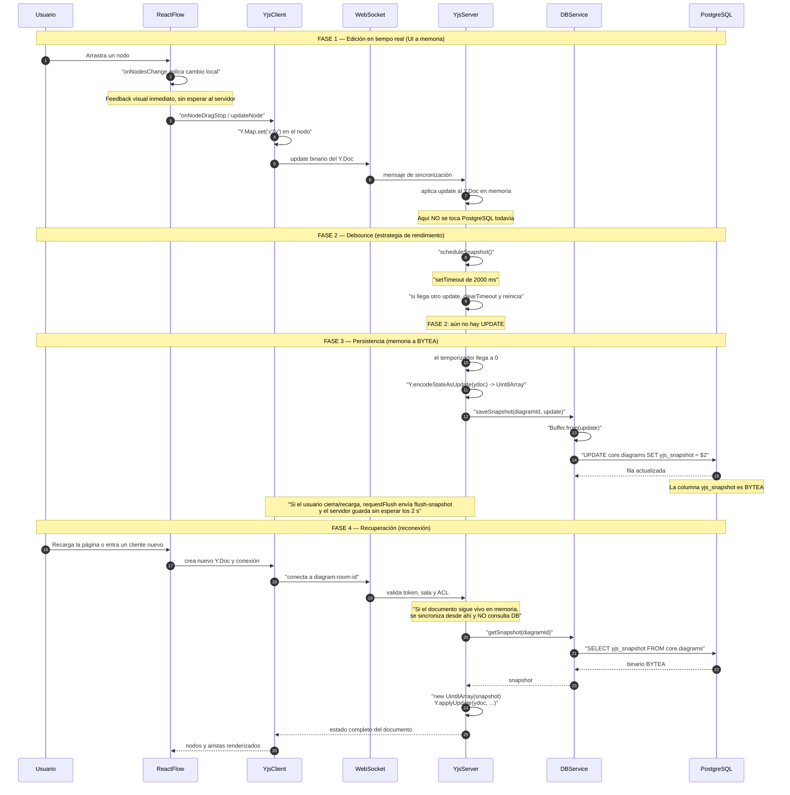

# CICLO DE VIDA DEL YJS SNAPSHOT

**Objetivo:** explicar, paso a paso, cómo un cambio visual (mover un nodo) se convierte en un binario `BYTEA` en PostgreSQL y cómo se recupera cuando un usuario recarga o entra otro cliente.

**Idea simple:** React Flow dibuja; Yjs guarda el documento en memoria; el servidor espera 2 segundos y toma una foto binaria; PostgreSQL guarda la foto. Al reconectar, la foto se vuelve a aplicar al documento.

> Este documento está pensado para defensa: cada paso tiene una explicación corta y una frase que puedes decir en voz alta.

---

## 1. El “Súper Mermaid”



---

## 2. Paso a paso (las 4 fases)

### Fase 1: Edición en Tiempo Real (UI a memoria)

1. **Usuario** arrastra un nodo en **ReactFlow**.
2. **ReactFlow** actualiza el estado local con `onNodesChange`; el movimiento se siente inmediato.
3. Al soltar, **YjsClient** actualiza el `Y.Map` del nodo con `yjsNodeHelpers.updateNode`.
4. **YjsClient** envía el update binario por **WebSocket**.
5. **YjsServer** aplica el update a su propio `Y.Doc` en memoria.

**Nota clave:** aquí **NO** se toca PostgreSQL. La edición vive en memoria y viaja como update de Yjs.

### Fase 2: El Debounce (rendimiento)

6. **YjsServer** detecta el update y llama `scheduleSnapshot`.
7. Se inicia un `setTimeout` de **2000 ms**.
8. Si llegan más cambios, se hace `clearTimeout` y el temporizador se reinicia.

**Nota clave:** esto evita saturar PostgreSQL con miles de escrituras por segundo. Una ráfaga de movimientos se convierte en **un solo** `UPDATE` al final.

### Fase 3: Persistencia (memoria a BYTEA)

9. El temporizador llega a 0.
10. **YjsServer** ejecuta `Y.encodeStateAsUpdate(ydoc)`, que devuelve un `Uint8Array`.
11. **YjsServer** llama `DBService.saveSnapshot(diagramId, update)`.
12. **DBService** convierte el array con `Buffer.from(update)`.
13. **DBService** ejecuta `UPDATE core.diagrams SET yjs_snapshot = $2`.
14. **PostgreSQL** guarda el binario en la columna `BYTEA`.

**Extra:** si el usuario cierra o recarga, `requestFlush` envía un mensaje `flush-snapshot` por WebSocket y el servidor ejecuta `flushDiagramSnapshot` sin esperar los 2 s.

### Fase 4: Recuperación (reconexión)

15. **Usuario** recarga la página o entra un cliente nuevo.
16. **YjsClient** crea un `Y.Doc` y se conecta a la sala `diagram-room-<id>`.
17. **YjsServer** valida token, sala y ACL.
18. Si el documento **no** está vivo en memoria, **YjsServer** llama `getSnapshot`.
19. **DBService** ejecuta `SELECT yjs_snapshot FROM core.diagrams`.
20. **PostgreSQL** devuelve el `BYTEA`; **YjsServer** hace `Y.applyUpdate` y el nuevo cliente recibe el estado completo.

**Matiz importante:** si el documento sigue vivo porque otro usuario está conectado, el servidor sincroniza desde memoria y no necesita consultar PostgreSQL. La lectura de DB ocurre cuando el documento ya no está en el `docs` Map del servidor.

---

## 3. Conceptos clave

### 3.1. ¿Por qué `Uint8Array` y `Buffer`?

- **Yjs** produce datos binarios puros en un `Uint8Array`.
- **`pg`**, el driver de PostgreSQL para Node.js, espera un `Buffer` para enviar binarios a `BYTEA`.
- Por eso `saveSnapshot` hace:

```javascript
await pool.query(
  `UPDATE core.diagrams
   SET yjs_snapshot = $2, updated_at = CURRENT_TIMESTAMP
   WHERE id = $1`,
  [id, Buffer.from(update)]
);
```

**Frase:** “Yjs habla en bytes; `pg` necesita un Buffer para transportar esos bytes a PostgreSQL.”

### 3.2. ¿Por qué `BYTEA`?

- `BYTEA` es el tipo binario de PostgreSQL: guarda bytes sin interpretarlos.
- Yjs necesita conservar relojes lógicos, IDs internos y tombstones; **no** es un JSON legible.
- Guardar un JSON con clases y relaciones rompería esa estructura y la concurrencia.
- **Analogía:** `BYTEA` es guardar la foto comprimida tal cual; JSON sería describir la foto con palabras y volver a dibujarla.

**Frase:** “No guardo un JSON del diagrama: guardo el documento que Yjs sabe leer.”

### 3.3. ¿Qué es el Debounce?

- Es una técnica para agrupar eventos consecutivos.
- Cada cambio reinicia un temporizador; la acción solo se ejecuta cuando pasa el tiempo sin cambios.
- En este proyecto: **2 segundos**.
- Sin debounce, mover un nodo generaría decenas o cientos de `UPDATE` por segundo.
- Con debounce, guardas **una sola vez** al final de la ráfaga.

**Analogía:** es el botón del ascensor que espera a que todos suban antes de cerrar.

---

## 4. ¿Qué pasaría si no usáramos este flujo?

| Si… | Consecuencia | Por qué |
|---|---|---|
| Guardáramos en cada clic | El servidor colapsaría | Cuello de botella de I/O: cientos de `UPDATE` por segundo. |
| Guardáramos un JSON con clases | Perderíamos la concurrencia de Yjs | Dos personas editando el mismo nodo generarían conflictos y se perderían relojes lógicos. |
| No usáramos snapshot | Habría que reconstruir el documento desde eventos | Más complejo, más lento y propenso a inconsistencias. |
| No hiciéramos flush al cerrar | Se perderían los últimos 2 s | El debounce aún no habría disparado el `UPDATE`. |
| No validáramos el snapshot al cargar | Un binario corrupto rompería la sala | `snapshotError` y `ensureDocumentReady` evitan servir un documento roto. |

---

## 5. Cómo defenderlo en 30 segundos

1. “El cambio se aplica primero en React Flow para que se sienta inmediato.”
2. “Yjs es el dueño del estado; el servidor mantiene el documento en memoria.”
3. “El debounce agrupa los cambios y evita saturar PostgreSQL.”
4. “Cuando el temporizador vence, `Y.encodeStateAsUpdate` genera un binario y `saveSnapshot` lo guarda como `BYTEA`.”
5. “Al reconectar, `getSnapshot` lee el binario y `Y.applyUpdate` reconstruye el documento.”
6. “Si el documento sigue vivo en memoria, el nuevo cliente se sincroniza desde ahí, no desde una versión vieja de la base.”

**Frase final:** “React Flow dibuja, Yjs manda, PostgreSQL guarda una foto binaria y el debounce evita que la base explote.”

---

## 6. Archivos exactos

| Archivo | Método/línea | Qué hace |
|---|---|---|
| `frontend/src/hooks/useCollaborativeFlow.ts` | `onNodesChange` (294), `onNodeDragStop` (305), `requestFlush` (171) | Captura el movimiento y pide flush al cerrar. |
| `frontend/src/utils/yjsNodeHelpers.ts` | `updateNode` (73) | Escribe la posición en el `Y.Map`. |
| `backend/realtime/yjs.js` | `scheduleSnapshot` (21), `flushDiagramSnapshot` (58), `setPersistence` (94), `writeState` (118) | Debounce, flush, carga y guardado. |
| `backend/services/diagramService.js` | `saveSnapshot` (220), `getSnapshot` (213) | `UPDATE` y `SELECT` del binario. |
| `core.diagrams` | columna `yjs_snapshot` | Almacena el `BYTEA`. |

---

## 7. Preguntas rápidas del profesor

### “¿Por qué no guardas cada cambio?”

Porque cada movimiento del mouse generaría un `UPDATE`; con varios usuarios, el pool y Neon se saturarían. El debounce agrupa la ráfaga.

### “¿Por qué no guardas un JSON?”

Porque Yjs no produce JSON: produce un binario con relojes lógicos, IDs internos y tombstones. `BYTEA` preserva eso.

### “¿Qué pasa si se cae el servidor antes del debounce?”

Se pierde lo posterior al último snapshot. Por eso existe `flush-snapshot` en `beforeunload`/`pagehide` y `writeState` cuando se va el último cliente.

### “¿Cómo se recupera?”

Si el documento sigue en memoria, se sincroniza desde ahí. Si no, `bindState` lee `BYTEA` y aplica `Y.applyUpdate`.

### “¿Qué pasa si el snapshot está corrupto?”

`bindState` marca `snapshotError`; `ensureDocumentReady` cierra la conexión con error en vez de servir un documento roto.

---

**Fin del documento.**
