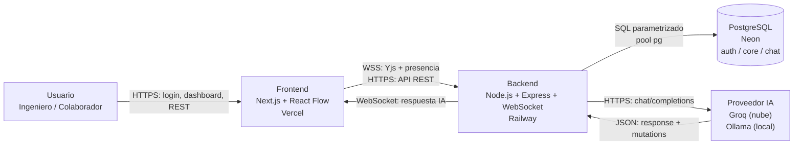
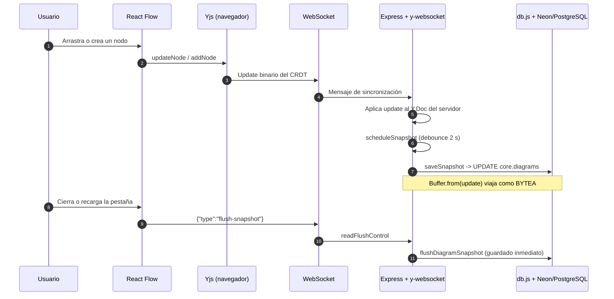
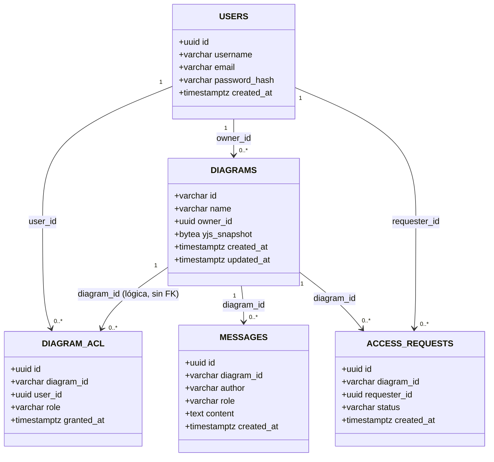
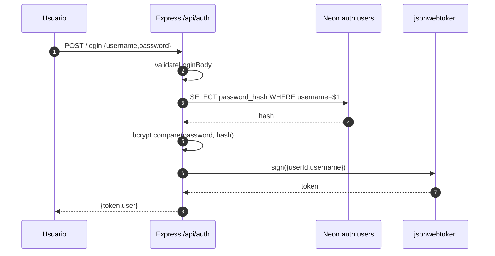
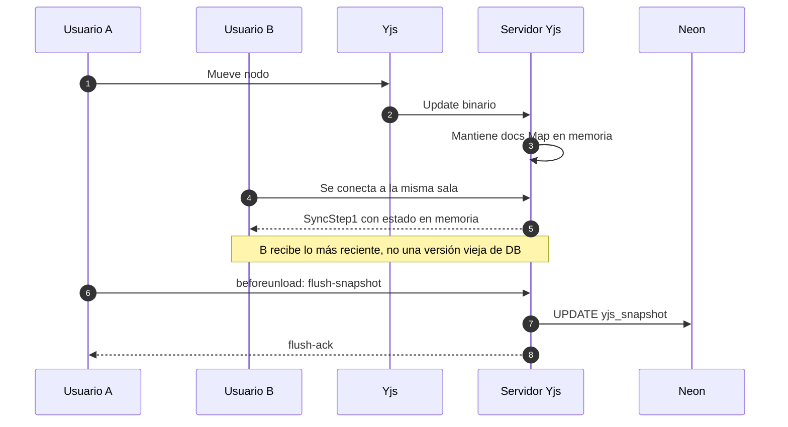
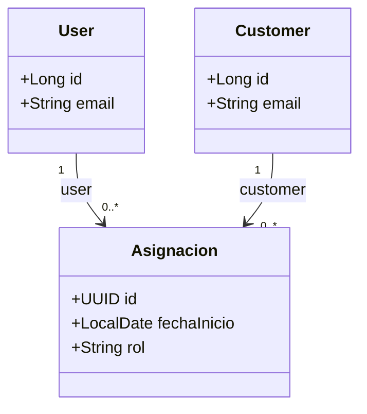

# MANUAL DE DEFENSA DEFINITIVO

**Proyecto:** Herramienta CASE Colaborativa con IA  
**Examen:** Segundo Parcial  
**Enfoque:** autoría, arquitectura, PostgreSQL/Neon, Yjs e IA  
**Regla:** todo lo que dice este manual existe en el código actual. Si algo no coincide, gana el archivo.

---

## Cómo usar este manual

1. Lee la Parte 1 para entender el mapa completo.
2. Memoriza la Parte 2: son las analogías que te salvan si te bloqueas.
3. Practica la Parte 3: ahí están los archivos y métodos que el profesor puede pedir.
4. Ensaya la Parte 4 en voz alta.
5. Haz la demo de la Parte 5 con cronómetro.
6. Lee la Parte 6 antes de entrar.

---

# PARTE 1: El Mapa Visual del Proyecto (El “Qué”)

## 1.1. Diagrama de contexto



**Lectura en una frase:** el navegador edita el diagrama en Yjs; el backend Node lo sincroniza y lo guarda en Neon; la IA solo propone cambios que el backend valida.

## 1.2. Diagrama de flujo de datos: de un clic a PostgreSQL



**Puntos que debes decir en voz alta:**

- El clic no genera un `INSERT` por nodo.
- React Flow no es la fuente de verdad: solo dibuja.
- Yjs es el dueño del estado en caliente.
- PostgreSQL guarda una foto binaria del documento completo.
- El debounce de 2 s agrupa cambios; el `beforeunload` fuerza el guardado final.

## 1.3. La gran diferencia: Herramienta vs. Backend generado

| Pregunta | La Herramienta (Node.js) | El Backend Generado (Spring Boot) |
|---|---|---|
| ¿Qué es? | El producto que usas para modelar. | Un ZIP de código Java que produce la herramienta. |
| ¿Dónde corre? | Railway / local. | Donde el usuario despliegue su ZIP. |
| ¿Qué lenguaje? | JavaScript/TypeScript. | Java 21 + Spring Boot. |
| ¿Cómo guarda? | SQL nativo con `pg`, snapshot `BYTEA`. | JPA/Hibernate con `ddl-auto=update`. |
| ¿Qué tablas crea? | `auth`, `core`, `chat` de la herramienta. | `Cliente`, `Pedido`, etc. en **otra** base. |
| ¿Qué IA usa? | Groq/Ollama para asistir el modelado. | No depende de la IA de la herramienta. |
| ¿Quién lo genera? | No se genera: es el runtime. | `backend/generator/generate.js`. |
| Frase clave | “La herramienta es Node.” | “El backend generado es Spring.” |

**Error que no debes cometer:** decir que `Cliente` o `Pedido` son tablas de Neon. No lo son. Son entidades del backend generado, creadas dinámicamente en la base del usuario.

---

# PARTE 2: Diccionario Técnico para Dummies

## 2.1. Las cinco palabras que más te van a preguntar

| Término | Analogía del mundo real | Qué significa técnicamente | Dónde vive |
|---|---|---|---|
| **CRDT / Yjs** | Dos personas escribiendo en la misma hoja de Excel mágica: aunque escriban a la vez, la hoja termina igual para ambos. | Estructura de datos replicada que converge sin coordinador. Yjs conserva relojes lógicos, IDs internos y tombstones. | `frontend/src/hooks/useCollaborativeFlow.ts`, `backend/realtime/yjs.js` |
| **JWT** | El pase VIP de un concierto: el portero mira la pulsera firmada, no llama a la oficina. | Token firmado que lleva `userId`, `username` y expiración. El servidor verifica la firma sin sesión en DB. | `backend/middleware/auth.js` |
| **Debounce** | El botón del ascensor que espera a que todos suban antes de cerrar. | Reinicia un temporizador con cada cambio; solo ejecuta el guardado cuando pasan 2 s sin cambios. | `backend/realtime/yjs.js`, `scheduleSnapshot` |
| **BYTEA** | Guardar una foto comprimida dentro de un archivador: no la desarmas, la guardas tal cual. | Tipo binario de PostgreSQL. Guarda el `Uint8Array` de Yjs sin convertirlo a JSON. | `core.diagrams.yjs_snapshot`, `backend/services/diagramService.js` |
| **ORM (Hibernate/JPA)** | Un traductor que convierte “Cliente tiene pedidos” en el idioma de la base de datos. | Capa que mapea clases Java a tablas. La herramienta Node **no** la usa; el backend generado sí. | `backend/generator/templates/model.java.hbs` |

## 2.2. Otras palabras que aparecen en la defensa

| Término | Analogía | Explicación corta |
|---|---|---|
| **ACL** | Lista de invitados de una fiesta, pero por cada sala. | Tabla `auth.diagram_acl`: usuario + diagrama + rol (`OWNER`, `EDITOR`, `VIEWER`). |
| **Snapshot** | Foto del documento completo. | `Y.encodeStateAsUpdate(ydoc)` convertido a `BYTEA`. |
| **WebSocket** | Teléfono directo entre navegador y servidor. | Canal bidireccional para Yjs y presencia. |
| **XMI** | Acta notarial del diagrama. | XML estándar UML 2.5.1 con modelo + UMLDI + extensión EA. |
| **UMLDI** | Croquis de posiciones pegado al acta. | Sección XMI con `bounds`, `waypoints` y geometría. |
| **Handlebars** | Molde de galletas. | Plantillas que reciben contexto y generan archivos Java. |
| **AST** | Plano del diagrama en texto. | `{ entities, relationships }` que consumen IA y generador. |

## 2.3. Diagrama de la base de datos real



**Lo que debes observar en el diagrama:**

- No existe `Class` ni `Relation`.
- El grafo completo está dentro de `DIAGRAMS.yjs_snapshot`.
- `DIAGRAM_ACL` es la tabla intermedia N:M entre usuarios y diagramas.
- `MESSAGES` es relacional porque se consulta y se audita.
- `DIAGRAM_ACL.diagram_id` se dibuja como relación lógica, no como FK física.

---

# PARTE 3: El “Deep Dive” (El “Dónde está el código”)

## 3.1. Conexión a Base de Datos — `backend/db.js`

**Qué hace:** crea el pool de PostgreSQL, configura SSL para Neon y ofrece `withTransaction` para operaciones atómicas.

**Archivo exacto:** `backend/db.js`  
**Método clave:** `withTransaction` + configuración de `Pool`

**Código real (`backend/db.js:25-55`):**

```javascript
const pool = new Pool({
  connectionString,
  max: Number(process.env.PG_POOL_MAX) || 10,
  idleTimeoutMillis: 30000,
  connectionTimeoutMillis: 10000,
  ssl: connectionString && connectionString.includes('sslmode=require')
    ? { rejectUnauthorized: false }
    : undefined,
});

pool.on('error', (err) => {
  console.error('Error inesperado en el pool de PostgreSQL:', err.message);
});

async function withTransaction(callback) {
  const client = await pool.connect();
  try {
    await client.query('BEGIN');
    const result = await callback(client);
    await client.query('COMMIT');
    return result;
  } catch (err) {
    try {
      await client.query('ROLLBACK');
    } catch {}
    throw err;
  } finally {
    client.release();
  }
}
```

**Explicación línea por línea:**

- `new Pool`: en vez de abrir una conexión por request, mantiene una flota reutilizable.
- `max: 10`: límite de conexiones simultáneas; Neon cobra/limita conexiones.
- `idleTimeoutMillis`: cierra conexiones inactivas a los 30 s.
- `connectionTimeoutMillis`: si no consigue conexión en 10 s, falla rápido.
- `ssl`: Neon exige TLS. Solo se activa si la URL contiene `sslmode=require`.
- `rejectUnauthorized: false`: evita errores de cadena de certificados en el entorno gestionado. **Tradeoff:** en producción con CA propia se debería validar.
- `pool.on('error')`: una conexión inactiva rota no debe tumbar el proceso.
- `BEGIN`: inicia transacción.
- `callback(client)`: recibe el cliente para ejecutar varias consultas con la misma conexión.
- `COMMIT`: confirma todo.
- `catch → ROLLBACK`: si una consulta falla, deshace todo.
- `finally → release`: devuelve el cliente al pool; sin esto, el pool se agota.

**Analogía:** el pool es una flota de mensajeros; `withTransaction` es un mensajero que hace varias entregas y, si una falla, devuelve todas.

---

## 3.2. Autenticación — `backend/middleware/auth.js` + `userService.js`

**Qué hace:** firma y verifica JWT; hashea y compara contraseñas con bcrypt.

**Archivos exactos:** `backend/middleware/auth.js`, `backend/services/userService.js`  
**Métodos clave:** `requireAuth`, `signToken`, `bcrypt.hash`, `bcrypt.compare`

**Código real (`backend/middleware/auth.js:21-39`):**

```javascript
function requireAuth(req, res, next) {
  if (!authEnabled()) {
    req.user = { userId: 'anonymous', username: 'anonymous' };
    return next();
  }

  const auth = req.headers.authorization;
  if (!auth || !auth.startsWith('Bearer ')) {
    return res.status(401).json({ error: 'Token requerido' });
  }

  try {
    const payload = jwt.verify(auth.slice(7), getSecret());
    req.user = { userId: payload.userId, username: payload.username };
    next();
  } catch (err) {
    return res.status(401).json({ error: 'Token inválido o expirado' });
  }
}
```

**Explicación línea por línea:**

- `authEnabled()`: permite modo abierto en desarrollo (`AUTH_ENABLED=false`).
- `req.user`: identidad desde el token, no desde el body. Evita suplantación.
- `auth.startsWith('Bearer ')`: formato estándar.
- `slice(7)`: corta exactamente “Bearer ”.
- `jwt.verify`: valida firma y expiración.
- `req.user = payload`: adjunta identidad a la request.
- `401`: token ausente, inválido o vencido.

**Código real (`backend/middleware/auth.js:68-74`):**

```javascript
function signToken(user) {
  return jwt.sign(
    { userId: user.id, username: user.username },
    getSecret(),
    { expiresIn: process.env.JWT_EXPIRATION || '7d' }
  );
}
```

**Explicación:** el token solo lleva identidad mínima y expiración. No lleva contraseña ni rol global. El rol se consulta por diagrama en `auth.diagram_acl`.

**Código real de bcrypt (`backend/services/userService.js:65` y `86`):**

```javascript
const passwordHash = await bcrypt.hash(String(password), 10);
```

```javascript
const ok = await bcrypt.compare(String(password), user.passwordHash);
```

**Explicación:** `bcrypt.hash(..., 10)` usa 10 rondas de sal; la contraseña nunca se guarda en claro. `compare` vuelve a hashear el intento y compara. No se puede “desencriptar” bcrypt.



**Frase de defensa:** “El servidor no guarda sesiones: verifica una pulsera firmada. La contraseña se guarda como hash bcrypt, nunca en claro.”

---

## 3.3. Colaboración — `backend/realtime/yjs.js` + `useCollaborativeFlow.ts`

**Qué hace:** sincroniza el grafo en tiempo real, lo persiste cada 2 s y fuerza un guardado inmediato al cerrar/recargar.

**Archivos exactos:** `backend/realtime/yjs.js`, `frontend/src/hooks/useCollaborativeFlow.ts`  
**Métodos clave:** `scheduleSnapshot`, `bindState`, `writeState`, `flushDiagramSnapshot`, `requestFlush`

### 3.3.1. Debounce del servidor

**Código real (`backend/realtime/yjs.js:21-36`):**

```javascript
function scheduleSnapshot(docName, ydoc, diagramId, delay = SNAPSHOT_DEBOUNCE_MS) {
  if (ydoc.snapshotError) return;
  const previous = snapshotTimers.get(docName);
  if (previous) clearTimeout(previous);

  const timer = setTimeout(async () => {
    snapshotTimers.delete(docName);
    if (ydoc.snapshotError) return;
    try {
      await diagramService.saveSnapshot(diagramId, Y.encodeStateAsUpdate(ydoc));
    } catch (err) {
      console.error(`No se pudo guardar el snapshot de ${diagramId}:`, err.message);
    }
  }, delay);
  snapshotTimers.set(docName, timer);
}
```

**Explicación:**

- `snapshotTimers`: un timer por sala.
- `clearTimeout(previous)`: cada cambio reinicia la cuenta.
- `Y.encodeStateAsUpdate`: serializa el documento completo.
- `saveSnapshot`: hace el `UPDATE` a Neon.
- `try/catch`: un fallo de red no tumba el servidor.

### 3.3.2. Cargar antes de aceptar escrituras

**Código real (`backend/realtime/yjs.js:94-117`):**

```javascript
setPersistence({
  provider: null,
  bindState: async (docName, ydoc) => {
    const ready = (async () => {
      await waitForPendingWrite(docName);
      const diagramId = diagramIdFromRoom(docName);
      if (!diagramId) return;

      try {
        const snapshot = await diagramService.getSnapshot(diagramId);
        if (snapshot) Y.applyUpdate(ydoc, new Uint8Array(snapshot));
      } catch (err) {
        ydoc.snapshotError = err;
        console.error(`No se pudo cargar el snapshot de ${diagramId}:`, err.message);
        return;
      }

      ydoc.on('update', () => scheduleSnapshot(docName, ydoc, diagramId));
      scheduleSnapshot(docName, ydoc, diagramId);
    })();

    ydoc.readyPromise = ready;
    await ready;
  },
```

**Explicación:**

- `waitForPendingWrite`: espera a que termine un guardado de apagado.
- `getSnapshot`: lee `yjs_snapshot` de `core.diagrams`.
- `Y.applyUpdate`: reconstruye el documento en memoria.
- `ydoc.on('update')`: desde aquí, cada cambio programa un guardado.
- `readyPromise`: el servidor no deja entrar al cliente hasta que el snapshot histórico está cargado. Sin esto, el primer update podría borrar el pasado.

### 3.3.3. Guardado inmediato al cerrar/recargar

**Código real (`backend/realtime/yjs.js:58-82`):**

```javascript
async function flushDiagramSnapshot(diagramId) {
  const safeId = String(diagramId || '').replace(/[^a-zA-Z0-9_-]/g, '');
  if (!safeId) return false;

  const roomName = `diagram-room-${safeId}`;
  const ydoc = docs.get(roomName);
  if (!ydoc || ydoc.snapshotError) return false;

  if (ydoc.readyPromise) await ydoc.readyPromise;
  if (ydoc.snapshotError) return false;

  const timer = snapshotTimers.get(roomName);
  if (timer) {
    clearTimeout(timer);
    snapshotTimers.delete(roomName);
  }

  try {
    await diagramService.saveSnapshot(safeId, Y.encodeStateAsUpdate(ydoc));
    return true;
  } catch (err) {
    scheduleSnapshot(roomName, ydoc, safeId);
    throw err;
  }
}
```

**Explicación línea por línea:**

- `safeId`: sanitiza el id.
- `docs.get(roomName)`: busca el documento **vivo en memoria** del servidor. Si no está, no crea uno vacío.
- `ydoc.snapshotError`: si la carga falló, no sobrescribe con basura.
- `await ydoc.readyPromise`: espera a que el snapshot histórico esté aplicado.
- `clearTimeout`: cancela el guardado pendiente para no duplicar.
- `Y.encodeStateAsUpdate`: saca la foto binaria actual.
- `saveSnapshot`: hace el `UPDATE` inmediato.
- `catch → scheduleSnapshot`: si falla, deja un reintento programado.

**Código real del cliente (`frontend/src/hooks/useCollaborativeFlow.ts:168-185`):**

```typescript
// ── 3. Flush inmediato al cerrar/recargar ───────────────────────
// No esperamos al debounce de 2 s del servidor: pedimos por el mismo
// WebSocket que persista el documento de esta sala antes de irnos.
const requestFlush = () => {
  const ws = provider.ws;
  if (!ws || ws.readyState !== WebSocket.OPEN) return;
  try {
    ws.send(JSON.stringify({
      type: 'flush-snapshot',
      diagramId: roomName.startsWith('diagram-room-')
        ? roomName.slice('diagram-room-'.length)
        : roomName,
    }));
  } catch {}
};

window.addEventListener('beforeunload', requestFlush);
window.addEventListener('pagehide', requestFlush);
```

**Explicación:**

- `provider.ws`: socket abierto por y-websocket.
- `readyState !== OPEN`: si ya está cerrando, no intenta enviar.
- `JSON.stringify`: mensaje de control legible; y-websocket lo ignora porque no es binario de sync.
- `beforeunload` y `pagehide`: cubren cierre de pestaña, recarga y mobile.
- El backend intercepta ese JSON en `readFlushControl` y llama `flushDiagramSnapshot`.

**Código real del interceptor (`backend/realtime/yjs.js:254-270`):**

```javascript
ws.on('message', (raw) => {
  const control = readFlushControl(raw);
  if (!control) return;

  const requestedId = typeof control.diagramId === 'string' ? control.diagramId : diagramId;
  if (!requestedId || requestedId !== diagramId) return;

  flushDiagramSnapshot(diagramId)
    .then((ok) => {
      if (ws.readyState === WebSocket.OPEN) {
        ws.send(JSON.stringify({ type: 'flush-ack', diagramId, ok }));
      }
    })
    .catch((err) => {
      console.error(`No se pudo forzar el guardado de ${diagramId}:`, err.message);
    });
});
```

**Explicación:** solo acepta el mensaje para la sala autenticada; evita que un cliente fuerce el guardado de otro diagrama.

### 3.3.4. Persistencia real del snapshot

**Código real (`backend/services/diagramService.js:220-229`):**

```javascript
async function saveSnapshot(diagramId, update) {
  const id = safeId(diagramId);
  if (!id || !update) return;
  await pool.query(
    `UPDATE core.diagrams
     SET yjs_snapshot = $2, updated_at = CURRENT_TIMESTAMP
     WHERE id = $1`,
    [id, Buffer.from(update)]
  );
}
```

**Explicación:**

- `Buffer.from(update)`: convierte el `Uint8Array` de Yjs a `Buffer`; `pg` lo mapea a `BYTEA`.
- `UPDATE`: no inserta filas por nodo; actualiza el documento completo.
- `updated_at`: el dashboard ordena por última modificación.



**Frase de defensa:** “React Flow dibuja; Yjs manda. El servidor mantiene el documento vivo mientras hay conexiones y fuerza el snapshot al cerrar.”

---

## 3.4. El Generador — `backend/generator/expander.js`

**Qué hace:** convierte una relación `*` a `*` en una entidad intermedia Java con UUID propio y dos `@ManyToOne`.

**Archivo exacto:** `backend/generator/expander.js`  
**Método clave:** `expandManyToMany`

**Código real (`backend/generator/expander.js:76-173`):**

```javascript
function expandManyToMany(entities, relationships, takenNames) {
  const allEntities = [...(entities || [])];
  const allRelationships = [];
  const intermediates = [];
  const taken = takenNames instanceof Set ? takenNames : new Set(
    (entities || []).map(e => e.name)
  );

  for (const rel of relationships || []) {
    if (!isManyToManyRel(rel)) {
      allRelationships.push(rel);
      continue;
    }

    const from = relFromName(rel, entities);
    const to = relToName(rel, entities);
    if (!from || !to) {
      allRelationships.push(rel);
      continue;
    }

    let intermediateEntity = isValidJavaIdentifier(rel.intermediateEntity)
      ? rel.intermediateEntity
      : `${toJavaClassName(from)}${toJavaClassName(to)}`;
    if (taken.has(intermediateEntity)) {
      const base = intermediateEntity;
      let n = 2;
      while (taken.has(base + n)) n++;
      intermediateEntity = base + n;
    }
    taken.add(intermediateEntity);
    const intermediateTable = /^[a-z0-9_]+$/.test(rel.intermediateTable || '')
      ? rel.intermediateTable
      : `${snakeCase(intermediateEntity)}`;
    const intermediateAttributes = (rel.intermediateAttributes || []).map(a => ({ ...a }));

    intermediates.push({
      name: intermediateEntity,
      tableName: intermediateTable,
      isAssociationClass: !!rel.isAssociationClass,
      fromEntity: from,
      toEntity: to,
      fromEntityLower: toLowerFirst(from),
      toEntityLower: toLowerFirst(to),
      fromEntitySnake: snakeCase(from),
      toEntitySnake: snakeCase(to),
      intermediateAttributes,
      sourceRelationshipId: rel.id,
    });

    allEntities.push({
      id: `intermediate_${rel.id || intermediateEntity}`,
      name: intermediateEntity,
      originalName: intermediateEntity,
      tableName: intermediateTable,
      fieldName: camelCase(intermediateEntity),
      route: `${intermediateTable}s`,
      attributes: [
        { id: `pk_${intermediateEntity}`, name: 'id', type: 'UUID', isPk: true, nullable: false, unique: true },
        ...intermediateAttributes,
      ],
      intermediateOf: rel.id,
      intermediateTable,
    });

    allRelationships.push({
      id: `${rel.id || intermediateEntity}_a`,
      source: { entityName: intermediateEntity },
      target: { entityName: from },
      fromEntity: intermediateEntity,
      toEntity: from,
      type: 'MANY_TO_ONE',
      cardinalityFrom: '*',
      cardinalityTo: '1',
      synthetic: true,
    });
    allRelationships.push({
      id: `${rel.id || intermediateEntity}_b`,
      source: { entityName: intermediateEntity },
      target: { entityName: to },
      fromEntity: intermediateEntity,
      toEntity: to,
      type: 'MANY_TO_ONE',
      cardinalityFrom: '*',
      cardinalityTo: '1',
      synthetic: true,
    });
  }

  return { allEntities, allRelationships, intermediates };
}
```

**Explicación línea por línea:**

- `allEntities`/`allRelationships`: copias para no mutar el AST original.
- `isManyToManyRel`: true si es `MANY_TO_MANY` o si ambos extremos son “muchos”.
- `relFromName`/`relToName`: resuelven nombres desde id u objeto.
- `intermediateEntity`: respeta el nombre de la clase asociativa si es válido; si no, `OrigenDestino`.
- `taken`: evita colisiones; agrega `2`, `3`, etc.
- `intermediateTable`: snake_case o nombre provisto.
- `intermediateAttributes`: atributos propios de la relación.
- `allEntities.push`: crea una entidad real con PK UUID.
- `allRelationships.push` × 2: crea dos relaciones `* → 1` hacia los originales.
- `return`: el resto del generador sigue el pipeline normal.

**Código Java generado real (`Asignacion.java`):**

```java
@Entity
@Table(name = "asignacion")
@Getter @Setter @NoArgsConstructor @AllArgsConstructor
public class Asignacion {

    @Id
    @GeneratedValue(strategy = GenerationType.UUID)
    @Column(name = "id", updatable = false, nullable = false)
    private UUID id;

    @ManyToOne(fetch = FetchType.LAZY)
    @JoinColumn(name = "user_id", nullable = false)
    private User user;

    @ManyToOne(fetch = FetchType.LAZY)
    @JoinColumn(name = "customer_id", nullable = false)
    private Customer customer;

    @Column(name = "fecha_inicio")
    private LocalDate fechaInicio;
    @Column(name = "rol")
    private String rol;
}
```



**Por qué NO `@ManyToMany`:** no permite columnas extra en la tabla intermedia, puede generar ciclos JSON y no representa una clase asociativa UML con atributos propios.

---

# PARTE 4: El Banco de Preguntas (El “Por qué”)

## 4.1. Preguntas básicas

### P1. ¿Qué hace la aplicación?

**Respuesta corta:** “Es una herramienta CASE colaborativa para modelar UML en tiempo real, asistir el modelado con IA, exportar XMI y generar un backend Spring Boot.”

**El “por qué”:** integra análisis, diseño y generación en un solo flujo; el diagrama no se queda en una imagen, se convierte en un AST y luego en código.

**Alternativa descartada:** una herramienta solo de dibujo no generaría backend ni colaboración real; sería menos valiosa.

**Dónde mostrarlo:** `frontend/src/app/diagram/[id]/page.tsx`; `backend/routes/generator.js`; `backend/generator/generate.js`.

### P2. ¿Por qué React y no Angular o Vue?

**Respuesta corta:** “Porque React Flow ya resuelve nodos, aristas, handles, zoom y eventos de canvas; React 19 + Next.js 16 permitieron integrar Yjs y hooks sin pelear con el framework.”

**El “por qué”:** el requisito dominante era un editor de grafos colaborativo, no un CRUD. React Flow + React fue la ruta más corta y mantenible.

**Alternativa descartada:** Angular o Vue también podían funcionar, pero implicaban adaptar otro ecosistema de canvas; no aportaban ventaja para este caso.

**Dónde mostrarlo:** `frontend/package.json`; `frontend/src/components/diagram/EditorFlow.tsx`; `frontend/src/hooks/useCollaborativeFlow.ts`.

### P3. ¿Por qué Node.js en la herramienta?

**Respuesta corta:** “Porque el backend es I/O concurrente: REST, WebSocket, PostgreSQL e IA. Node nos dio un solo lenguaje y un ecosistema directo para Yjs, `ws` y `pg`.”

**El “por qué”:** el producto no necesita cómputo pesado; necesita muchas conexiones y eventos. Java se reserva para el backend generado, que sí es Spring Boot.

**Alternativa descartada:** hacer la herramienta en Java habría duplicado lenguaje y complicado la integración con Yjs/WebSocket del navegador.

**Dónde mostrarlo:** `backend/package.json`; `backend/server.js`; `backend/realtime/yjs.js`.

### P4. ¿Por qué PostgreSQL/Neon y no MongoDB?

**Respuesta corta:** “Porque lo durable es relacional y transaccional: usuarios, ACL, solicitudes y chat. Necesitamos FKs, CHECK, índices parciales y `BYTEA`.”

**El “por qué”:** MongoDB habría facilitado guardar un JSON, pero habríamos perdido integridad referencial en permisos y auditoría. Además, el grafo no se guarda como JSON: se guarda como binario Yjs.

**Alternativa descartada:** MongoDB para todo; se descartó por la ACL y el chat, que sí se consultan y se relacionan.

**Dónde mostrarlo:** `backend/db.js`; `Documentacion_Segundo_Parcial/04_Diseno_UML.md:975-1031`; `REVERSE_ENGINEERING_REPORT.md`.

---

## 4.2. Preguntas de arquitectura

### P5. ¿Por qué no usaron un ORM en Node? ¿Por qué no Prisma o TypeORM?

**Respuesta corta:** “Porque el esquema es pequeño, hay `BYTEA`, transacciones manuales y locks de ACL. `pg` con SQL parametrizado nos da control directo; un ORM añadía una capa que no resolvía el problema central: el grafo no es relacional.”

**El “por qué”:** las operaciones necesitan transacciones atómicas (`diagrama + ACL`), `pg_advisory_xact_lock`, índices parciales y `UPDATE yjs_snapshot`. Con SQL vemos exactamente qué viaja a Neon.

**Alternativa descartada:** Prisma/TypeORM. Habrían dado tipado y migraciones, pero también codegen, *N+1* potencial y una capa extra para un esquema de cinco tablas. El backend generado sí usa JPA porque es otra arquitectura.

**Dónde mostrarlo:** `backend/db.js`; `backend/services/diagramService.js`; `backend/services/aclService.js`.

### P6. ¿Por qué separaron en capas `routes`, `services` y `db.js`?

**Respuesta corta:** “Para que cada archivo tenga una sola razón para cambiar: la ruta maneja HTTP, el servicio maneja reglas y SQL, y `db.js` maneja infraestructura.”

**El “por qué”:** se puede testear la app sin abrir un puerto, reutilizar servicios y cambiar detalles de Express sin tocar la lógica.

**Alternativa descartada:** meter todo en `server.js`. Habría sido más rápido al inicio, pero imposible de testear y mantener.

**Dónde mostrarlo:** `backend/app.js`; `backend/routes/auth.js`; `backend/services/userService.js`; `backend/db.js`.

### P7. ¿Por qué `server.js` tiene solo 59 líneas?

**Respuesta corta:** “Porque es el composition root: crea la app, el servidor HTTP, el WebSocket y el apagado. La lógica está en `app.js`, `routes`, `services` y `db.js`.”

**El “por qué”:** separar el ciclo de vida del proceso de la lógica HTTP permite testear y razonar. `server.js` no sabe qué es un diagrama; solo sabe arrancar y apagar.

**Alternativa descartada:** un único archivo monolítico; se descartó por mantenibilidad.

**Dónde mostrarlo:** `backend/server.js`; `backend/app.js`.

### P8. ¿Cómo evitan perder cambios al cerrar la pestaña?

**Respuesta corta:** “Hay dos redes: el servidor guarda cada 2 s con debounce y, al cerrar o recargar, el frontend envía un `flush-snapshot` por WebSocket; el backend busca el documento vivo y hace el `UPDATE` inmediato.”

**El “por qué”:** el debounce reduce escrituras, pero puede perder los últimos 2 s si el navegador se cierra. El flush cierra esa ventana. Además, y-websocket ejecuta `writeState` cuando se va el último cliente.

**Alternativa descartada:** guardar en cada píxel; saturaría Neon. También se descartó un botón manual de guardar como única solución, porque el usuario no debería depender de recordarlo.

**Dónde mostrarlo:** `frontend/src/hooks/useCollaborativeFlow.ts:171-185`; `backend/realtime/yjs.js:58-82`, `254-270`; `backend/services/diagramService.js:220-229`.

### P9. ¿React Flow es el dueño de la verdad?

**Respuesta corta:** “No. React Flow solo dibuja. El estado canónico es Yjs; `page.tsx` recibe `nodes` y `edges` de `useCollaborativeFlow`, no de un `useNodesState` local.”

**El “por qué”:** si React Flow tuviera su propio estado compitiendo, los cambios remotos y locales se pisarían. Yjs es el único punto de convergencia.

**Alternativa descartada:** `useNodesState` + Yjs en paralelo; se descartó porque genera dos fuentes de verdad y condiciones de carrera.

**Dónde mostrarlo:** `frontend/src/app/diagram/[id]/page.tsx` (`nodes={nodes}`, `edges={edges}`); `frontend/src/hooks/useCollaborativeFlow.ts`.

**Matiz honesto:** React Flow mantiene un espejo local para que el arrastre se sienta fluido; al soltar, escribe la posición final a Yjs.

---

## 4.3. Preguntas de base de datos

### P10. ¿Por qué no hay una tabla de `Class` ni de `Relation`?

**Respuesta corta:** “Porque el grafo no es relacional: es un CRDT de Yjs. Las clases y relaciones viven dentro de `core.diagrams.yjs_snapshot` como un documento binario.”

**El “por qué”:** Yjs necesita conservar relojes lógicos, IDs internos y tombstones. Normalizar cada nodo en una fila rompería la convergencia y generaría miles de escrituras.

**Alternativa descartada:** tablas `classes` y `relations`. Darían integridad referencial clásica, pero perderían la semántica de colaboración en tiempo real.

**Dónde mostrarlo:** `backend/services/diagramService.js`; `backend/realtime/yjs.js`; `REVERSE_ENGINEERING_REPORT.md:8-18`.

### P11. ¿Por qué `BYTEA` y no `JSONB`?

**Respuesta corta:** “Porque Yjs produce un binario opaco, no un JSON. `BYTEA` lo guarda byte por byte; `JSONB` obligaría a recodificar y podría corromper la semántica del CRDT.”

**El “por qué”:** `Y.encodeStateAsUpdate` devuelve un `Uint8Array`; `pg` lo mapea a `BYTEA` con `Buffer.from`. No consultamos clases individuales en SQL; consultamos el documento completo.

**Alternativa descartada:** `JSONB` con un JSON del diagrama. Sería legible, pero perdería tombstones y relojes, y no sería el mismo documento que usa Yjs.

**Dónde mostrarlo:** `backend/services/diagramService.js:220-229`; DDL de `core.diagrams`.

### P12. ¿Por qué `diagram_acl.diagram_id` no tiene FK física?

**Respuesta corta:** “Porque el DDL entregado no la declara. La integridad se maneja en `deleteDiagram` con una transacción: primero borra la ACL y luego el diagrama.”

**El “por qué”:** se decidió desacoplar `auth` de `core`; una FK acoplaría los esquemas. La transacción evita permisos huérfanos.

**Alternativa descartada:** `ON DELETE CASCADE` en la FK. Sería más simple, pero cambiaría el esquema y acoplaría `auth` a `core`. **Tradeoff:** el borrado directo por SQL debe recordar limpiar la ACL.

**Dónde mostrarlo:** `backend/services/diagramService.js:202-211`; `REVERSE_ENGINEERING_REPORT.md:39-46`.

### P13. ¿Cómo se recupera el diagrama al reconectar?

**Respuesta corta:** “Si el documento sigue vivo en el `docs` Map del servidor, el nuevo cliente recibe el estado en memoria. Si el último usuario se desconectó, y-websocket ejecuta `writeState`, guarda el snapshot y destruye el documento; al reconectar se carga desde Neon con `Y.applyUpdate`.”

**El “por qué”:** mientras hay alguien conectado, la memoria del servidor es más reciente que la BD. Cuando no queda nadie, se hace el guardado final para no perderlo.

**Alternativa descartada:** leer siempre de la BD al reconectar. Sería más simple, pero un usuario que recarga mientras otro edita vería una versión vieja.

**Dónde mostrarlo:** `backend/realtime/yjs.js:94-117`, `118-137`; `docs` de `y-websocket/bin/utils`.

### P14. ¿Cómo se evita que dos usuarios se pisen al mover el mismo nodo?

**Respuesta corta:** “Yjs resuelve la concurrencia con relojes lógicos. Si ambos mueven el mismo nodo, las escrituras se ordenan de forma determinista y ambos clientes convergen. El debounce solo agrupa el guardado, no resuelve conflictos.”

**El “por qué”:** un CRDT está diseñado para converger sin coordinador. No se usa “last write por timestamp del servidor” porque los relojes de pared no son confiables.

**Alternativa descartada:** bloquear el nodo con un lock pesimista en PostgreSQL. Se descartó porque mataría la fluidez y añadiría latencia por cada movimiento.

**Dónde mostrarlo:** `frontend/src/utils/yjsNodeHelpers.ts`; `frontend/src/hooks/useCollaborativeFlow.ts`; `backend/realtime/yjs.js`.

---

## 4.4. Preguntas de IA

### P15. ¿Cómo evitan que la IA alucine o borre cosas sin permiso?

**Respuesta corta:** “La IA no ejecuta nada. Devuelve un JSON con máximo cinco acciones; `validateMutations` verifica la allowlist, tipos y límites; si falla, el backend responde 502 y no se aplica nada.”

**El “por qué”:** el LLM es probabilístico. El prompt reduce el riesgo, pero la validación determinista es la garantía. La IA propone; el backend decide.

**Alternativa descartada:** confiar en el prompt o en `temperature: 0.1`. Se descartó porque una instrucción no es una garantía de formato ni de seguridad.

**Dónde mostrarlo:** `backend/services/aiService.js` (`systemPrompt`); `backend/routes/ai.js:145-146`; `backend/validation.js:288-361`; `frontend/src/utils/ast.ts:194-317`.

### P16. ¿Cómo funciona la memoria del chat?

**Respuesta corta:** “Se guardan los mensajes en `chat.messages`; el backend toma los últimos 15, los formatea con autor y los inyecta en el prompt. El historial es contexto, no una lista de órdenes pendientes.”

**El “por qué”:** sin memoria, la IA no resolvería “borra eso” o “agrégale un atributo”. Con autor, distingue lo que pidió Carlos de lo que pidió Andrés.

**Alternativa descartada:** mandar todo el historial. Se descartó por costo, latencia y riesgo de que instrucciones viejas contaminen la orden actual.

**Dónde mostrarlo:** `backend/services/chatService.js`; `backend/services/aiService.js` (`formatChatHistory`); `backend/routes/ai.js:124-125`.

### P17. ¿Cómo funciona la tutoría contextual?

**Respuesta corta:** “El frontend envía `selectedElement` con tipo, nombre, atributos, métodos o extremos de la relación. El backend lo valida y lo inserta en el prompt; la IA debe usar ese elemento como ejemplo práctico.”

**El “por qué”:** sin contexto, la respuesta sería genérica. Con el elemento seleccionado, puede explicar “esta composición” o “esta clase” con datos reales.

**Alternativa descartada:** mandar una captura de pantalla siempre. Se descartó porque el AST es más preciso y barato que una imagen para texto.

**Dónde mostrarlo:** `frontend/src/hooks/useEditorSelection.ts`; `backend/validation.js` (`validateSelectedElement`); `backend/services/aiService.js` (`formatSelectedElement`).

### P18. ¿Cómo funcionan Groq y Ollama sin duplicar código?

**Respuesta corta:** “Con una función Strategy: `resolveAiProvider` devuelve `baseUrl`, `model` y `apiKey` según el proveedor. El resto del código llama al mismo contrato OpenAI-compatible.”

**El “por qué”:** cambiar de nube a local no debe duplicar prompt ni validación. Solo cambia la estrategia de conexión.

**Alternativa descartada:** dos implementaciones separadas, una para Groq y otra para Ollama. Se descartó por duplicación y riesgo de divergencia.

**Dónde mostrarlo:** `backend/services/aiService.js:17-44`; `frontend/src/hooks/useAiProvider.ts`; `frontend/src/components/AiConfigModal.tsx`.

### P19. ¿Qué pasa si el usuario escribe `@carlos` o `@ai`?

**Respuesta corta:** “Si `@carlos` coincide con un usuario conectado, el mensaje va solo al chat Yjs y la IA no se llama. Si es `@ai`, `@ia` o texto normal, se llama al endpoint de IA.”

**El “por qué”:** el chat es compartido; las menciones permiten diferenciar conversación humana de comando para la IA. La lista de conectados viene del awareness de Yjs.

**Alternativa descartada:** mandar todo a la IA. Se descartó porque la IA respondería a conversaciones entre personas y gastaría tokens.

**Dónde mostrarlo:** `frontend/src/utils/chatMentions.ts`; `frontend/src/hooks/useAICommand.ts`; `frontend/src/components/ChatPanel.tsx`.

### P20. ¿Qué pasa si Groq devuelve 503 o JSON inválido?

**Respuesta corta:** “El backend responde 503/504/502 con un mensaje controlado; el frontend muestra el error en el chat y no aplica mutaciones parciales.”

**El “por qué”:** la IA es un servicio externo; su caída no debe corromper el diagrama.

**Alternativa descartada:** aplicar lo que se pueda aunque el JSON esté incompleto. Se descartó porque dejaría el modelo en un estado inconsistente.

**Dónde mostrarlo:** `backend/services/aiService.js` (catch de `fetch`); `backend/routes/ai.js`; `frontend/src/hooks/useAICommand.ts`.

---

# PARTE 5: El Guion de la Demo (Paso a Paso)

## 5.1. Preparación previa

Antes de entrar, ten abiertas estas pestañas o ventanas:

1. App desplegada o local en `/login`.
2. Segundo navegador o ventana incógnito para el otro usuario.
3. Enterprise Architect con el modelo.
4. VS Code con `backend/realtime/yjs.js`, `backend/services/diagramService.js`, `backend/generator/expander.js`.
5. Terminal con `frontend` listo para `npm run dev` si falla Vercel.

## 5.2. Guion minuto a minuto

| Tiempo | Pantalla | Acción | Frase exacta |
|---|---|---|---|
| **0:00–0:20** | Login | Muestra los inputs y escribe un usuario. | “La pantalla de login tiene contraste explícito: borde `gray-300`, texto `gray-900`, placeholder `gray-500` y foco azul. No dependemos del color heredado del sistema.” |
| **0:20–0:40** | Dashboard | Inicia sesión y muestra las tarjetas. | “El dashboard separa mis diagramas de los compartidos usando la ACL por diagrama. El JWT viene firmado y la identidad no se toma del body.” |
| **0:40–0:55** | Editor | Abre un diagrama y señala la paleta. | “La paleta usa SVG inline, no emojis. El texto es oscuro y sólido; por eso Clase, Interfaz y Nota se leen igual en móvil y escritorio.” |
| **0:55–1:25** | Editor | Arrastra una clase, agrega una relación. | “React Flow solo dibuja. Cada cambio se escribe en Yjs, que es el dueño de la verdad. No hay un `useNodesState` compitiendo.” |
| **1:25–1:55** | Dos pestañas | Mueve un nodo en una pestaña; muestra la otra. | “Yjs sincroniza por WebSocket. Si dos mueven el mismo nodo, el CRDT converge; el debounce solo agrupa el guardado.” |
| **1:55–2:20** | Editor | Mueve un nodo y cierra la pestaña inmediatamente. Recarga en la otra. | “Al cerrar, el frontend envía `flush-snapshot` por WebSocket. El backend busca el documento vivo y hace el `UPDATE` sin esperar los 2 segundos.” |
| **2:20–2:45** | Chat | Escribe `@compañero, revisa esto` con el compañero conectado. | “Las menciones a un humano van solo al chat Yjs; la IA no se llama. Con `@ai` o texto normal sí se llama al backend.” |
| **2:45–3:15** | Chat | Escribe “Crea una clase Pedido con total BigDecimal”. | “La IA devuelve un JSON con mutaciones; `validateMutations` lo valida; el frontend aplica solo acciones permitidas. La IA propone, el backend decide.” |
| **3:15–3:45** | EA | Abre el diagrama de clases y el modelo lógico real. | “En EA tenemos requisitos, análisis BCE, diseño por capas, modelo conceptual, físico y lógico real. El modelo real tiene cinco tablas, no clases ni relaciones.” |
| **3:45–4:15** | EA / VS Code | Muestra `yjs_snapshot` y `saveSnapshot`. | “El grafo se guarda como `BYTEA`; no hay una fila por clase. `Buffer.from` convierte el `Uint8Array` de Yjs al binario que PostgreSQL entiende.” |
| **4:15–4:40** | VS Code | Muestra `expander.js` y `Asignacion.java`. | “Una relación N:M no se convierte en `@ManyToMany`; se expande a una entidad intermedia con UUID, dos `@ManyToOne` y atributos propios.” |
| **4:40–5:00** | Cierre | Vuelve al editor o al dashboard. | “En resumen: Yjs para colaboración, SQL nativo para lo durable, IA validada y generación de código con pruebas. La herramienta es Node; el backend generado es Spring. Gracias.” |

## 5.3. Frases de respaldo durante la demo

- “Ese cambio no se guarda por clic: se guarda como documento.”
- “Si el WebSocket falla, el editor local sigue; la colaboración requiere reconectar.”
- “La IA no tiene acceso a la base ni al sistema de archivos.”
- “El backend generado es un artefacto, no la herramienta.”
- “La ACL decide por diagrama, no por usuario global.”

## 5.4. Mapa de autoría: si preguntan por X, abre Y

| Si preguntan por… | Abre… | Método o línea clave |
|---|---|---|
| Pool/SSL de Neon | `backend/db.js` | `new Pool`, `withTransaction` |
| JWT | `backend/middleware/auth.js` | `requireAuth`, `signToken` |
| bcrypt | `backend/services/userService.js` | `bcrypt.hash`, `bcrypt.compare` |
| Debounce | `backend/realtime/yjs.js` | `scheduleSnapshot` |
| Guardado al cerrar | `frontend/src/hooks/useCollaborativeFlow.ts` | `requestFlush` |
| Flush del servidor | `backend/realtime/yjs.js` | `flushDiagramSnapshot`, `readFlushControl` |
| Snapshot binario | `backend/services/diagramService.js` | `saveSnapshot`, `getSnapshot` |
| N:M a Java | `backend/generator/expander.js` | `expandManyToMany` |
| Validación IA | `backend/validation.js` | `validateMutations` |
| Memoria IA | `backend/services/aiService.js` | `formatChatHistory` |
| Menciones | `frontend/src/utils/chatMentions.ts` | `classifyChatMessage` |
| Paleta visual | `frontend/src/components/Palette.tsx` | `ITEMS`, `RELATIONSHIPS` |
| Login contrast | `frontend/src/styles/design-system.ts` | `input.base` |

---

# PARTE 6: Plan de Contingencia (Modo Pánico)

## 6.1. Si falla internet o Vercel

**Qué hacer:**

1. No recargues repetidamente.
2. Di: “La demo está desplegada; para no depender de la red la levanto local.”
3. Abre terminal en `frontend/`: `npm run dev`.
4. Abre terminal en `backend/`: `npm start`.
5. Si la base también falla, muestra código y pruebas; no inventes datos.

**Frase exacta:** “La arquitectura es la misma; solo cambia el host.”

## 6.2. Si Groq devuelve 503

**Qué hacer:**

1. Abre configuración de IA.
2. Cambia a Ollama si está corriendo.
3. Si no, explica: “El backend devuelve 503 controlado; no se aplica ninguna mutación parcial.”
4. Muestra el catch de `aiService.js` y el mensaje en el chat.
5. No inventes una respuesta de IA.

**Frase exacta:** “La IA es un servicio externo; su caída no corrompe el diagrama.”

## 6.3. Si Neon no responde

**Qué hacer:**

1. Abre `/ready`; debe devolver 503.
2. Si hay PostgreSQL local, cambia `DATABASE_URL` y reinicia.
3. Si no, muestra las consultas, el DDL y las pruebas.
4. Explica que `db.js` falla de forma controlada y el proceso no se cae.

**Frase exacta:** “La persistencia está desacoplada; el problema es de infraestructura, no de lógica.”

## 6.4. Si el WebSocket no conecta

**Qué hacer:**

1. Revisa `NEXT_PUBLIC_WS_URL`.
2. Verifica que el backend escuche en `1234`.
3. Busca códigos 4401/4403/4404 en consola.
4. Si no se resuelve, muestra la edición local y explica que la colaboración requiere WS.
5. No digas que “funciona” si no está conectado.

**Frase exacta:** “El WebSocket es el canal de colaboración; REST sigue funcionando para lo durable.”

## 6.5. Si EA no abre un diagrama

**Qué hacer:**

1. No edites el modelo en vivo.
2. Abre el `.eapx` de respaldo.
3. Si no abre, muestra `AUDIT_XMI.md` y el XMI exportado.
4. Usa capturas de la documentación.
5. Di: “El artefacto está versionado; el problema es del entorno.”

## 6.6. Si la IA devuelve formato inválido

**Qué hacer:**

1. Muestra el 502 controlado.
2. Explica que `validateMutations` rechazó la salida.
3. Reintenta con un comando más simple.
4. Cambia a Ollama si es necesario.
5. No apliques mutaciones a mano sin decir que es una simulación.

---

# Checklist final

- [ ] `cd frontend && npx tsc --noEmit` pasa.
- [ ] `cd frontend && npm run build` pasa.
- [ ] `node --check backend/realtime/yjs.js` pasa.
- [ ] Login se ve con contraste y foco azul.
- [ ] Paleta se ve con texto oscuro y SVG.
- [ ] Dos navegadores sincronizan.
- [ ] Cerrar pestaña y recargar conserva el nodo.
- [ ] `@usuario` no llama a la IA; `@ai` sí.
- [ ] XMI importa en EA.
- [ ] ZIP generado compila con Maven.
- [ ] Documentos abiertos: `REVERSE_ENGINEERING_REPORT.md`, `AUDIT_XMI.md`, `GUIA_YJS_SNAPSHOT.md`.

## Última regla

Si no sabes algo:

1. No inventes.
2. Di: “No lo implementé; la decisión fue X por Y. En producción haría Z.”
3. Abre el archivo y muestra la parte que sí existe.
4. Una limitación reconocida vale más que una mentira detectada.

---

**Fin del manual.**

