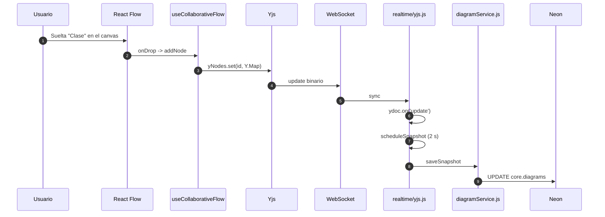
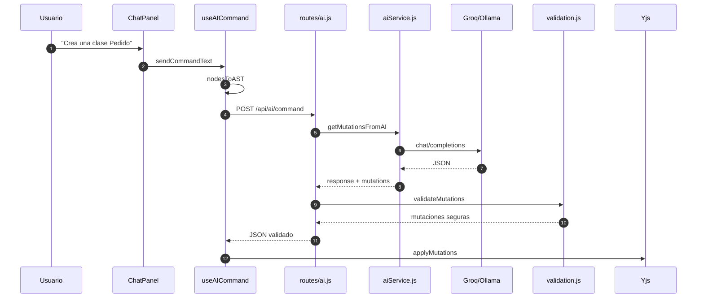
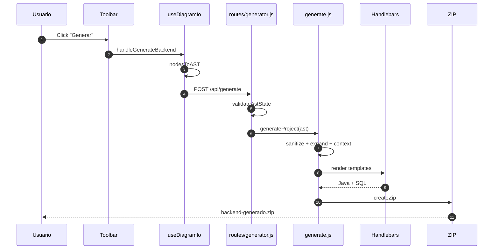
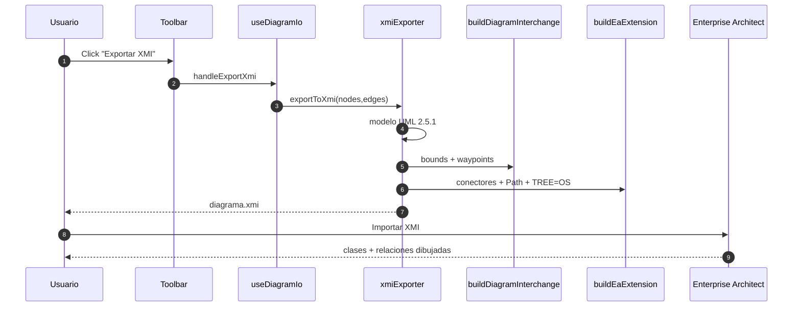

# MANUAL DE DEFENSA INTUITIVO

**Para:** defender el proyecto sin conocer el código de memoria.  
**Regla:** si algo no está en el código, este manual no lo dice.  
**Cómo usarlo:** sigue el guion con el dedo; cada paso tiene frase, clic, magia y archivo.

---

## 🟢 PARTE 1: El Guion de la Demo (Paso a Paso Absoluto)

### Antes de entrar

- Abre la app en `/login`.
- Abre una segunda ventana o incógnito para el otro usuario.
- Abre VS Code con estos archivos:
  - `backend/realtime/yjs.js`
  - `backend/services/diagramService.js`
  - `backend/validation.js`
  - `backend/generator/naming.js`
- Abre Enterprise Architect en el modelo lógico real.
- Ten lista una terminal por si Vercel falla.

### Guion minuto a minuto

| Tiempo | Qué dices textualmente | Qué haces en pantalla | Qué pasa por detrás (la magia) | Archivo exacto |
|---|---|---|---|---|
| **0:00–0:20** | “Esta es una herramienta CASE colaborativa: permite dibujar UML entre varias personas, asistir con IA y generar un backend.” | Abres `/login` y señalas los campos. | El formulario es una vista delgada; el contraste está en el sistema de diseño. | `frontend/src/styles/design-system.ts:24` |
| **0:20–0:35** | “El login no guarda sesiones: firma un pase VIP llamado JWT.” | Escribes usuario/contraseña y pulsas **Entrar**. | `AuthContext.login` llama `POST /api/auth/login`; el backend valida con bcrypt y firma un token. | `frontend/src/app/login/page.tsx`; `backend/routes/auth.js:19`; `backend/middleware/auth.js:68` |
| **0:35–0:50** | “El dashboard separa mis diagramas de los compartidos mediante una lista de permisos por diagrama.” | Muestras las tarjetas y abres un diagrama. | `GET /api/diagrams` consulta `auth.diagram_acl` y `core.diagrams`. | `frontend/src/app/dashboard/page.tsx`; `backend/routes/diagrams.js:18` |
| **0:50–1:10** | “La paleta usa iconos SVG, no emojis; por eso Clase, Interfaz y Nota se leen igual en cualquier dispositivo.” | Señalas **Clase**, **Interfaz**, **Clase abstracta** y **Nota**. | `Palette.tsx` guarda elementos y relaciones con iconos React, no caracteres de fuente. | `frontend/src/components/Palette.tsx:29` y `:69` |
| **1:10–1:40** | “React Flow solo dibuja. El dueño de la verdad es Yjs.” | Arrastras una clase al lienzo, agregas un atributo y una relación. | `useCanvasInteractions` crea el nodo; `useCollaborativeFlow` lo escribe en un `Y.Map`; Yjs lo sincroniza. | `frontend/src/hooks/useCanvasInteractions.ts`; `frontend/src/hooks/useCollaborativeFlow.ts:294` |
| **1:40–2:05** | “Si dos personas mueven el mismo nodo, Yjs converge; no hay dos estados compitiendo.” | Abres la segunda ventana y mueves el mismo nodo. | Yjs usa relojes lógicos; el debounce solo agrupa el guardado. | `frontend/src/hooks/useCollaborativeFlow.ts:305`; `backend/realtime/yjs.js:21` |
| **2:05–2:30** | “Al cerrar la pestaña no esperamos dos segundos: pedimos un guardado inmediato por WebSocket.” | Mueves un nodo, cierras la pestaña y recargas en la otra ventana. | `requestFlush` envía `flush-snapshot`; el backend llama `flushDiagramSnapshot` y hace el `UPDATE`. | `frontend/src/hooks/useCollaborativeFlow.ts:171`; `backend/realtime/yjs.js:58`; `backend/services/diagramService.js:220` |
| **2:30–2:55** | “El chat distingue conversación humana de comando IA: `@compañero` no despierta a la IA; `@ai` sí.” | Escribes `@compañero, revisa esto` y luego `@ai, crea una clase Pedido`. | `classifyChatMessage` decide; si es humano, escribe solo en Yjs; si es IA, llama al backend. | `frontend/src/utils/chatMentions.ts:12`; `frontend/src/hooks/useAICommand.ts:93` |
| **2:55–3:20** | “La IA propone un JSON; el backend lo valida antes de tocar el diagrama.” | Muestras la clase creada por la IA. | `validateMutations` revisa allowlist, tipos y límites; si falla, responde 502. | `backend/validation.js:288`; `backend/routes/ai.js:101` |
| **3:20–3:50** | “El botón Generar convierte el diagrama en un AST y luego en un ZIP Spring Boot.” | Pulsas **Generar** y muestras la descarga. | `useDiagramIo` envía el AST; `generateProject` sanitiza, expande N:M y renderiza Handlebars. | `frontend/src/hooks/useDiagramIo.ts:20`; `backend/generator/generate.js:22` |
| **3:50–4:20** | “El XMI no es XML decorativo: incluye UMLDI y la extensión de Enterprise Architect para que las líneas se dibujen.” | Exportas XMI y muestras el diagrama en EA. | `exportToXmi` genera modelo + `buildDiagramInterchange` + `buildEaExtension`. | `frontend/src/utils/xmiExporter.ts:244`, `:292`, `:473` |
| **4:20–4:45** | “La base real tiene cinco tablas; las clases no están en SQL, están dentro de un snapshot binario.” | Muestras `05_Modelo_Logico_Real_Codigo` y `saveSnapshot`. | `core.diagrams.yjs_snapshot` es `BYTEA`; `Buffer.from` convierte el documento Yjs. | `backend/services/diagramService.js:220` |
| **4:45–5:00** | “En resumen: Yjs para colaborar, SQL nativo para lo durable, IA validada y generación con pruebas. La herramienta es Node; el backend generado es Spring.” | Cierras con el dashboard o el editor. | Arquitectura completa. | `backend/server.js`; `backend/app.js` |

### Frases de impacto para cualquier momento

- “React Flow dibuja; Yjs manda.”
- “La IA propone; el backend decide.”
- “El grafo es un documento, no una fila por clase.”
- “La foto se guarda cada dos segundos, y al cerrar se fuerza la última foto.”
- “La herramienta es Node; el backend generado es Spring.”

---

## 🔵 PARTE 2: El “Mapa del Tesoro” (¿Dónde está cada cosa?)

| Función del sistema | Archivo y línea exacta | Explicación en 1 frase |
|---|---|---|
| **Login y JWT** | `backend/middleware/auth.js:21` (`requireAuth`), `:68` (`signToken`) | Verifica el pase VIP y adjunta la identidad. |
| **Registro/Login** | `backend/routes/auth.js:11` y `:19` | Recibe credenciales y devuelve token. |
| **Hash de contraseña** | `backend/services/userService.js:83` (`verifyPassword`) | Compara bcrypt sin guardar texto plano. |
| **Conexión a Neon** | `backend/db.js:25` (`new Pool`), `:40` (`withTransaction`) | Abre conexiones reutilizables y transacciones. |
| **Guardar diagrama** | `backend/services/diagramService.js:220` (`saveSnapshot`) | Guarda la foto binaria del CRDT. |
| **Borrar diagrama** | `backend/services/diagramService.js:202` (`deleteDiagram`) | Borra ACL y diagrama en una transacción. |
| **Colaboración Yjs** | `backend/realtime/yjs.js:21` (`scheduleSnapshot`), `:94` (`setPersistence`), `:186` (`attachRealtime`) | Sincroniza, carga y guarda el documento vivo. |
| **Guardado al cerrar** | `frontend/src/hooks/useCollaborativeFlow.ts:171` (`requestFlush`); `backend/realtime/yjs.js:58` (`flushDiagramSnapshot`) | Pide guardado inmediato antes de irse. |
| **Mover nodo** | `frontend/src/hooks/useCollaborativeFlow.ts:294` (`onNodesChange`), `:305` (`onNodeDragStop`) | Actualiza el canvas y escribe la posición final en Yjs. |
| **Chat IA** | `frontend/src/hooks/useAICommand.ts:93` (`sendCommandText`); `backend/routes/ai.js:101` | Envía el comando y aplica la respuesta. |
| **Menciones** | `frontend/src/utils/chatMentions.ts:12` (`classifyChatMessage`) | Decide humano vs IA. |
| **Validar IA** | `backend/validation.js:288` (`validateMutations`) | Allowlist de acciones permitidas. |
| **Proveedor IA** | `backend/services/aiService.js:17` (`resolveAiProvider`), `:87` (`getMutationsFromAI`) | Elige Groq/Ollama y arma el prompt. |
| **Memoria IA** | `backend/services/aiService.js:59` (`formatChatHistory`) | Pasa los últimos 15 mensajes con autor. |
| **Generar backend** | `frontend/src/hooks/useDiagramIo.ts:20`; `backend/routes/generator.js:16`; `backend/generator/generate.js:22` | Canvas → AST → ZIP. |
| **Relación N:M** | `backend/generator/expander.js:76` (`expandManyToMany`) | Convierte N:M en entidad intermedia. |
| **Sanitizar nombres** | `backend/generator/naming.js:64` (`toJavaClassName`) | Evita keywords, espacios y números iniciales. |
| **Exportar XMI** | `frontend/src/utils/xmiExporter.ts:473` (`exportToXmi`), `:244` (`buildDiagramInterchange`), `:292` (`buildEaExtension`) | Modelo + geometría + extensión EA. |
| **Canvas → AST** | `frontend/src/utils/ast.ts:67` (`nodesToAST`) | Traduce IDs visuales a nombres y relaciones. |
| **Aplicar IA al canvas** | `frontend/src/utils/ast.ts:194` (`applyMutations`) | Crea entidades, atributos y relaciones en orden seguro. |
| **Paleta visual** | `frontend/src/components/Palette.tsx:29` y `:69` | Elementos y relaciones con SVG. |
| **Contraste de inputs** | `frontend/src/styles/design-system.ts:24` | Borde, placeholder y foco visibles. |

---

## 🟡 PARTE 3: Los 4 Flujos Principales (Explicados como un cuento)

## Flujo A: Un usuario crea una clase

**Cuento:** el usuario suelta una clase en el lienzo; Yjs la guarda en su pizarra mágica; el servidor espera dos segundos y le toma una foto binaria a la pizarra.

**Paso a paso:**

- **Paso 1:** el usuario arrastra **Clase** desde `frontend/src/components/Palette.tsx`.
- **Paso 2:** `useCanvasInteractions.ts` captura el drop y crea el nodo.
- **Paso 3:** `useCollaborativeFlow.ts` llama `addNode` y `yjsNodeHelpers.ts` crea un `Y.Map`.
- **Paso 4:** Yjs emite el cambio por `WebsocketProvider`.
- **Paso 5:** `backend/realtime/yjs.js` aplica el update y programa `scheduleSnapshot`.
- **Paso 6:** a los 2 s, `saveSnapshot` guarda `BYTEA` en `core.diagrams`.
- **Archivo estrella:** `backend/services/diagramService.js:220`.

## Flujo B: El usuario pide algo a la IA

**Cuento:** el usuario escribe; el backend le pasa el dibujo a la IA; la IA devuelve una receta; el backend revisa que la receta no tenga veneno; el frontend la cocina en el canvas.

**Paso a paso:**

- **Paso 1:** `ChatPanel.tsx` captura Enter y llama `sendCommandText`.
- **Paso 2:** `useAICommand.ts` clasifica: `@usuario` conectado no va a la IA; texto normal o `@ai` sí.
- **Paso 3:** `nodesToAST` convierte el canvas en `{entities, relationships}`.
- **Paso 4:** `routes/ai.js` valida, recupera historial y llama `getMutationsFromAI`.
- **Paso 5:** `aiService.js` arma el prompt y llama Groq/Ollama.
- **Paso 6:** `validation.js` revisa la allowlist; si algo no cuadra, 502.
- **Paso 7:** `applyMutations` crea entidades, atributos y relaciones en orden.
- **Archivo estrella:** `backend/validation.js:288`.

## Flujo C: El usuario genera el Backend

**Cuento:** el usuario pide un backend; la herramienta convierte el dibujo en un plano; Handlebars rellena los moldes; archiver lo mete en una caja ZIP.

**Paso a paso:**

- **Paso 1:** `Toolbar.tsx` llama `onGenerateBackend`.
- **Paso 2:** `useDiagramIo.ts` convierte el canvas a AST y hace `POST /api/generate`.
- **Paso 3:** `routes/generator.js` valida que haya al menos una entidad.
- **Paso 4:** `generate.js` sanitiza nombres y expande relaciones N:M.
- **Paso 5:** Handlebars renderiza `model.java.hbs`, `controller.java.hbs`, `pom.xml.hbs`.
- **Paso 6:** `packager.js` crea el ZIP.
- **Archivo estrella:** `backend/generator/generate.js:22`.

## Flujo D: Exportar a XMI

**Cuento:** el usuario pide un acta notarial del dibujo; la herramienta escribe el modelo, pega un croquis de posiciones y añade instrucciones para el portero de Enterprise Architect.

**Paso a paso:**

- **Paso 1:** `Toolbar.tsx` llama `handleExportXmi`.
- **Paso 2:** `useDiagramIo.ts` filtra aristas decorativas y llama `exportToXmi`.
- **Paso 3:** `xmiExporter.ts` genera clases, atributos, asociaciones y herencia.
- **Paso 4:** `buildDiagramInterchange` agrega posiciones y waypoints.
- **Paso 5:** `buildEaExtension` agrega conectores y estilo ortogonal.
- **Paso 6:** EA importa y dibuja.
- **Archivo estrella:** `frontend/src/utils/xmiExporter.ts:473`.

---

## 🔴 PARTE 4: Las Preguntas del Profesor (Escenarios Reales)

## Escenario 1: “Si le muestro la base de datos, ¿por qué no veo las tablas de Clases?”

**Qué decir:**

- “Porque las clases no son filas: son un documento CRDT.”
- “El lienzo completo vive en `core.diagrams.yjs_snapshot`, que es `BYTEA`.”
- “Lo relacional guarda identidad, permisos y chat; el grafo se guarda como foto binaria.”

**Qué mostrar en EA:**

- El diagrama `05_Modelo_Logico_Real_Codigo`.
- La tabla `core.diagrams` y su columna `yjs_snapshot`.
- El diagrama conceptual `04.0_Modelo_Conceptual_BD_Herramienta`.

**Qué abrir en VS Code:**

- `backend/services/diagramService.js`
- Método **`saveSnapshot`**, línea **220**.
- `backend/realtime/yjs.js`
- Método **`scheduleSnapshot`**, línea **21**.

**Frase de cierre:**

- “No hay `Class` ni `Relation` porque el CRDT necesita conservar relojes lógicos; normalizarlo lo rompería.”

## Escenario 2: “¿Cómo sé que la IA no me va a borrar el diagrama?”

**Qué decir:**

- “La IA no ejecuta código: devuelve un JSON.”
- “Ese JSON pasa por `validateMutations`, que solo permite cinco acciones.”
- “Si el formato falla, el backend responde 502 y no se aplica nada.”

**Qué mostrar:**

- `backend/validation.js`
- Método **`validateMutations`**, línea **288**.
- `backend/services/aiService.js`
- El `systemPrompt` y `getMutationsFromAI`, línea **87**.
- `frontend/src/utils/ast.ts`
- Método **`applyMutations`**, línea **194**.

**Frase de cierre:**

- “La IA propone; el backend valida; el frontend aplica.”

## Escenario 3: “¿Qué pasa si el servidor de la base de datos se cae?”

**Qué decir:**

- “El backend usa un `Pool` de conexiones y falla de forma controlada.”
- “`/ready` devuelve 503 si PostgreSQL no responde.”
- “El `errorHandler` responde JSON; no se cae el proceso.”

**Qué mostrar:**

- `backend/db.js`
- `new Pool`, línea **25**.
- `withTransaction`, línea **40**.
- `backend/app.js`
- Ruta `/ready`.
- `backend/middleware/errorHandler.js`.

**Frase de cierre:**

- “La caída de Neon no corrompe el diagrama; el editor local sigue y el backend reporta 503.”

## Escenario 4: “Si escribo una clase llamada ‘Class’, ¿el sistema se rompe?”

**Qué decir:**

- “No. El generador sanitiza el nombre.”
- “`Class` es palabra reservada de Java; se convierte en `ClassEntity`.”
- “`Order Details` se convierte en `OrderDetails`; `1Order` en `V1Order`.”

**Qué mostrar:**

- `backend/generator/naming.js`
- Método **`toJavaClassName`**, línea **64**.
- `backend/generator/contextBuilder.js`
- Método **`sanitizeEntities`**, línea **12**.
- `AUDIT_FUZZ_GENERATOR.md`.

**Frase de cierre:**

- “El nombre visible se conserva; solo se sanitiza el identificador Java.”

---

## 🟣 PARTE 5: Modo Pánico (Si algo falla en vivo)

## Si no carga Vercel o falla internet

**Qué dices:**

- “La demo está desplegada; para no depender de la red la levanto local.”

**Qué haces:**

1. Abre terminal en `frontend/`.
2. Ejecuta `npm run dev`.
3. Abre `http://localhost:3000`.
4. Si el backend no está arriba, abre otra terminal en `backend/` y ejecuta `npm start`.

**Si no hay base local:**

- Muestra el código, el DDL y las pruebas.
- No inventes datos en vivo.

## Si Groq da error 503

**Qué dices:**

- “El 503 es controlado; no se aplica ninguna mutación parcial.”

**Qué haces:**

1. Abre la configuración de IA.
2. Cambia a **Ollama** si está corriendo.
3. Si no, muestra el catch de `backend/services/aiService.js`.
4. Reintenta con un comando más simple.

**Frase de cierre:**

- “La IA es un servicio externo; su caída no corrompe el diagrama.”

## Si el backend no compila

**Qué dices:**

- “El generador produce un ZIP; la compilación se hace con Java 21 y Maven.”

**Qué haces:**

1. Verifica `java -version` y `mvn -version`.
2. Ejecuta `mvn clean package -DskipTests`.
3. Muestra `backend/generator/templates/pom.xml.hbs`.
4. Muestra `AUDIT_FUZZ_GENERATOR.md`.

**Si el error es de nombres:**

- Abre `backend/generator/naming.js`.
- Explica `ClassEntity` y `V1Order`.

## Si Neon no responde

**Qué dices:**

- “El backend reporta 503; la persistencia está desacoplada.”

**Qué haces:**

1. Abre `/ready`.
2. Revisa `DATABASE_URL`.
3. Si hay PostgreSQL local, cambia la URL y reinicia.
4. Si no, muestra el DDL y las consultas.

## Si el WebSocket no sincroniza

**Qué dices:**

- “El WebSocket valida token, sala y ACL antes de aceptar.”

**Qué haces:**

1. Revisa `NEXT_PUBLIC_WS_URL`.
2. Verifica que el backend escuche en `1234`.
3. Busca 4401/4403/4404 en consola.
4. Revisa que el diagrama exista en `core.diagrams`.

## Si EA no abre el diagrama

**Qué dices:**

- “El artefacto está versionado; el problema es del entorno.”

**Qué haces:**

1. Abre el `.eapx` de respaldo.
2. Si no, muestra `AUDIT_XMI.md`.
3. Muestra el XMI exportado.
4. No edites el modelo en vivo.

---

## Checklist final

- [ ] Login se ve con contraste y foco azul.
- [ ] Paleta se ve con SVG y texto oscuro.
- [ ] Dos navegadores sincronizan.
- [ ] Cerrar pestaña y recargar conserva el nodo.
- [ ] `@usuario` no llama a la IA; `@ai` sí.
- [ ] La IA responde y muta el diagrama.
- [ ] XMI importa en EA.
- [ ] ZIP generado compila con Maven.
- [ ] `/health` y `/ready` responden.
- [ ] `npx tsc --noEmit` y `npm run build` pasan.

**Última regla:** si no sabes algo, di “no lo implementé; la decisión fue X por Y”. Una limitación honesta vale más que una mentira detectada.

---

**Fin del manual.**

