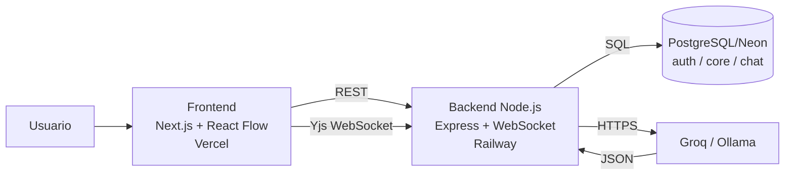
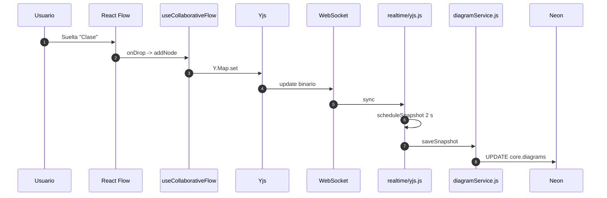
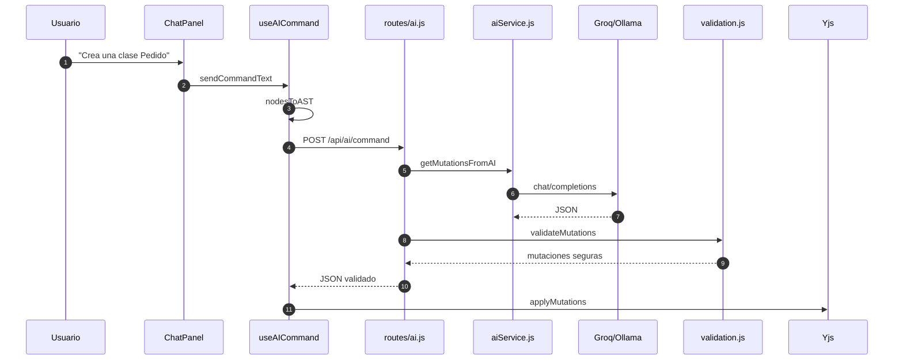
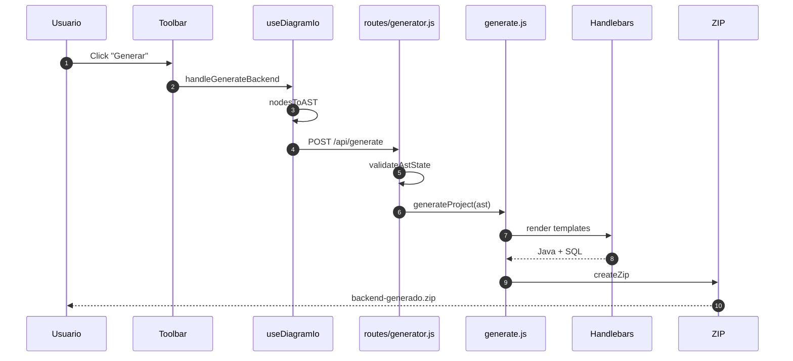
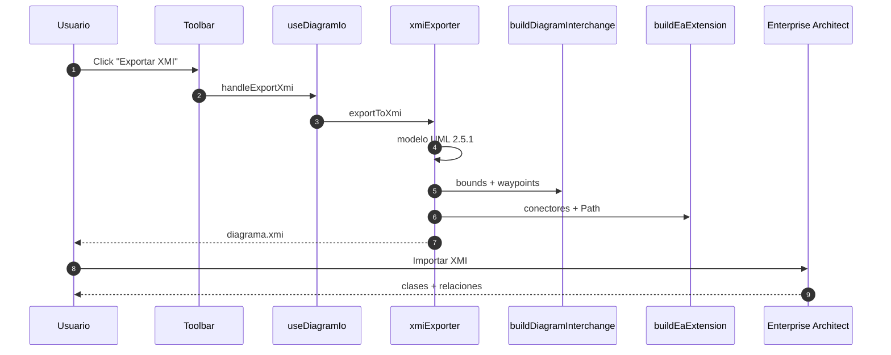
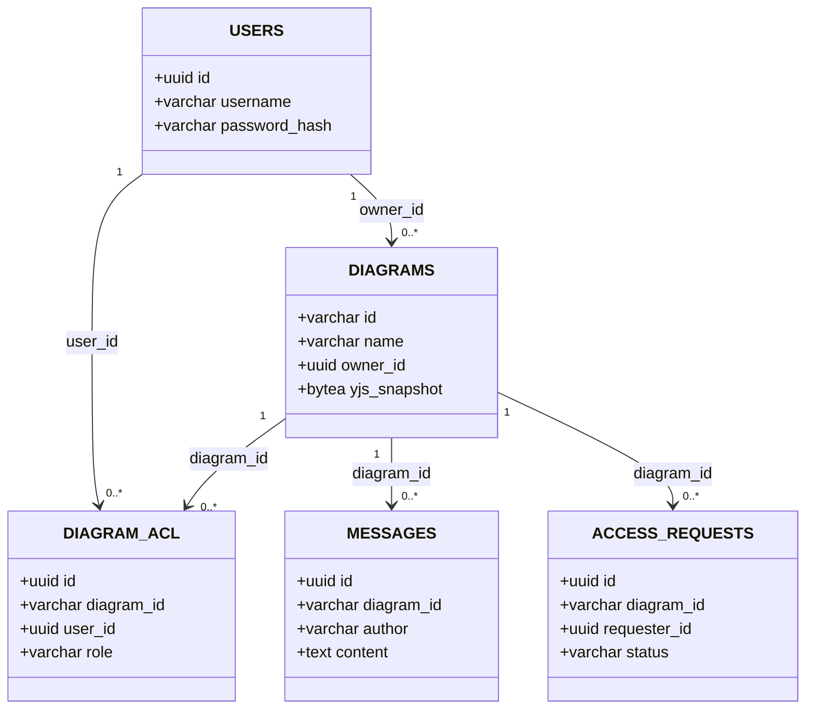

# MANUAL DE DEFENSA ÚNICO

**Este es el único manual que necesitas para la presentación.**  
Reemplaza a las guías y manuales anteriores.  
**Regla de oro:** todo lo que dice aquí existe en el código actual. Si algo no coincide, gana el archivo.

---

## Cómo usar este manual

1. Lee la **Parte 1** para entender la idea en 1 minuto.
2. Ensaya la **Parte 2** con cronómetro.
3. Usa la **Parte 3** si te preguntan “¿dónde está X?”.
4. Practica los **4 flujos** de la Parte 4.
5. Si te piden código, abre la **Parte 7**.
6. Repasa las **30 preguntas** de la Parte 8.
7. Lee el **modo pánico** de la Parte 10 antes de entrar.

---

# PARTE 1: La idea en 1 minuto

## 1.1. ¿Qué es la aplicación?

- Es una **herramienta CASE colaborativa**.
- Permite dibujar **UML** entre varias personas.
- Tiene un **asistente de IA** que propone cambios.
- Exporta a **XMI** para Enterprise Architect.
- Genera un **backend Spring Boot** desde el diagrama.

**Analogía:** es una pizarra mágica compartida donde varios dibujan a la vez, un asistente sugiere mejoras y al final la pizarra se convierte en código.

## 1.2. Las 3 decisiones que debes memorizar

| Decisión | En simple | En técnico |
|---|---|---|
| **Yjs** | La pizarra mágica que todos ven igual. | CRDT que converge sin coordinador. |
| **SQL nativo con `pg`** | Hablamos directo con el archivador. | Sin ORM; `pg` + SQL parametrizado + transacciones. |
| **IA validada** | El asistente propone; tú revisas antes de firmar. | El LLM devuelve JSON y `validateMutations` lo autoriza. |

## 1.3. La gran diferencia

| Pregunta | La Herramienta | El Backend Generado |
|---|---|---|
| ¿Qué es? | El producto que usas. | Un ZIP de Java que produce la herramienta. |
| ¿Lenguaje? | Node.js + TypeScript. | Java 21 + Spring Boot. |
| ¿Base? | Neon con `auth/core/chat`. | La base del usuario, con `Cliente`, `Pedido`, etc. |
| ¿Quién lo crea? | No se genera: es el runtime. | `backend/generator/generate.js`. |
| Frase | “La herramienta es Node.” | “El backend generado es Spring.” |

## 1.4. Mapa visual



---

# PARTE 2: El Guion de la Demo (0:00 a 5:00)

## 2.1. Antes de entrar

- Abre `/login`.
- Abre una segunda ventana o incógnito.
- Abre VS Code con:
  - `backend/realtime/yjs.js`
  - `backend/services/diagramService.js`
  - `backend/validation.js`
  - `backend/generator/naming.js`
- Abre Enterprise Architect en `05_Modelo_Logico_Real_Codigo`.
- Ten una terminal lista por si Vercel falla.

## 2.2. Guion exacto

| Tiempo | Qué dices | Qué haces | Qué pasa por detrás | Archivo |
|---|---|---|---|---|
| **0:00–0:20** | “Esta es una herramienta CASE colaborativa para modelar UML, asistir con IA y generar un backend.” | Abres `/login` y señalas los campos. | La vista usa el sistema de diseño con contraste explícito. | `frontend/src/styles/design-system.ts:24` |
| **0:20–0:35** | “El login no guarda sesiones: firma un pase VIP llamado JWT.” | Escribes credenciales y pulsas **Entrar**. | `AuthContext.login` llama `POST /api/auth/login`; el backend compara bcrypt y firma el token. | `frontend/src/app/login/page.tsx`; `backend/routes/auth.js:19` |
| **0:35–0:50** | “El dashboard separa mis diagramas de los compartidos con una lista de permisos por diagrama.” | Muestras las tarjetas y abres un diagrama. | `GET /api/diagrams` consulta `auth.diagram_acl` y `core.diagrams`. | `backend/routes/diagrams.js:18` |
| **0:50–1:10** | “La paleta usa iconos SVG, no emojis; por eso Clase, Interfaz y Nota se leen en cualquier dispositivo.” | Señalas **Clase**, **Interfaz**, **Clase abstracta** y **Nota**. | `Palette.tsx` usa componentes SVG y texto oscuro. | `frontend/src/components/Palette.tsx:29` |
| **1:10–1:40** | “React Flow solo dibuja; el dueño de la verdad es Yjs.” | Arrastras una clase, agregas un atributo y una relación. | `useCanvasInteractions` crea el nodo; `useCollaborativeFlow` lo escribe en Yjs. | `frontend/src/hooks/useCollaborativeFlow.ts:294` |
| **1:40–2:05** | “Si dos personas mueven el mismo nodo, Yjs converge; no hay dos estados compitiendo.” | Abres la segunda ventana y mueves el mismo nodo. | Yjs ordena operaciones con relojes lógicos; el debounce solo agrupa el guardado. | `frontend/src/hooks/useCollaborativeFlow.ts:305` |
| **2:05–2:30** | “Al cerrar la pestaña no esperamos dos segundos: pedimos un guardado inmediato por WebSocket.” | Mueves un nodo, cierras y recargas en la otra ventana. | `requestFlush` envía `flush-snapshot`; el backend hace `UPDATE` inmediato. | `frontend/src/hooks/useCollaborativeFlow.ts:171`; `backend/realtime/yjs.js:58` |
| **2:30–2:55** | “El chat distingue humano de IA: `@compañero` no despierta a la IA; `@ai` sí.” | Escribes `@compañero, revisa esto` y luego `@ai, crea una clase Pedido`. | `classifyChatMessage` decide; el humano va solo a Yjs. | `frontend/src/utils/chatMentions.ts:12` |
| **2:55–3:20** | “La IA propone un JSON; el backend lo valida antes de tocar el diagrama.” | Muestras la clase creada por la IA. | `validateMutations` revisa allowlist, tipos y límites. | `backend/validation.js:288` |
| **3:20–3:50** | “El botón Generar convierte el diagrama en un AST y luego en un ZIP Spring Boot.” | Pulsas **Generar** y muestras la descarga. | `useDiagramIo` envía el AST; `generateProject` sanitiza, expande N:M y renderiza Handlebars. | `frontend/src/hooks/useDiagramIo.ts:20`; `backend/generator/generate.js:22` |
| **3:50–4:20** | “El XMI no es XML decorativo: incluye UMLDI y la extensión de EA para que las líneas se dibujen.” | Exportas XMI y muestras el diagrama en EA. | `exportToXmi` genera modelo, `buildDiagramInterchange` y `buildEaExtension`. | `frontend/src/utils/xmiExporter.ts:473` |
| **4:20–4:45** | “La base real tiene cinco tablas; las clases no están en SQL, están en un snapshot binario.” | Muestras el modelo real y `saveSnapshot`. | `core.diagrams.yjs_snapshot` es `BYTEA`; `Buffer.from` convierte el documento. | `backend/services/diagramService.js:220` |
| **4:45–5:00** | “En resumen: Yjs para colaborar, SQL nativo para lo durable, IA validada y generación con pruebas.” | Cierras con el editor o dashboard. | Arquitectura completa. | `backend/server.js`; `backend/app.js` |

## 2.3. Frases de impacto

- “React Flow dibuja; Yjs manda.”
- “La IA propone; el backend decide.”
- “El grafo es un documento, no una fila por clase.”
- “La foto se guarda cada dos segundos, y al cerrar se fuerza la última.”
- “La herramienta es Node; el backend generado es Spring.”

---

# PARTE 3: El Mapa del Tesoro

> Si el profesor pregunta “¿dónde está X?”, busca la fila y abre esa ruta.

| Función | Archivo y línea | Explicación en 1 frase |
|---|---|---|
| **Login** | `frontend/src/app/login/page.tsx`; `backend/routes/auth.js:19` | Recibe usuario/contraseña y devuelve JWT. |
| **JWT** | `backend/middleware/auth.js:21` (`requireAuth`), `:68` (`signToken`) | Verifica la pulsera VIP y adjunta identidad. |
| **bcrypt** | `backend/services/userService.js:83` (`verifyPassword`) | Compara contraseña con el hash, sin texto plano. |
| **Pool/Neon** | `backend/db.js:25` (`new Pool`), `:40` (`withTransaction`) | Abre conexiones reutilizables y transacciones. |
| **Crear diagrama** | `backend/services/diagramService.js:96` (`createDiagramWithOwner`) | Inserta diagrama y ACL de owner en una transacción. |
| **Guardar snapshot** | `backend/services/diagramService.js:220` (`saveSnapshot`) | Guarda el documento Yjs completo en `BYTEA`. |
| **Borrar diagrama** | `backend/services/diagramService.js:202` (`deleteDiagram`) | Borra ACL y diagrama en una transacción. |
| **Colaboración** | `backend/realtime/yjs.js:21` (`scheduleSnapshot`), `:94` (`setPersistence`), `:186` (`attachRealtime`) | Sincroniza, carga y guarda el documento vivo. |
| **Guardado al cerrar** | `frontend/src/hooks/useCollaborativeFlow.ts:171` (`requestFlush`); `backend/realtime/yjs.js:58` (`flushDiagramSnapshot`) | Fuerza el guardado antes de cerrar/recargar. |
| **Mover nodo** | `frontend/src/hooks/useCollaborativeFlow.ts:294` (`onNodesChange`), `:305` (`onNodeDragStop`) | Actualiza el canvas y escribe la posición final en Yjs. |
| **Chat IA** | `frontend/src/hooks/useAICommand.ts:93` (`sendCommandText`); `backend/routes/ai.js:101` | Envía el comando y aplica la respuesta validada. |
| **Menciones** | `frontend/src/utils/chatMentions.ts:12` (`classifyChatMessage`) | Decide si el mensaje es para humano o para IA. |
| **Validar IA** | `backend/validation.js:288` (`validateMutations`) | Allowlist de cinco acciones permitidas. |
| **Proveedor IA** | `backend/services/aiService.js:17` (`resolveAiProvider`), `:87` (`getMutationsFromAI`) | Elige Groq/Ollama y arma el prompt. |
| **Memoria IA** | `backend/services/aiService.js:59` (`formatChatHistory`) | Pasa los últimos 15 mensajes con autor. |
| **Generar backend** | `frontend/src/hooks/useDiagramIo.ts:20`; `backend/routes/generator.js:16`; `backend/generator/generate.js:22` | Canvas → AST → ZIP. |
| **N:M a Java** | `backend/generator/expander.js:76` (`expandManyToMany`) | Convierte N:M en entidad intermedia. |
| **Sanitizar nombres** | `backend/generator/naming.js:64` (`toJavaClassName`) | Evita keywords, espacios y números iniciales. |
| **Exportar XMI** | `frontend/src/utils/xmiExporter.ts:473` (`exportToXmi`), `:244` (`buildDiagramInterchange`), `:292` (`buildEaExtension`) | Modelo + geometría + extensión EA. |
| **Canvas → AST** | `frontend/src/utils/ast.ts:67` (`nodesToAST`), `:194` (`applyMutations`) | Traduce el canvas y aplica los cambios de la IA. |
| **Paleta** | `frontend/src/components/Palette.tsx:29` y `:69` | Elementos y relaciones con SVG. |
| **Contraste** | `frontend/src/styles/design-system.ts:24` | Borde, placeholder y foco visibles. |

---

# PARTE 4: Los 4 Flujos Principales

## Flujo A: Crear una clase



**Paso a paso:**

- **1.** Arrastras **Clase** desde `Palette.tsx`.
- **2.** `useCanvasInteractions.ts` captura el drop.
- **3.** `useCollaborativeFlow.ts` escribe en `Y.Map`.
- **4.** Yjs envía el update por WebSocket.
- **5.** `backend/realtime/yjs.js` aplica el update.
- **6.** A los 2 s, `saveSnapshot` guarda `BYTEA`.
- **Archivo estrella:** `backend/services/diagramService.js:220`.

## Flujo B: Pedir algo a la IA



**Paso a paso:**

- **1.** `ChatPanel.tsx` captura Enter.
- **2.** `useAICommand.ts` clasifica `@usuario`, `@ai` o texto normal.
- **3.** `nodesToAST` convierte el canvas en AST.
- **4.** `routes/ai.js` valida, recupera historial y llama `getMutationsFromAI`.
- **5.** `aiService.js` llama Groq/Ollama.
- **6.** `validation.js` revisa la allowlist; si falla, 502.
- **7.** `applyMutations` crea entidades, atributos y relaciones.
- **Archivo estrella:** `backend/validation.js:288`.

## Flujo C: Generar el Backend



**Paso a paso:**

- **1.** `Toolbar.tsx` llama `onGenerateBackend`.
- **2.** `useDiagramIo.ts` convierte el canvas a AST.
- **3.** `routes/generator.js` valida que haya entidades.
- **4.** `generate.js` sanitiza, normaliza y expande N:M.
- **5.** Handlebars renderiza `model.java.hbs`, `controller.java.hbs`, `pom.xml.hbs`.
- **6.** `packager.js` crea el ZIP.
- **Archivo estrella:** `backend/generator/generate.js:22`.

## Flujo D: Exportar a XMI



**Paso a paso:**

- **1.** `useDiagramIo.ts` filtra aristas decorativas.
- **2.** `exportToXmi` genera modelo UML.
- **3.** `buildDiagramInterchange` agrega posiciones y waypoints.
- **4.** `buildEaExtension` agrega conectores y `TREE=OS`.
- **5.** EA importa y dibuja.
- **Archivo estrella:** `frontend/src/utils/xmiExporter.ts:473`.

---

# PARTE 5: Diccionario para Personas Normales

| Palabra | Analogía | Qué significa |
|---|---|---|
| **CRDT / Yjs** | Pizarra mágica que todos ven igual. | Estado replicado que converge sin coordinador. |
| **JWT** | Pase VIP firmado. | Token que prueba quién eres sin sesión en DB. |
| **Debounce** | Ascensor que espera a que todos suban. | Espera 2 s sin cambios antes de guardar. |
| **BYTEA** | Foto comprimida en un archivador. | Binario de PostgreSQL; guarda el documento Yjs. |
| **Snapshot** | Fotocopia del cuaderno completo. | `Y.encodeStateAsUpdate` guardado en DB. |
| **ORM** | Traductor de clases a tablas. | Capa JPA/Hibernate; el backend generado la usa, la herramienta no. |
| **ACL** | Lista de invitados por sala. | Permisos por usuario y diagrama. |
| **AST** | Plano del diagrama en texto. | `{entities, relationships}` para IA y generador. |
| **XMI** | Acta notarial del diagrama. | XML estándar UML para EA. |
| **UMLDI** | Croquis de posiciones. | Geometría de formas y conectores. |
| **Handlebars** | Molde de galletas. | Plantillas que generan Java. |
| **WebSocket** | Teléfono directo navegador-servidor. | Canal bidireccional para Yjs. |

---

# PARTE 6: La Base de Datos Explicada Sin Dolor

## 6.1. Los tres esquemas

| Esquema | Guarda | Analogía |
|---|---|---|
| `auth` | Usuarios, ACL, solicitudes. | Recepción y llaves. |
| `core` | Diagramas y snapshot. | Sala de archivos. |
| `chat` | Mensajes de IA. | Cuaderno de actas. |

**No existen** tablas `Class` ni `Relation`. El grafo vive en `core.diagrams.yjs_snapshot`.



## 6.2. Tabla por tabla

### `auth.users`

| Columna | Tipo | Archivo que la usa |
|---|---|---|
| `id` | `uuid` PK | `userService.js`, `diagramService.js` |
| `username` | `varchar` UNIQUE | `userService.js` |
| `email` | `varchar` UNIQUE | `userService.js` |
| `password_hash` | `varchar` | `userService.js` (bcrypt) |
| `created_at` | `timestamptz` | `userService.js` |

**Por qué en `auth`:** la identidad es un dominio separado del diagrama.

### `core.diagrams`

| Columna | Tipo | Archivo que la usa |
|---|---|---|
| `id` | `varchar` PK | `diagramService.js` |
| `name` | `varchar` | `diagramService.js` |
| `owner_id` | `uuid` FK | `diagramService.js` |
| `yjs_snapshot` | `bytea` | `diagramService.js`, `realtime/yjs.js` |
| `created_at` | `timestamptz` | `diagramService.js` |
| `updated_at` | `timestamptz` | `diagramService.js` |

**Por qué en `core`:** es el agregado principal; el grafo no se normaliza.

### `auth.diagram_acl`

| Columna | Tipo | Archivo que la usa |
|---|---|---|
| `id` | `uuid` PK | `aclService.js` |
| `diagram_id` | `varchar` | `aclService.js`, `diagramAuth.js` |
| `user_id` | `uuid` FK | `aclService.js` |
| `role` | `varchar` CHECK | `aclService.js` |
| `granted_at` | `timestamptz` | `aclService.js` |

**Por qué en `auth`:** el rol es una relación usuario-diagrama. `diagram_id` no tiene FK física.

### `chat.messages`

| Columna | Tipo | Archivo que la usa |
|---|---|---|
| `id` | `uuid` PK | `chatService.js` |
| `diagram_id` | `varchar` FK | `chatService.js` |
| `author` | `varchar` | `chatService.js` |
| `role` | `varchar` CHECK | `chatService.js` |
| `content` | `text` | `chatService.js` |
| `created_at` | `timestamptz` | `chatService.js` |

**Por qué en `chat`:** se consulta, se ordena y se audita; no es un CRDT.

### `auth.access_requests`

| Columna | Tipo | Archivo que la usa |
|---|---|---|
| `id` | `uuid` PK | `accessRequestService.js` |
| `diagram_id` | `varchar` FK | `accessRequestService.js` |
| `requester_id` | `uuid` FK | `accessRequestService.js` |
| `status` | `varchar` CHECK | `accessRequestService.js` |
| `created_at` | `timestamptz` | `accessRequestService.js` |

**Por qué en `auth`:** es una regla de acceso. El índice parcial impide dos PENDING iguales.

## 6.3. DDL completo

```sql
CREATE EXTENSION IF NOT EXISTS "uuid-ossp";

CREATE SCHEMA IF NOT EXISTS auth;
CREATE SCHEMA IF NOT EXISTS core;
CREATE SCHEMA IF NOT EXISTS chat;

CREATE TABLE auth.users (
  id uuid PRIMARY KEY DEFAULT uuid_generate_v4(),
  username varchar NOT NULL UNIQUE,
  email varchar NOT NULL UNIQUE,
  password_hash varchar NOT NULL,
  created_at timestamptz DEFAULT CURRENT_TIMESTAMP
);

CREATE TABLE core.diagrams (
  id varchar PRIMARY KEY,
  name varchar NOT NULL,
  owner_id uuid REFERENCES auth.users(id) ON DELETE CASCADE,
  yjs_snapshot bytea,
  created_at timestamptz DEFAULT CURRENT_TIMESTAMP,
  updated_at timestamptz DEFAULT CURRENT_TIMESTAMP
);

CREATE TABLE auth.diagram_acl (
  id uuid PRIMARY KEY DEFAULT uuid_generate_v4(),
  diagram_id varchar NOT NULL,
  user_id uuid REFERENCES auth.users(id) ON DELETE CASCADE,
  role varchar NOT NULL CHECK (role IN ('OWNER', 'EDITOR', 'VIEWER')),
  granted_at timestamptz DEFAULT CURRENT_TIMESTAMP,
  UNIQUE (diagram_id, user_id)
);

CREATE TABLE chat.messages (
  id uuid PRIMARY KEY DEFAULT uuid_generate_v4(),
  diagram_id varchar REFERENCES core.diagrams(id) ON DELETE CASCADE,
  author varchar NOT NULL,
  role varchar NOT NULL CHECK (role IN ('user', 'assistant', 'system')),
  content text NOT NULL,
  created_at timestamptz DEFAULT CURRENT_TIMESTAMP
);

CREATE TABLE auth.access_requests (
  id uuid PRIMARY KEY DEFAULT uuid_generate_v4(),
  diagram_id varchar NOT NULL REFERENCES core.diagrams(id) ON DELETE CASCADE,
  requester_id uuid NOT NULL REFERENCES auth.users(id) ON DELETE CASCADE,
  status varchar NOT NULL DEFAULT 'PENDING'
    CHECK (status IN ('PENDING', 'APPROVED', 'REJECTED')),
  created_at timestamptz NOT NULL DEFAULT CURRENT_TIMESTAMP
);

CREATE UNIQUE INDEX access_requests_pending_unique
  ON auth.access_requests (diagram_id, requester_id)
  WHERE status = 'PENDING';
CREATE INDEX access_requests_diagram_status_idx
  ON auth.access_requests (diagram_id, status);
CREATE INDEX access_requests_requester_idx
  ON auth.access_requests (requester_id);
```

---

# PARTE 7: Los 5 Métodos Clave (Solo si te llevan al Código)

> No memorices todo. Aprende qué hace cada método y una frase de defensa.

## 7.1. `saveSnapshot` — `backend/services/diagramService.js:220`

**Qué hace:** guarda el documento Yjs completo en `core.diagrams.yjs_snapshot`.

```javascript
async function saveSnapshot(diagramId, update) {
  const id = safeId(diagramId);
  if (!id || !update) return;
  await pool.query(
    `UPDATE core.diagrams
     SET yjs_snapshot = $2, updated_at = CURRENT_TIMESTAMP
     WHERE id = $1`,
    [id, Buffer.from(update)]
  );
}
```

**En simple:**

- `safeId`: limpia el id.
- `if`: no guarda si falta algo.
- `UPDATE`: cambia solo la foto del diagrama.
- `Buffer.from`: convierte el binario de Yjs para `BYTEA`.
- `$1`/`$2`: SQL parametrizado, sin concatenar.

**Frase:** “No guardo una fila por clase; guardo la foto binaria del documento.”

## 7.2. `validateMutations` — `backend/validation.js:288`

**Qué hace:** revisa el JSON de la IA antes de aplicarlo.

```javascript
if (!Array.isArray(raw)) return fail('mutations debe ser un arreglo');
if (raw.length > MAX_MUTATIONS) return fail('La IA devolvió demasiadas mutaciones');

for (const item of raw) {
  if (!isPlainObject(item) || !MUTATION_ACTIONS.has(item.action)) {
    return fail('La IA devolvió una acción no permitida');
  }
  // addEntity, addAttribute, removeEntity,
  // addRelationship, removeRelationship
}
```

**En simple:**

- Debe ser una lista.
- No más de 200 cambios.
- Solo cinco acciones permitidas.
- Si falla, el backend responde 502 y no aplica nada.

**Frase:** “La IA propone; la allowlist decide.”

## 7.3. `expandManyToMany` — `backend/generator/expander.js:76`

**Qué hace:** convierte una relación `*` a `*` en una entidad intermedia con UUID y dos `@ManyToOne`.

```javascript
allEntities.push({
  id: `intermediate_${rel.id || intermediateEntity}`,
  name: intermediateEntity,
  tableName: intermediateTable,
  attributes: [
    { name: 'id', type: 'UUID', isPk: true, nullable: false, unique: true },
    ...intermediateAttributes,
  ],
});

allRelationships.push({
  id: `${rel.id || intermediateEntity}_a`,
  source: { entityName: intermediateEntity },
  target: { entityName: from },
  type: 'MANY_TO_ONE',
  cardinalityFrom: '*',
  cardinalityTo: '1',
});
```

**En simple:**

- No usa `@ManyToMany`.
- Crea una clase intermedia real.
- Esa clase tiene su propio `id`.
- Guarda atributos de la relación (`fecha`, `rol`, etc.).

**Frase:** “Una relación con datos propios es una clase, no una tabla puente invisible.”

## 7.4. `applyMutations` — `frontend/src/utils/ast.ts:194`

**Qué hace:** aplica los cambios de la IA al canvas en orden seguro.

```typescript
export function applyMutations(mutations: any[], hooks: any) {
  const entityNameToId: Record<string, string> = {};
  const nodeDataById: Record<string, any> = {};

  // 1. addEntity
  // 2. addAttribute
  // 3. addRelationship
  // 4. removeRelationship
  // 5. removeEntity
}
```

**En simple:**

- Primero crea entidades.
- Luego atributos.
- Luego relaciones.
- Después borra relaciones.
- Al final borra entidades.

**Por qué:** si borras una entidad antes de sus relaciones, quedan aristas huérfanas.

**Frase:** “El orden no es decorativo: es un contrato para no dejar referencias rotas.”

## 7.5. `buildDiagramInterchange` — `frontend/src/utils/xmiExporter.ts:244`

**Qué hace:** agrega la geometría que EA necesita para dibujar el diagrama.

```typescript
const box = getNodeBox(node);
xml += `      <ownedElement xmi:type="umldi:UMLClassifierShape" xmi:id="DE_${nodeId}" modelElement="${nodeId}">\n`;
xml += `        <bounds xmi:type="dc:bounds" xmi:id="DB_${nodeId}" x="${x}" y="${y}" width="${w}" height="${h}"/>\n`;
xml += `      </ownedElement>\n`;

xml += `      <ownedElement xmi:type="umldi:UMLEdge" xmi:id="DE_${geom.subject}" source="${geom.sourceId}" target="${geom.targetId}" geometry="${umlDiGeometry(geom)}">\n`;
xml += `        <waypoint xmi:type="dc:waypoint" xmi:id="WP_${geom.subject}_0" x="${geom.sx}" y="${geom.sy}"/>\n`;
xml += `        <waypoint xmi:type="dc:waypoint" xmi:id="WP_${geom.subject}_1" x="${geom.ex}" y="${geom.ey}"/>\n`;
```

**En simple:**

- `UMLClassifierShape`: dibuja la clase.
- `bounds`: posición y tamaño.
- `UMLEdge`: dibuja la línea.
- `waypoint`: puntos de la línea.

**Frase:** “El modelo dice qué es; UMLDI dice dónde dibujarlo.”

---

# PARTE 8: Las 30 Preguntas del Profesor

## 8.1. Básicas

| # | Pregunta | Respuesta corta | Por qué / alternativa | Dónde |
|---|---|---|---|---|
| 1 | ¿Qué hace? | Herramienta CASE colaborativa con UML, IA, XMI y generación Spring Boot. | Une modelado y generación; una herramienta solo de dibujo no generaría código. | `frontend/src/app/diagram/[id]/page.tsx`; `backend/generator/generate.js` |
| 2 | ¿Por qué React? | React Flow ya resuelve el canvas; React 19 + Next 16 integran Yjs. | Angular/Vue no aportaban ventaja para el canvas. | `frontend/package.json`; `EditorFlow.tsx` |
| 3 | ¿Por qué Node? | Backend I/O: REST, WebSocket, DB e IA. | Java para la herramienta duplicaría lenguaje. | `backend/package.json`; `server.js` |
| 4 | ¿Por qué PostgreSQL/Neon? | Necesitamos FKs, CHECK, transacciones y `BYTEA`. | MongoDB perdería integridad de ACL/chat. | `backend/db.js`; DDL en `04_Diseno_UML.md` |
| 5 | ¿Herramienta vs backend generado? | Herramienta = Node; generado = Spring Boot en otra base. | No son el mismo producto. | `backend/generator/templates/` |

## 8.2. Arquitectura

| # | Pregunta | Respuesta corta | Por qué / alternativa | Dónde |
|---|---|---|---|---|
| 6 | ¿Por qué no ORM en Node? | Esquema pequeño, `BYTEA`, transacciones y locks. | Prisma/TypeORM añadían capa y codegen para cinco tablas. | `backend/db.js`; `diagramService.js` |
| 7 | ¿Por qué separaron capas? | Ruta = HTTP; servicio = reglas/SQL; DB = infraestructura. | Un monolito sería más rápido al inicio e imposible de mantener. | `app.js`; `routes/`; `services/` |
| 8 | ¿Por qué `server.js` tiene 59 líneas? | Es el composition root. | La lógica vive en `app.js`, rutas y servicios. | `backend/server.js` |
| 9 | ¿React Flow es dueño de la verdad? | No. Yjs manda; React Flow dibuja. | `useNodesState` paralelo competiría con Yjs. | `page.tsx`; `useCollaborativeFlow.ts` |
| 10 | ¿Cómo evitan perder cambios? | Debounce + flush al cerrar + `writeState` final. | Guardar en cada pixel saturaría Neon. | `useCollaborativeFlow.ts:171`; `yjs.js:58` |
| 11 | ¿Qué pasa con 100 usuarios? | Yjs escala en memoria; un solo Node tiene límite. | No se promete escalabilidad infinita sin pruebas. | `backend/realtime/yjs.js` |

## 8.3. Base de datos

| # | Pregunta | Respuesta corta | Por qué / alternativa | Dónde |
|---|---|---|---|---|
| 12 | ¿Por qué no hay tablas `Class`/`Relation`? | El grafo es un CRDT en `yjs_snapshot`. | Normalizarlo rompería relojes y tombstones. | `diagramService.js`; `REVERSE_ENGINEERING_REPORT.md` |
| 13 | ¿Por qué `BYTEA` y no `JSONB`? | Yjs produce binario opaco. | JSON obligaría a recodificar y perdería semántica. | `diagramService.js:220` |
| 14 | ¿Por qué ACL sin FK? | El DDL no la declara; `deleteDiagram` usa transacción. | `CASCADE` acoplaría `auth` y `core`. | `diagramService.js:202` |
| 15 | ¿Cómo se recupera al reconectar? | Doc vivo en memoria o `bindState` desde `BYTEA`. | Leer siempre de DB daría versión vieja. | `yjs.js:94-117` |
| 16 | ¿Dónde está el DDL? | `04_Diseno_UML.md` y `backend/scripts/access_requests.sql`. | No se inventa un esquema distinto. | Documentación y scripts |
| 17 | ¿Por qué transacción al borrar? | Borra ACL y diagrama; si falla, rollback. | Sin transacción quedarían huérfanos. | `diagramService.js:202` |

## 8.4. IA

| # | Pregunta | Respuesta corta | Por qué / alternativa | Dónde |
|---|---|---|---|---|
| 18 | ¿Cómo evitan alucinaciones? | Prompt + `validateMutations` + límites. | El prompt no es garantía; la allowlist sí. | `validation.js:288` |
| 19 | ¿Cómo funciona la memoria? | Últimos 15 mensajes con autor. | Mandar todo cuesta tokens y contamina. | `aiService.js:59`; `chatService.js` |
| 20 | ¿Cómo funciona la tutoría? | `selectedElement` se inyecta en el prompt. | Una captura es más cara que el AST. | `useEditorSelection.ts`; `aiService.js` |
| 21 | ¿Groq y Ollama? | Strategy con contrato OpenAI-compatible. | Dos implementaciones duplicarían lógica. | `aiService.js:17` |
| 22 | ¿Menciones `@usuario`? | Si es humano conectado, va solo a Yjs. | Mandar todo a IA haría que respondiera conversaciones. | `chatMentions.ts:12` |
| 23 | ¿Si Groq falla? | 503/504/502 controlado, sin mutaciones. | Aplicar JSON incompleto corrompería el modelo. | `aiService.js`; `routes/ai.js` |

## 8.5. Generación

| # | Pregunta | Respuesta corta | Por qué / alternativa | Dónde |
|---|---|---|---|---|
| 24 | ¿Cómo se genera N:M? | Entidad intermedia con UUID y dos `@ManyToOne`. | `@ManyToMany` no admite columnas extra. | `expander.js:76` |
| 25 | ¿Cómo se genera herencia? | Padre `JOINED`; hijo `extends` + `@PrimaryKeyJoinColumn`. | JPA exige una sola estrategia. | `contextBuilder.js:222`; `model.java.hbs` |
| 26 | ¿Y si la clase se llama “Class”? | Se convierte en `ClassEntity`. | Una regex sola no conoce keywords. | `naming.js:64`; `AUDIT_FUZZ_GENERATOR.md` |
| 27 | ¿Cómo se exporta XMI? | Modelo + UMLDI + extensión EA. | EA no dibuja solo con el modelo. | `xmiExporter.ts:244`, `:292`, `:473` |

## 8.6. Seguridad

| # | Pregunta | Respuesta corta | Por qué / alternativa | Dónde |
|---|---|---|---|---|
| 28 | ¿Cómo funciona JWT? | Firma identidad y expira; rol se consulta en ACL. | Sesiones en DB permiten revocación, pero añaden consulta. | `middleware/auth.js:21`, `:68` |
| 29 | ¿SQL injection y XSS? | Placeholders `$1`; React escapa texto. | Concatenar SQL o HTML crudo sería vulnerable. | `userService.js`; `ChatPanel.tsx` |
| 30 | ¿Limitaciones de seguridad? | Sin rate limiting, CORS abierto, JWT en `localStorage`. | Se reconoce; se endurecería con rate limit, CORS y cookie `HttpOnly`. | `app.js:17`; `apiClient.ts` |

---

# PARTE 9: Escenarios Reales del Profesor

## Escenario 1: “¿Por qué no veo tablas de Clases?”

**Dices:**

- “Porque las clases no son filas: son un documento CRDT.”
- “El grafo completo vive en `core.diagrams.yjs_snapshot` como `BYTEA`.”

**Muestras:**

- EA: `05_Modelo_Logico_Real_Codigo`.
- VS Code: `backend/services/diagramService.js:220` (`saveSnapshot`).
- VS Code: `backend/realtime/yjs.js:21` (`scheduleSnapshot`).

**Cierras:** “Lo relacional guarda identidad, permisos y chat; el grafo se guarda como foto binaria.”

## Escenario 2: “¿Cómo sé que la IA no me va a borrar el diagrama?”

**Dices:**

- “La IA no ejecuta código; devuelve un JSON.”
- “`validateMutations` solo permite cinco acciones.”
- “Si falla, el backend responde 502 y no aplica nada.”

**Muestras:**

- `backend/validation.js:288` (`validateMutations`).
- `backend/services/aiService.js:87` (`getMutationsFromAI`).
- `frontend/src/utils/ast.ts:194` (`applyMutations`).

**Cierras:** “La IA propone; el backend valida; el frontend aplica.”

## Escenario 3: “¿Qué pasa si se cae la base de datos?”

**Dices:**

- “El backend usa un `Pool` y falla de forma controlada.”
- “`/ready` devuelve 503; el `errorHandler` responde JSON.”

**Muestras:**

- `backend/db.js:25` (`new Pool`), `:40` (`withTransaction`).
- `backend/app.js` (`/ready`).
- `backend/middleware/errorHandler.js`.

**Cierras:** “La caída de Neon no corrompe el diagrama; el backend reporta el problema.”

## Escenario 4: “Si escribo una clase ‘Class’, ¿se rompe?”

**Dices:**

- “No. `Class` es keyword de Java; se convierte en `ClassEntity`.”
- “`Order Details` → `OrderDetails`; `1Order` → `V1Order`.”

**Muestras:**

- `backend/generator/naming.js:64` (`toJavaClassName`).
- `backend/generator/contextBuilder.js:12` (`sanitizeEntities`).
- `AUDIT_FUZZ_GENERATOR.md`.

**Cierras:** “El nombre visible se conserva; solo se sanitiza el identificador Java.”

---

# PARTE 10: Dependencias ¿Por qué esta y no otra?

| Librería | Por qué se usó | Alternativa descartada |
|---|---|---|
| **React Flow** | Nodos, aristas, handles, zoom y eventos listos. | D3.js (muy bajo nivel), GoJS (comercial/pesado). |
| **`pg`** | SQL directo, Pool, transacciones y `BYTEA`. | Prisma/TypeORM (capa/codegen para cinco tablas). |
| **Yjs** | CRDT probado, converge sin coordinador. | Socket.io puro (mensajería, no CRDT). |
| **`y-websocket`** | Provider y servidor listo para Yjs. | Protocolo propio (riesgoso y más código). |
| **Handlebars** | Plantillas con condicionales y helpers. | EJS/Pug (menos robustos para Java). |
| **Groq** | Rápido, compatible OpenAI, capa gratuita. | OpenAI/Anthropic (costo/cuenta/contrato distinto). |
| **Ollama** | IA local sin nube. | Solo Groq (dependencia de internet). |
| **bcryptjs** | Hash portable sin binarios nativos. | Argon2 (más moderno pero binario). |
| **jsonwebtoken** | JWT estándar y simple. | Sesiones en DB (más consultas, pero revocables). |
| **archiver** | ZIP en streaming. | `adm-zip` (menos eficiente en carpetas grandes). |

**Frase:** “Cada librería resuelve una parte; no se añadió ninguna que no estuviera en el flujo real.”

---

# PARTE 11: Modo Pánico

## Si no carga Vercel o falla internet

**Dices:** “La demo está desplegada; para no depender de la red la levanto local.”

**Haces:**

1. `cd frontend` → `npm run dev`.
2. `cd backend` → `npm start`.
3. Abre `http://localhost:3000`.

**Si no hay DB local:** muestra código, DDL y pruebas; no inventes datos.

## Si Groq da 503

**Dices:** “El 503 es controlado; no se aplica ninguna mutación parcial.”

**Haces:**

1. Abre configuración de IA.
2. Cambia a **Ollama** si está corriendo.
3. Si no, muestra el catch de `backend/services/aiService.js`.
4. Reintenta con un comando simple.

## Si el backend generado no compila

**Dices:** “El generador produce el ZIP; la compilación usa Java 21 y Maven.”

**Haces:**

1. `java -version` y `mvn -version`.
2. `mvn clean package -DskipTests`.
3. Muestra `backend/generator/templates/pom.xml.hbs`.
4. Muestra `AUDIT_FUZZ_GENERATOR.md`.

## Si Neon no responde

**Dices:** “El backend reporta 503; la persistencia está desacoplada.”

**Haces:**

1. Abre `/ready`.
2. Revisa `DATABASE_URL`.
3. Si hay DB local, cambia la URL y reinicia.
4. Si no, muestra el DDL y las consultas.

## Si el WebSocket no sincroniza

**Dices:** “El WebSocket valida token, sala y ACL antes de aceptar.”

**Haces:**

1. Revisa `NEXT_PUBLIC_WS_URL`.
2. Verifica el puerto `1234`.
3. Busca 4401/4403/4404 en consola.
4. Verifica que el diagrama exista en `core.diagrams`.

## Si EA no abre el diagrama

**Dices:** “El artefacto está versionado; el problema es del entorno.”

**Haces:**

1. Abre el `.eapx` de respaldo.
2. Muestra `AUDIT_XMI.md`.
3. Muestra el XMI exportado.

---

# Checklist final

- [ ] `npx tsc --noEmit` y `npm run build` pasan.
- [ ] `node --check backend/realtime/yjs.js` pasa.
- [ ] Login con contraste y foco azul.
- [ ] Paleta con SVG y texto oscuro.
- [ ] Dos navegadores sincronizan.
- [ ] Cerrar pestaña y recargar conserva el nodo.
- [ ] `@usuario` no llama a la IA; `@ai` sí.
- [ ] La IA responde y muta el diagrama.
- [ ] XMI importa en EA.
- [ ] ZIP generado compila con Maven.
- [ ] `/health` y `/ready` responden.
- [ ] `REVERSE_ENGINEERING_REPORT.md`, `AUDIT_XMI.md` y `GUIA_YJS_SNAPSHOT.md` abiertos.

## Si no sabes algo

1. No inventes.
2. Di: “No lo implementé; la decisión fue X por Y.”
3. Abre el archivo y muestra la parte que sí existe.
4. Una limitación honesta vale más que una mentira detectada.

---

**Fin del manual único.**

